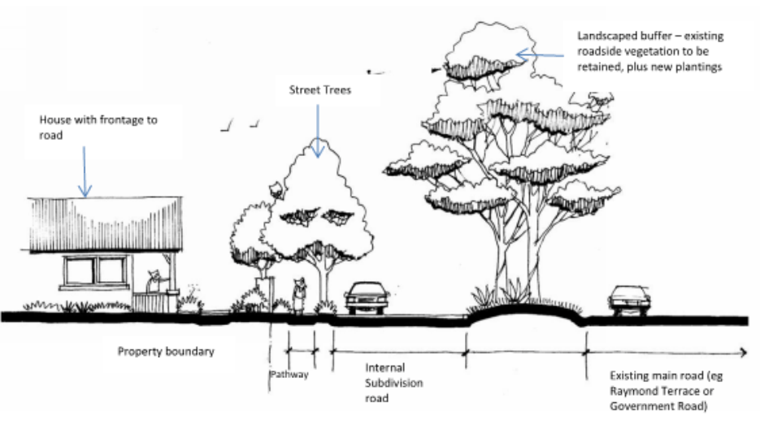
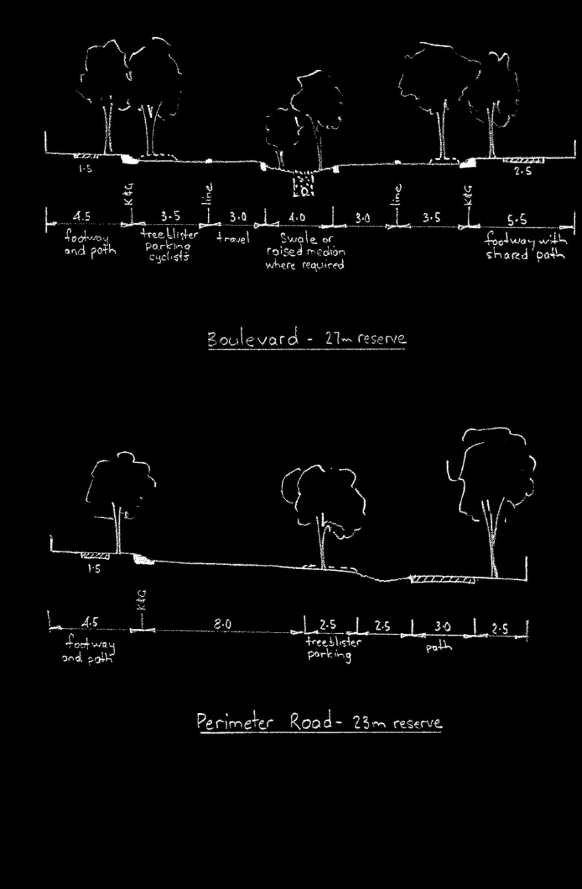
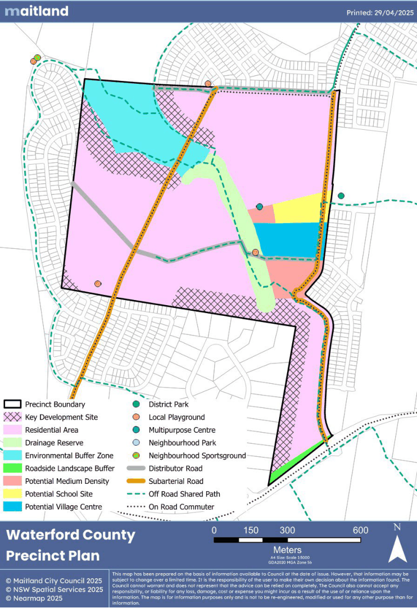

#### 10.4.5.7. Key Development Sites

#### Objectives

O.176 To ensure that detailed urban design controls are provided for significant development sites.

> Words printed on the picture (title and legend, copied from the PDF):
> • Gateway sites
> • Exhibition villages

#### PRESCRIPTIVE CONTROLS AND ACCEPTABLE SOLUTIONS

Each Precinct Plan is to include detailed urban design controls for the following significant development sites:

#### PC.1

• Schools, libraries and community facilities

• Residential areas adjoining the flood fringe

• Interface area surrounding Timberlane Estate, and

• Clay conservation areas, existing quarry sites and buffers. Development or works within, or adjacent to the land zoned C2 Environmental Conservation are to ensure clearing of vegetation is minimised to the satisfaction of Council.

#### PC.2

| PRESCRIPTIVE CONTROLS AND ACCEPTABLE SOLUTIONS |  |
|---|---|
| PC.3 • O.176 | Mechanisms are to be put in place with development to ensure the integrity and protection of established vegetation and riparian areas zoned C2 Environmental Protection. Details are to be included in all Development Applications affecting the C2 zone. |
| PC.4 • O.176 | Development within residential zones must be designed and planned to ensure any Asset Protection Zones and the like are not required or needed in the C2 Environmental Conservation Zone. |
| PC.5 | Precinct Plans are to identify and suitably accommodate large rural allotments to enable the sustainable management of the rural flood fringe areas. |
| • O.176 |  |
| PC.6 • O.176 | A limited number of rural dwellings will be considered on flood free areas. In cases where they are proposed, rural dwelling sites are to be located at least 0.5m above the 1% AEP flood level, and access to such dwellings to be flood free with minimal fill or earthworks. |
| PC.7 | Fencing of allotments are to be of post and wire style (or similar) so as to minimise any visual impacts of development. |
| • O.176 |  |
| PC.8 | Development adjacent to the rural zones and flood prone lands are to be suitably designed so as to be compatible with the existing rural landscape and setting. |
| • O.176 |  |
| PC.9 • O.176 | Development adjacent to Raymond Terrace Road and Government Road must be orientated and dimensioned so as to make provision for housing of a high-quality architectural appearance. |
| AS.1 • O.176 | Housing adjacent to Raymond Terrace Road and Government Road should be appropriately designed so as to provide a high-quality architectural appearance with visual interest, particularly by discouraging bulky buildings and blank walls. |
| PC.10 • O.176 | Development on land adjoining the existing Timberlane Estate must be suitably located and designed so as to maintain view corridors and minimise any impacts on the existing neighbourhood amenity. |

> [Picture on page 94: a picture, saved as a picture (images/ch-10-00-special-precincts-locality-plans-and-urban-release-page-94-2.gif, 150 dpi).]

Figure 10-46: Subdivision design adjacent to Raymond Terrace Road and Government

#### Roads.

> [Picture on page 95: a picture, saved as a picture (images/ch-10-00-special-precincts-locality-plans-and-urban-release-page-95-1.gif, 150 dpi).]

#### Figure 10-47: Thornton North - Typical cross-sections for WSUD drainage swales.

### Development Requirements – Waterford County Precinct

The following section is the Precinct Plan provisions referred to in the general provisions above that applies to the Waterford County Precinct. No specific requirements have been made for the following matters within the Waterford County Precinct as they are already adequately addressed by other relevant provisions within the Maitland Local Environmental Plan 2011 and the Maitland Development Control Plan 2026:

• Amelioration of Natural and Environmental Hazards

• Residential Densities

• Neighbourhood Commercial and Retail Uses

• Provision of Public Facilities and Services

> [Picture on page 96: a picture, saved as a picture (images/ch-10-00-special-precincts-locality-plans-and-urban-release-page-96-11.gif, 150 dpi).]

#### Figure 10-48: Waterford County Precinct Plan
