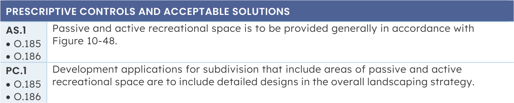
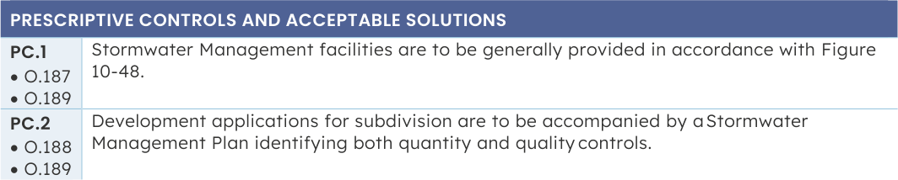

#### 10.4.5.11. Passive and Active Recreation Areas

#### Objectives

O.185 Neighbourhoods are conveniently located open space areas that offer a range of recreational

opportunities for residents, accessible within walking distance from each residence.

O.186 To provide a safe and appropriate level of pedestrian and cycleway access linking new development

with established urban areas, parks and public transport, including a mix of on-road and off-road cycle routes.

> [Picture on page 98: a picture, saved as a picture (images/ch-10-00-special-precincts-locality-plans-and-urban-release-page-98-17.gif, 150 dpi).]
> Words printed on the picture (title and legend, copied from the PDF):
> • O.185
> • O.186
> • O.185
> • O.186

Figure 10-48.

#### PRESCRIPTIVE CONTROLS AND ACCEPTABLE SOLUTIONS

Passive and active recreational space is to be provided generally in accordance with

#### AS.1

Development applications for subdivision that include areas of passive and active recreational space are to include detailed designs in the overall landscaping strategy.

#### PC.1

#### Objectives

O.187 To provide for an integrated and sustainable approach to the design and provision of open space

and urban water management.

O.188 To protect and enhance the water quality, water quantity and habitat value of downstream

waterways and environment.

O.189 To prevent erosion and run-off during site preparation, construction and the ongoing use of the land

to minimise cumulative impact on receiving waterways.

> [Picture on page 99: a picture, saved as a picture (images/ch-10-00-special-precincts-locality-plans-and-urban-release-page-99-8.gif, 150 dpi).]
> Words printed on the picture (title and legend, copied from the PDF):
> 10-48.
> • O.187
> • O.189
> • O.188
> • O.189

#### PRESCRIPTIVE CONTROLS AND ACCEPTABLE SOLUTIONS

Stormwater Management facilities are to be generally provided in accordance with Figure

#### PC.1

Development applications for subdivision are to be accompanied by a Stormwater Management Plan identifying both quantity and quality controls.

#### PC.2
