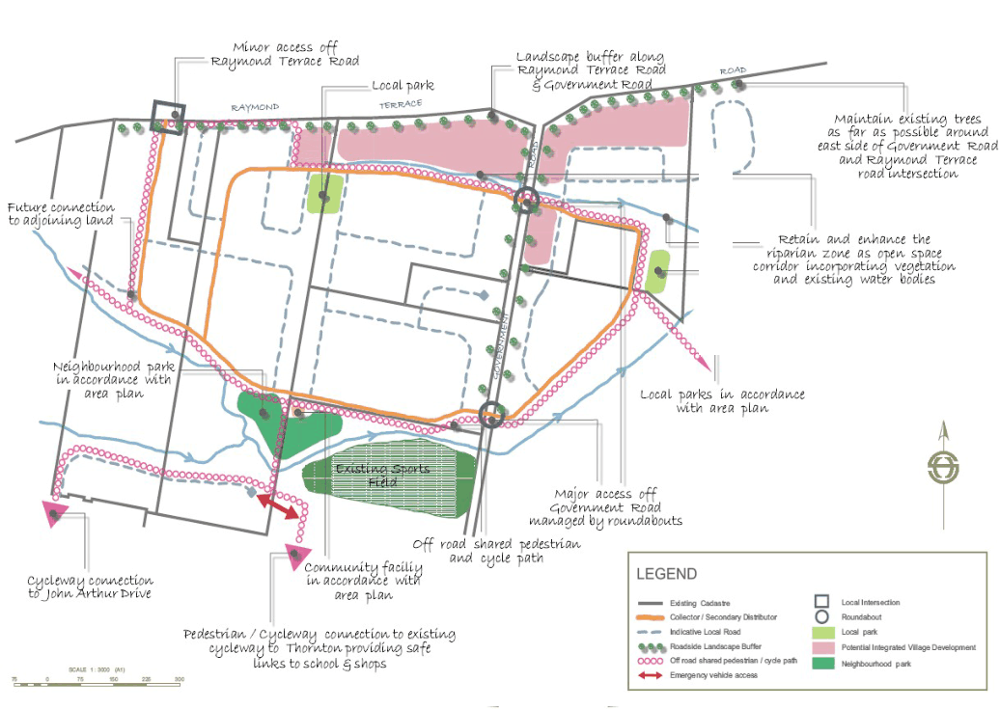

#### 10.4.5.13. Key Development Sites

#### Objectives

O.190 To ensure that detailed urban design controls are provided for significant development sites.

| PRESCRIPTIVE CONTROLS AND ACCEPTABLE SOLUTIONS |  |
|---|---|
| AS.1 | Key Development Sites are to be located generally in accordance with Figure 10-48. |
| • O.190 |  |
| PC.1 • O.190 | Development of, and adjoining Timberlane Estate are to be designed and located so as to minimise bulk and scale, thereby maintaining view corridors and minimising any impacts to the existing rural residential amenity. |
| PC.2 • O.190 | Allotments immediately adjoining the western and northern boundaries of Timberlane Estate must have a minimum lot size of 1500m2 and average minimum of 1800m2, with building restrictions placed on the land titles so as not to allow any dwellings and/ or structures within 15m of boundaries adjoining Timberlane Estate and 5m side boundary setbacks, in order to maintain view corridors and minimise and adverse impacts on the rural/residential amenity. |
| PC.3 • O.190 | Detailed landscaping strategies are to be submitted with all development applications for land adjoining Timberlane Estate, including plantings and fencing. A 5m landscape buffer is to be established and maintained along the adjoining boundary to Timberlane Estate. |
| PC.4 • O.190 | Only single-storey dwellings will be permitted on lots adjoining Timberlane Estate. Appropriate building restrictions are to be placed on the title of each lot. |
| PC.5 • O.190 | Building envelopes, detailing the required setbacks, are to be specified in any application to subdivide land adjoining Timberlane Estate. |
| PC.6 • O.190 | A perimeter road (with development on one side only) is to be provided around the edge of the Precinct where it adjoins flood prone land or rural land. |
| PC.7 • O.190 | An off-road shared pedestrian/cycle path is to be provided on the lower side of the perimeter road to create a continuous pathway. |
| PC.8 | Fencing of allotments is to be of post and wire style (or similar) so as to minimise any visual impacts of development. |
| • O.190 |  |

### Development Requirements – Government Road Precinct

The following section is the Precinct Plan provisions referred to in the general provisions above that applies to the Government Road Precinct. No specific requirements have been made for the following matters within the Government Road Precinct as they are already adequately addressed by other relevant provisions within the Maitland Local Environmental Plan 2011 and the Maitland Development Control Plan 2026:

• Amelioration of Natural and Environmental Hazards

• Residential Densities

• Neighbourhood Commercial and Retail Uses

• Provision of Public Facilities and Services

> [Picture on page 100: a picture, saved as a picture (images/ch-10-00-special-precincts-locality-plans-and-urban-release-page-100-11.gif, 150 dpi).]

#### Figure 10-49: Government Road Precinct Plan
