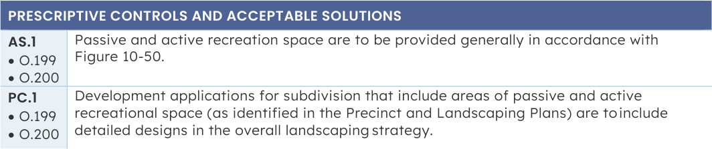

#### 10.4.5.17. Passive and Active Recreation Areas

#### Objectives

O.199 Neighbourhoods are conveniently located open space areas that offer a range of recreational

opportunities for residents, accessible within walking distance from each residence.

O.200 To provide a safe and appropriate level of pedestrian and cycleway access linking new development

with established urban areas, parks and public transport, including a mix of on-road and off-road cycle routes.

> [Picture on page 102: a picture, saved as a picture (images/ch-10-00-special-precincts-locality-plans-and-urban-release-page-102-16.gif, 150 dpi).]
> Words printed on the picture (title and legend, copied from the PDF):
> • O.199
> • O.200
> • O.199
> • O.200

Figure 10-50.

#### PRESCRIPTIVE CONTROLS AND ACCEPTABLE SOLUTIONS

Passive and active recreation space are to be provided generally in accordance with

#### AS.1

Development applications for subdivision that include areas of passive and active recreational space (as identified in the Precinct and Landscaping Plans) are to include detailed designs in the overall landscaping strategy.

#### PC.1
