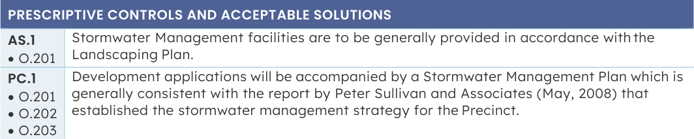
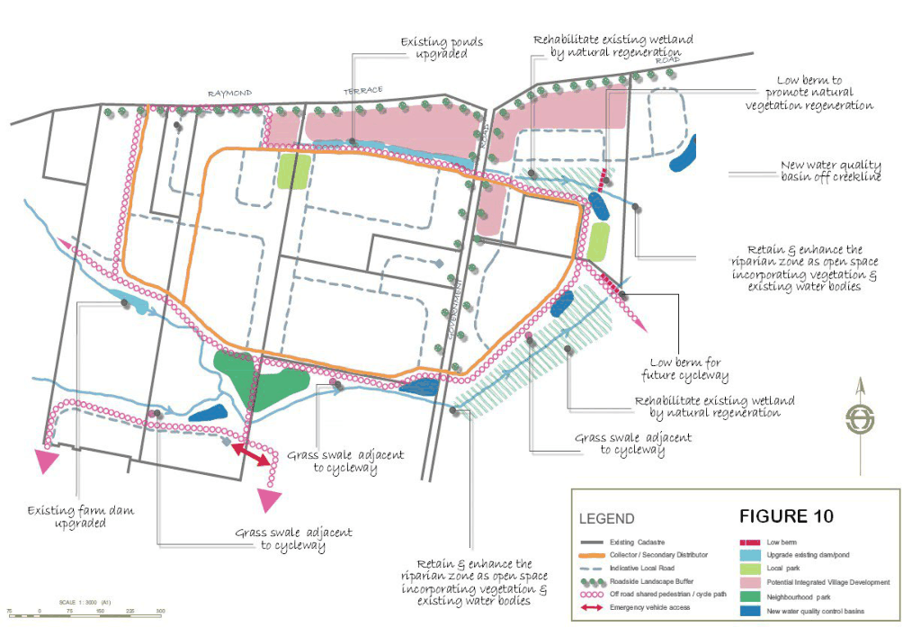
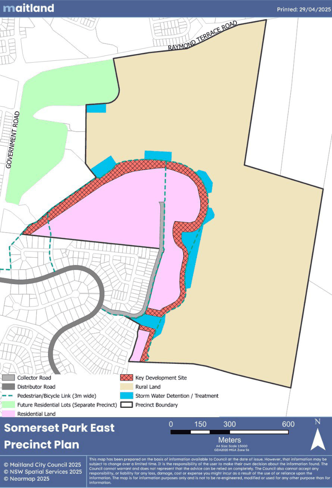

#### 10.4.5.18. Stormwater and Water Quality

#### Objectives

O.201 To provide for an integrated and sustainable approach to the design and provision of open space

and urban water management.

O.202 To protect and enhance the water quality, water quantity and habitat value of downstream

waterways and environment.

O.203 To prevent erosion and run-off during site preparation, construction and the ongoing use of the land

to minimise cumulative impact on receiving waterways.

> [Picture on page 102: a picture, saved as a picture (images/ch-10-00-special-precincts-locality-plans-and-urban-release-page-102-32.gif, 150 dpi).]
> Words printed on the picture (title and legend, copied from the PDF):
> • O.201
> • O.201
> • O.202
> • O.203

#### PRESCRIPTIVE CONTROLS AND ACCEPTABLE SOLUTIONS

Stormwater Management facilities are to be generally provided in accordance with the Landscaping Plan.

#### AS.1

Development applications will be accompanied by a Stormwater Management Plan which is generally consistent with the report by Peter Sullivan and Associates (May, 2008) that established the stormwater management strategy for the Precinct.

#### PC.1

#### Corner of Raymond Terrace Road and Government Objectives

O.204 To ensure that detailed urban design controls are provided for significant development sites.

| PRESCRIPTIVE CONTROLS AND ACCEPTABLE SOLUTIONS |  |
|---|---|
| PC.1 • O.204 | Any development proposed on land at the intersection of Raymond Terrace Road and Government Road is to be integrated with the existing vegetation community and provide for the retention of the majority of trees. A site-specific landscape plan must accompany any development application for this area addressing retention, integration and enhancement of the vegetation community. |
| PC.2 • O.204 | The 10m wide landscape buffer required for lots adjoining Government Road and Raymond Terrace Road is to be contained wholly within the affected lots and details are to be provided in a landscape plan with any development application. Where a supporting acoustic report for the development of the land identifies a requirement for noise attenuation, it should generally include a combination of earth mounding and fencing and details are also to be provided in the landscape plan. |
| PC.3 • O.204 | Fencing of allotments along the boundary of Raymond Terrace Road or Government Road is to be of consistent materials and colour and must form an integral part of the landscape plan provided with any development application. Fencing should not be a prominent element in the landscape along either road corridor. |

#### Rural Land Flood Fringe Interface

| PRESCRIPTIVE CONTROLS AND ACCEPTABLE SOLUTIONS |  |
|---|---|
| PC.4 | A perimeter road (with development on one side only) is to be provided around the edge of the Precinct where it adjoins flood prone land or rural land. |
| • O.204 |  |
| PC.5 | An off-road shared pedestrian/cycle path is to be provided on the lower side of the perimeter road to create a continuous pathway. |
| • O.204 |  |
| PC.6 • O.204 | Any fencing of allotments forward of the building line is to be of an open style of consistent design, material and colour so as to not dominate the landscape and minimise visual impact. |
| PC.7 • O.204 | Additional landscaping to the perimeter of development fronting the floodplain/rural land east of Government Road is to be provided to filter views of the new development across the floodplain. Details are to be provided in a landscape plan with any development application. |

> [Picture on page 104: a picture, saved as a picture (images/ch-10-00-special-precincts-locality-plans-and-urban-release-page-104-1.gif, 150 dpi).]

#### Figure 10-50: Thornton North - Government Road Precinct - Landscaping Plan

### Development Requirements – Somerset Park East Precinct

The following section is the Precinct Plan provisions referred to in the general provisions above that applies to the Somerset Park East Precinct. No specific requirements have been made for the following matters within the Somerset Park East Precinct as they are already adequately addressed by other relevant provisions within the Maitland Local Environmental Plan 2011 and the Maitland Development Control Plan 2026:

• Neighbourhood Commercial and Retail Uses

• Provision of Public Facilities and Services

• Amelioration of Natural and Environmental

Hazards

• Residential Densities

> [Picture on page 105: a picture, saved as a picture (images/ch-10-00-special-precincts-locality-plans-and-urban-release-page-105-12.gif, 150 dpi).]

#### Figure 10-51: Somerset Park East Precinct Plan

#### Objectives

O.205 To provide for the timely and efficient release of urban land making provision for necessary

infrastructure and sequencing.

#### PRESCRIPTIVE CONTROLS AND ACCEPTABLE SOLUTIONS

All development applications for subdivisions are to include a staged construction plan, where the development is intended to be constructed in stages.

#### PC.1

• O.205
