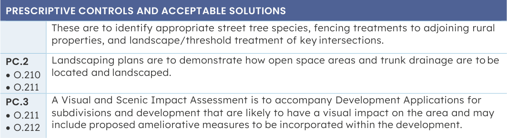

#### 10.4.5.22. Overall Landscaping Strategy

#### Objectives

O.210 To soften the visual impact of all built elements, creating attractive and consistent streetscapes

when viewed by passing traffic and pedestrians.

O.211 To ensure key environmental areas such as waterways, vegetation, land resources, and areas of

cultural significance and scenic value are protected.

O.212 To provide landscaping appropriate to the nature and scale of development that enhances the local

character and streetscape, supports retention and regeneration of ecological corridors and provides visual interest and a suitable backdrop to the built form.

#### PRESCRIPTIVE CONTROLS AND ACCEPTABLE SOLUTIONS

Development Applications for subdivision will include detailed landscaping plans.

#### PC.1

• O.210

> [Picture on page 107: a picture, saved as a picture (images/ch-10-00-special-precincts-locality-plans-and-urban-release-page-107-1.gif, 150 dpi).]
> Words printed on the picture (title and legend, copied from the PDF):
> located and landscaped.
> • O.210
> • O.211
> • O.211
> • O.212

#### PRESCRIPTIVE CONTROLS AND ACCEPTABLE SOLUTIONS

These are to identify appropriate street tree species, fencing treatments to adjoining rural properties, and landscape/threshold treatment of key intersections. Landscaping plans are to demonstrate how open space areas and trunk drainage are to be

#### PC.2

A Visual and Scenic Impact Assessment is to accompany Development Applications for subdivisions and development that are likely to have a visual impact on the area and may include proposed ameliorative measures to be incorporated within the development.

#### PC.3
