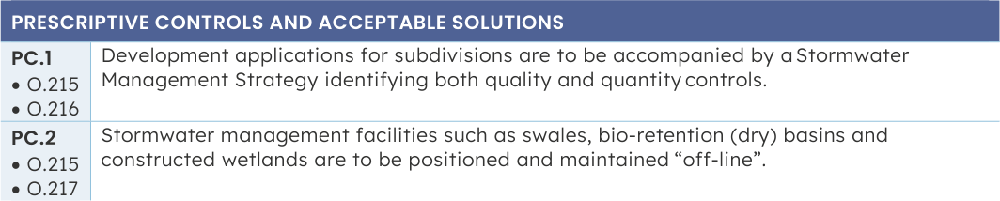
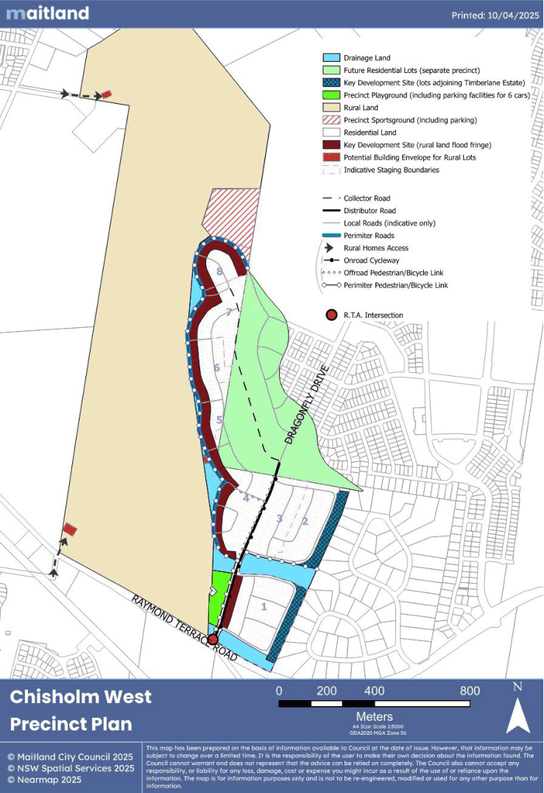

#### 10.4.5.24. Stormwater and Water Quality

#### Objectives

O.215 To provide for an integrated and sustainable approach to the design and provision of open space

and urban water management.

O.216 To protect and enhance the water quality, water quantity and habitat value of downstream

waterways and environment.

O.217 To prevent erosion and run-off during site preparation, construction and the ongoing use of the land

to minimise cumulative impact on receiving waterways.

> [Picture on page 107: a picture, saved as a picture (images/ch-10-00-special-precincts-locality-plans-and-urban-release-page-107-33.gif, 150 dpi).]
> Words printed on the picture (title and legend, copied from the PDF):
> • O.215
> • O.216
> • O.215
> • O.217

#### PRESCRIPTIVE CONTROLS AND ACCEPTABLE SOLUTIONS

Development applications for subdivisions are to be accompanied by a Stormwater Management Strategy identifying both quality and quantity controls.

#### PC.1

Stormwater management facilities such as swales, bio-retention (dry) basins and constructed wetlands are to be positioned and maintained “off-line”.

#### PC.2

#### Rural Land Flood Fringe Interface Objectives

O.218 Detailed urban design controls are provided for significant development sites.

| PRESCRIPTIVE CONTROLS AND ACCEPTABLE SOLUTIONS A perimeter road (with development on one side only) is to be provided around the edge of Precinct where it adjoins flood prone land or rural land. wide off-road shared pedestrian/cycle path is to be provided on the lower side of the road (except in Stage 1 off Yaldara Avenue where it is to be provided on the to create a continuous pathway linking with existing and proposed pedestrian public open space. to the perimeter of development fronting the floodplain/rural land water management basins is to be provided to filter views of the new floodplain. Details are to be provided in a landscape plan with any application. forward of the front building line must be of an open style of colour so as to not dominate the landscape and minimise |
|---|
| PC.1 • O.218 the |
| PC.2 A 3m • O.218 perimeter upper side) networks and |
| PC.3 Additional landscaping • O.218 and to the proposed development across the relevant development |
| PC.4 Any fencing of allotments • O.218 consistent design, material and visual impact. |

### Development Requirements – Chisholm West Precinct

The following section is the Precinct Plan provisions referred to in the general provisions above that applies to the Chisholm West Precinct. No specific requirements have been made for the following matters within the Chisholm West Precinct as they are already adequately addressed by other relevant provisions within the Maitland Local Environmental Plan 2011 and the Maitland Development Control Plan 2026:

• Amelioration of Natural and Environmental Hazards

• Residential Densities

• Neighbourhood Commercial and Retail Uses

• Provision of Public Facilities and Services

> [Picture on page 109: a picture, saved as a picture (images/ch-10-00-special-precincts-locality-plans-and-urban-release-page-109-11.gif, 150 dpi).]

#### Figure 10-52: Chisholm West Precinct Plan

#### Objectives

O.219 To provide for the timely and efficient release of urban land making provision for necessary

infrastructure and sequencing.

#### PRESCRIPTIVE CONTROLS AND ACCEPTABLE SOLUTIONS

All development applications for subdivisions are to include a staged construction plan, where the development is intended to be constructed in stages.

#### PC.1

• O.219
