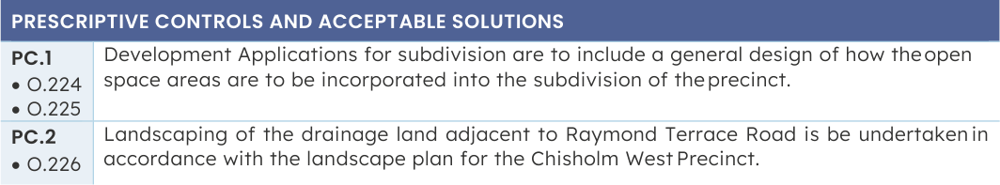

#### 10.4.5.27. Transport Movement Hierarchy

#### Objectives

O.220 To achieve a simple and safe movement system for private vehicles, public transport, pedestrians

and cyclists.

O.221 To provide walkable neighbourhoods with convenient access to neighbourhood shops, community

facilities and other services, with less dependence on cars for travel

O.222 To provide for access generally by way of an interconnected network of streets and paths which

facilitate safe, efficient and pleasant walking, cycling and driving.

O.223 To facilitate new development which supports the efficiency of public transport systems, and

provides safe, direct access to the system for residents.

| PRESCRIPTIVE CONTROLS AND ACCEPTABLE SOLUTIONS |  |
|---|---|
| AS.1 • O.220 | The layout, hierarchy and design of major streets within the Precinct is to be generally consistent with Figure 10-52. |
| AS.2 • O.220 • O.223 | Adjustments to the location of local roads will be considered as part of the relevant development application where it can be demonstrated they result in improved lot layout and orientation, better integration with adjoining subdivisions and greater regard to the topography. |
| PC.1 • O.221 • O.222 | A distributor road is to be provided through the site in the location identified in Figure 10-52. The road is to have a total minimum width of 23m (4.5m/13m/5.5m) and is to make provision for services, recycled water (within a suitable footway allocation), a 2.5m off-road cycleway on the western side, a 1.5m footpath on the eastern side and an on-road commuter cycleway. |
| PC.2 • O.222 | A signalised intersection is to be provided at the intersection of Raymond Terrace and the distributor road in accordance with the Thornton North Contributions Plan 2008 and the requirements of the NSW Roads and Traffic Authority, generally in the location shown on Figure 10-52. |
| PC.3 • O.220 • O.222 | Pedestrian paths, cycleways and off-road shared pathways are to be provided within the Precinct to link the residential areas to the proposed playground and sports field and to link to adjoining precincts generally as shown on Figure 10-52. |
| PC.4 • O.223 | Subdivision design is to provide for lot frontages addressing streets, reserves, open space and drainage areas. Allotments backing onto reserves, open space and drainage areas are not encouraged. Where this is unavoidable, boundary fencing is to be of an open style and of consistent materials and colour. Fencing is not to form a prominent element in the visual landscape of this area. |
| AS.3 • O.223 | Subdivision layout and lot orientation should maximise privacy, private open space areas, solar access and energy efficiency. In this regard, minor streets should generally be aligned east/west, subject to site constraints such as topography. |

#### Objectives

O.224 To soften the visual impact of all built elements, creating attractive and consistent streetscapes

when viewed by passing traffic and pedestrians.

O.225 To ensure key environmental areas such as waterways, vegetation, land resources, and areas of

cultural significance and scenic value are protected.

O.226 To provide landscaping appropriate to the nature and scale of development that enhances the local

character and streetscape, supports retention and regeneration of ecological corridors and provides visual interest and a suitable backdrop to the built form.

> [Picture on page 111: a picture, saved as a picture (images/ch-10-00-special-precincts-locality-plans-and-urban-release-page-111-9.gif, 150 dpi).]
> Words printed on the picture (title and legend, copied from the PDF):
> • O.224
> • O.225
> • O.226

#### PRESCRIPTIVE CONTROLS AND ACCEPTABLE SOLUTIONS

Development Applications for subdivision are to include a general design of how the open space areas are to be incorporated into the subdivision of the precinct.

#### PC.1

Landscaping of the drainage land adjacent to Raymond Terrace Road is be undertaken in accordance with the landscape plan for the Chisholm West Precinct.

#### PC.2
