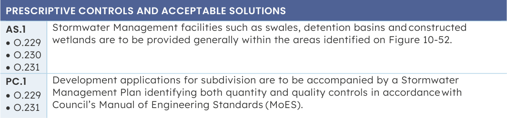

#### 10.4.5.30. Stormwater and Water Quality

#### Objectives

O.229 To provide for an integrated and sustainable approach to the design and provision of open space

and urban water management.

O.230 To protect and enhance the water quality, water quantity and habitat value of downstream

waterways and environment.

O.231 To prevent erosion and run-off during site preparation, construction and the ongoing use of the land

to minimise cumulative impact on receiving waterways.

> [Picture on page 111: a picture, saved as a picture (images/ch-10-00-special-precincts-locality-plans-and-urban-release-page-111-39.gif, 150 dpi).]
> Words printed on the picture (title and legend, copied from the PDF):
> • O.229
> • O.230
> • O.231
> • O.229
> • O.231

#### PRESCRIPTIVE CONTROLS AND ACCEPTABLE SOLUTIONS

Stormwater Management facilities such as swales, detention basins and constructed wetlands are to be provided generally within the areas identified on Figure 10-52.

#### AS.1

Development applications for subdivision are to be accompanied by a Stormwater Management Plan identifying both quantity and quality controls in accordance with Council’s Manual of Engineering Standards (MoES).

#### PC.1

#### PRESCRIPTIVE CONTROLS AND ACCEPTABLE SOLUTIONS

All stormwater facilities are to be dedicated to Council as part of the relevant development application.

#### PC.2

• O.230

• O.231
