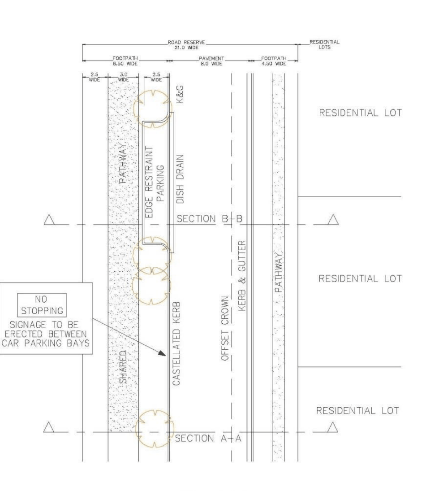
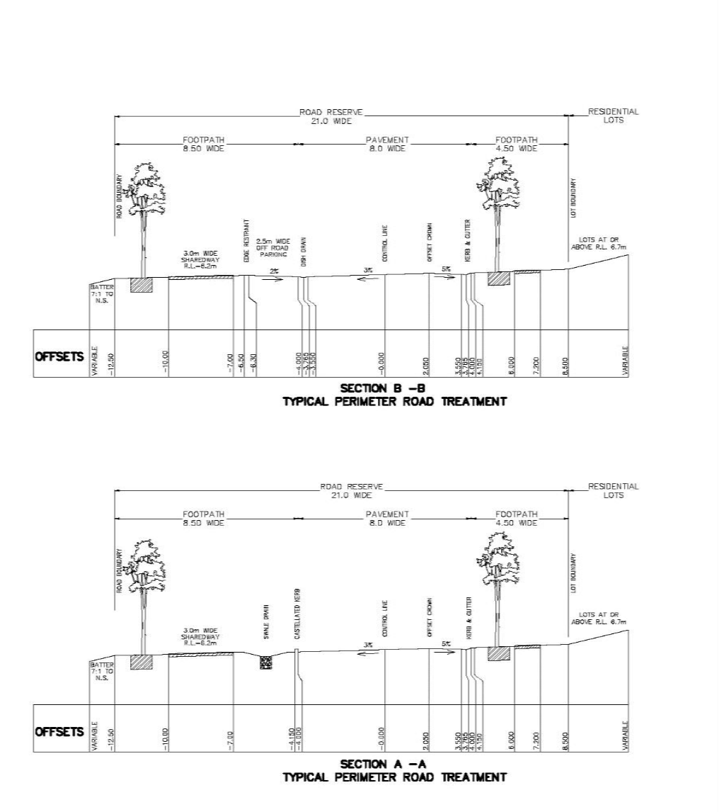
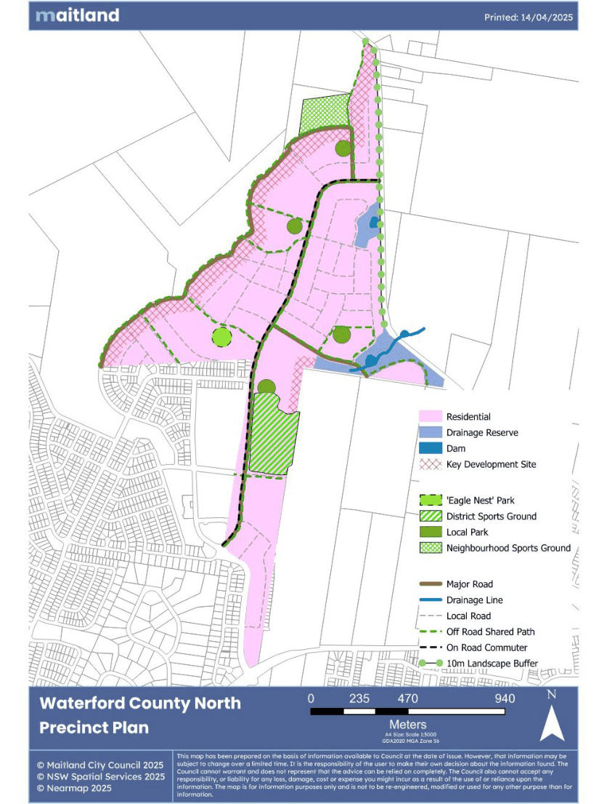

#### 10.4.5.31. Key Development Sites

#### Land adjoining Timberlane Estate

#### Objectives

O.232 To ensure that detailed urban design controls are provided for significant development sites.

| PRESCRIPTIVE CONTROLS AND ACCEPTABLE SOLUTIONS |  |
|---|---|
| AS.1 • O.232 | Development of land adjoining Timberlane Estate should be designed and located to minimise bulk and scale, thereby maintaining view corridors and minimising any impacts to the existing rural residential amenity. |
| PC.1 • O.232 | Allotments immediately adjoining the western and northern boundaries of Timberlane Estate must have a minimum lot size of 1500m2 and average minimum of 1800m2. Building restrictions are to be placed on the land titles of the affected properties prohibiting the erection of any dwellings within 15m of boundaries adjoining Timberlane Estate and 5m side boundary setbacks, in order to maintain view corridors and minimise any adverse impacts on the rural/residential amenity. |
| PC.2 • O.232 | Building envelopes, detailing the required setbacks, are to be specified in any application to subdivide land adjoining Timberlane Estate. |
| PC.3 • O.232 | Detailed landscaping strategies are to be submitted with all development applications for land adjoining Timberlane Estate, including plantings and fencing. A 5m landscape buffer is to be established and maintained along the adjoining boundary to Timberlane Estate. A restriction is to be placed on the title of affected properties indicating no structures are to be located within this area. |
| PC.4 • O.232 | Only single storey dwellings will be permitted on lots adjoining Timberlane Estate to maintain view lines and amenity. Appropriate building restrictions are to be placed on the title of each lot. |

#### Rural Land Flood Fringe Interface

| PRESCRIPTIVE CONTROLS AND ACCEPTABLE SOLUTIONS |  |
|---|---|
| PC.5 • O.232 | A perimeter road (with development on one side only) is to be provided around the edge of the Precinct where it adjoins flood prone land, rural or drainage land in accordance with Figure 10-52, Figure 10-53, and Figure 10-54. |
| PC.6 • O.232 | A 3m wide shared pathway are to be provided on the lower (non-development) side of the perimeter road in accordance with Figure 10-53 and Figure 10-54. This pathway is to extend through to the boundary of the Timberlane Estate as shown on Figure 10-52. |
| PC.7 • O.232 | Any fencing of allotments forward of the front building line are to be an open style of consistent design, material and colour so as not to dominate the landscape and minimise visual impact. |

> [Picture on page 113: a picture, saved as a picture (images/ch-10-00-special-precincts-locality-plans-and-urban-release-page-113-1.gif, 150 dpi).]
> Words printed on the picture (title and legend, copied from the PDF):
> • O.232

#### PRESCRIPTIVE CONTROLS AND ACCEPTABLE SOLUTIONS PC.8

Landscaping is to be provided along the perimeter road and to development fronting the floodplain/rural land and the proposed water management basins to filter views of the new development across the floodplain. Details are to be provided in the landscape plan submitted with the applicable development application.

#### Flood Fringe Rural Allotments

#### PRESCRIPTIVE CONTROLS AND ACCEPTABLE SOLUTIONS

| PC.9 | The Precinct Plan identifies suitable sites (building envelopes) for future dwellings on large |
|---|---|
| • O.232 | rural allotments, which have been located to maximise views, amenity and effective management of the floodplain. |

#### Land adjoining Raymond Terrace Road and Main Northern Railway

| PRESCRIPTIVE CONTROLS AND ACCEPTABLE SOLUTIONS A 10m wide landscape buffer is to be provided within the drainage reserve adjoining Raymond Terrace Road and is to include a combination of earth mounding, acoustic and vegetation. Plans showing details of this treatment are to be submitted with development application to subdivide Stage 1 of this Precinct. subdivision and associated development is to be designed so as to comply with standards and criteria for noise and vibration. is to be submitted with any development application for the subdivision Raymond Terrace Road detailing the necessary measures to mitigate from Raymond Terrace Road and the Main Northern Railway line. |  |
|---|---|
| PC.10 • O.232 fencing any |  |
| PC.11 | Residential the relevant |
| • O.232 |  |
| PC.12 An acoustic report • O.232 of land adjacent to the impact of noise |  |

> [Picture on page 114: a picture, saved as a picture (images/ch-10-00-special-precincts-locality-plans-and-urban-release-page-114-1.gif, 150 dpi).]

#### Figure 10-53: Chisholm West Precinct Plan – Perimeter Road Section

> [Picture on page 115: a picture, saved as a picture (images/ch-10-00-special-precincts-locality-plans-and-urban-release-page-115-1.gif, 150 dpi).]

#### Figure 10-54: Chisholm West Precinct Plan Perimeter Road Cross Section.

### Development Requirements – Waterford County North Precinct

The following section is the Precinct Plan provisions referred to in the general provisions above that applies to the Waterford County North Precinct. No specific requirements have been made for the following matters within the Waterford County North Precinct as they are already adequately addressed by other relevant provisions within the Maitland Local Environmental Plan 2011 and the Maitland Development Control Plan 2026:

• Neighbourhood Commercial and Retail Uses

• Provision of Public Facilities and Services

> [Picture on page 116: a picture, saved as a picture (images/ch-10-00-special-precincts-locality-plans-and-urban-release-page-116-9.gif, 150 dpi).]

#### Figure 10-55: Waterford County North Precinct Plan

#### Objectives

O.233 To provide for the timely and efficient release of urban land making provision for necessary

infrastructure and sequencing.

#### PRESCRIPTIVE CONTROLS AND ACCEPTABLE SOLUTIONS

All development applications for subdivisions are to include a staging plan, where the development is intended to be released sequentially.

#### PC.1

• O.233
