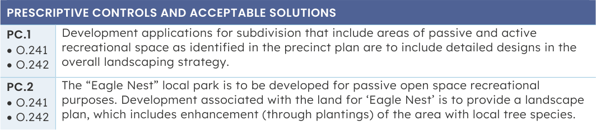

#### 10.4.5.33. Transport Movement Hierarchy

#### Objectives

O.234 To achieve a simple and safe movement system for private vehicles, public transport, pedestrians

and cyclists.

O.235 To provide walkable neighbourhoods with convenient access to neighbourhood shops, community

facilities and other services, with less dependence on cars for travel

O.236 To provide for access generally by way of an interconnected network of streets and paths which

facilitate safe, efficient and pleasant walking, cycling and driving.

O.237 To facilitate new development which supports the efficiency of public transport systems, and

provides safe, direct access to the system for residents.

| PRESCRIPTIVE CONTROLS AND ACCEPTABLE SOLUTIONS |  |
|---|---|
| AS.1 • O.234 | The layout, hierarchy and design of major streets within the precinct should be generally consistent with the precinct plan and Figure 10-56. |
| PC.1 • O.235 • O.236 | Pedestrian paths, cycle ways and off-road shared pathways are to be provided within the precinct generally as shown on the precinct plan. The pedestrian and cycle network should link the Chisholm local activity centre with open space and community facilities and link to adjoining precincts. |
| PC.2 • O.236 • O.237 | Subdivision design is to provide for lot frontages that address streets, reserves, open space and drainage areas. Allotments backing onto reserves, open space, environmental land and drainage areas are discouraged. Where this is unavoidable, boundary fencing is to be of an open style and of consistent materials and colour. Fencing must not form a prominent element in the landscape of this area. |
| PC.3 | Suitable transport access and connectivity within the site and to adjoining areas are to be maintained at all times for motor vehicles, pedestrians, cyclists and public transport providers. |
| • O.236 |  |
| • O.237 |  |
| PC.4 | The transport movement hierarchy must identify bus transport routes within the precinct. |
| • O.237 |  |

#### Objectives

O.238 To soften the visual impact of all built elements, creating attractive and consistent streetscapes

when viewed by passing traffic and pedestrians.

O.239 To ensure key environmental areas such as waterways, vegetation, land resources, and areas of

cultural significance and scenic value are protected.

O.240 To provide landscaping appropriate to the nature and scale of development that enhances the local

character and streetscape, supports retention and regeneration of ecological corridors and provides visual interest and a suitable backdrop to the built form.

| PRESCRIPTIVE CONTROLS AND ACCEPTABLE SOLUTIONS |  |
|---|---|
| AS.1 | The overall landscaping strategy within the precinct should be generally consistent with the precinct plan. |
| • O.238 |  |
| • O.239 |  |
| PC.1 • O.240 | A 10m wide landscaped buffer is to be provided within the rear of properties adjoining Mcfarlanes Road (refer to Figure 10-57). Existing mature trees within the buffer are to be retained. |
| PC.2 • O.240 | The respective landscaped buffer adjoining the McFarlane Road is to be wholly located within the affected allotments, with the maintenance of the landscape buffer being the responsibility of the individual owners of the respective allotments. Covenants are to be placed on affected land ensuring ongoing preservation and maintenance of the approved landscaping and fencing treatments on all lots that adjoin Mcfarlanes Road. |
| PC.3 • O.239 • O.240 | Fencing of allotments along the boundary of Mcfarlanes Road are to use consistent materials and colour and be landscaped both forward and behind the fence, as shown on Figure 10-58. Note: Fencing is not required where the boundary coincides with a proposed drainage reserve. |
| PC.4 | Side boundary fencing located within the landscaped buffer is to be similar to Mcfarlanes Road's boundary fencing treatment. |
| • O.240 |  |
| PC.5 | Private maintenance gates are to be provided in the boundary fence within each of the proposed lots that adjoin Mcfarlanes Road. |
| • O.240 |  |
| PC.6 • O.239 • O.240 | Development applications for subdivision will include detailed landscaping plans that: a. identify appropriate street tree species, b. illustrate fencing treatments to adjoining rural properties, c. illustrate landscape/threshold treatment of key intersections, d. demonstrate how open space areas and trunk drainage are to be located and landscaped, and e. demonstrate how existing mature trees are retained and protected in the landscape. |
| AS.2 | Existing significant mature trees should be retained where possible. |
| • O.239 |  |

#### Objectives

O.241 Neighbourhoods are conveniently located open space areas that offer a range of recreational

opportunities for residents, accessible within walking distance from each residence.

O.242 To provide a safe and appropriate level of pedestrian and cycleway access linking new development

with established urban areas, parks and public transport, including a mix of on-road and off-road cycle routes.

> [Picture on page 119: a picture, saved as a picture (images/ch-10-00-special-precincts-locality-plans-and-urban-release-page-119-7.gif, 150 dpi).]
> Words printed on the picture (title and legend, copied from the PDF):
> • O.241
> • O.242
> • O.241
> • O.242

#### PRESCRIPTIVE CONTROLS AND ACCEPTABLE SOLUTIONS

Development applications for subdivision that include areas of passive and active recreational space as identified in the precinct plan are to include detailed designs in the overall landscaping strategy.

#### PC.1

The “Eagle Nest” local park is to be developed for passive open space recreational purposes. Development associated with the land for ‘Eagle Nest’ is to provide a landscape plan, which includes enhancement (through plantings) of the area with local tree species.

#### PC.2
