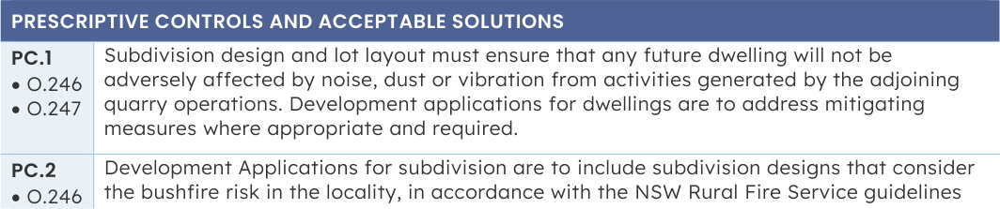

#### 10.4.5.37. Amelioration of Natural and Environmental Hazards

#### Objectives

O.246 Amelioration of natural and environmental hazards, including bushfire, flooding and site

contamination and, in relation to natural hazards, the safe occupation of, and the evacuation from, any land so affected is achieved.

O.247 To ensure that future residential development is not adversely affected by any noise and vibration

from incompatible land uses, including road and rail corridors and extractive industries.

> [Picture on page 119: a picture, saved as a picture (images/ch-10-00-special-precincts-locality-plans-and-urban-release-page-119-37.gif, 150 dpi).]
> Words printed on the picture (title and legend, copied from the PDF):
> • O.246
> • O.247
> • O.246

#### PRESCRIPTIVE CONTROLS AND ACCEPTABLE SOLUTIONS PC.1

Subdivision design and lot layout must ensure that any future dwelling will not be adversely affected by noise, dust or vibration from activities generated by the adjoining quarry operations. Development applications for dwellings are to address mitigating measures where appropriate and required. Development Applications for subdivision are to include subdivision designs that consider the bushfire risk in the locality, in accordance with the NSW Rural Fire Service guidelines

#### PC.2

| PRESCRIPTIVE CONTROLS AND ACCEPTABLE SOLUTIONS |  |
|---|---|
|  | current at that time. Submission of a bushfire risk assessment will be a minimum requirement for any development application involving bushfire prone land within the plan. |
| PC.3 • O.246 • O.247 | Subdivision design is to ensure that Asset Protection Zones (APZs) are contained wholly within the boundaries of residential allotments (and perimeter roads where considered safe and practical), and do not extend into environmentally zoned areas where clearing would be required. |
| PC.4 • O.247 | Development adjoining the C3 Environmental Management zone must be designed and planned to ensure any Asset Protection Zones and the like are not required or needed in the C3 zone. |
| PC.5 • O.247 | Development Applications will need to investigate soil salinity levels, soil structure/ stability and Acid Sulphate Soils as part of geotechnical investigations associated with the site. |
