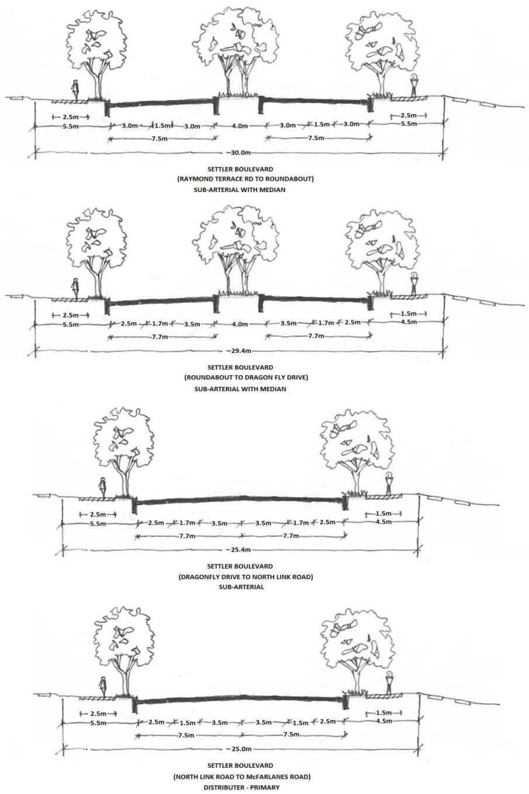
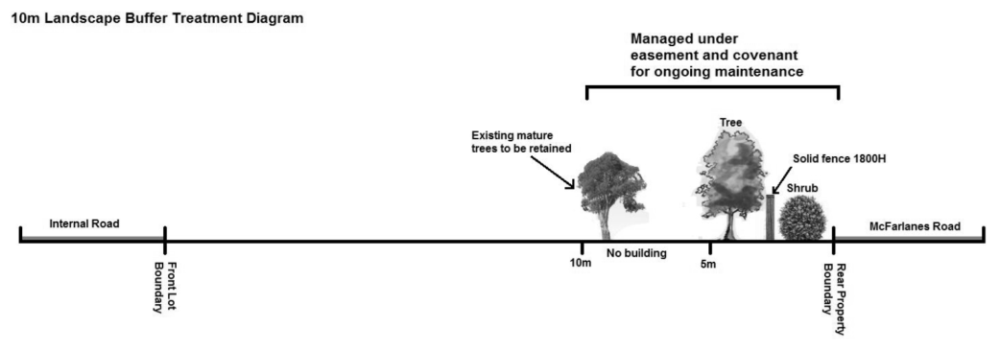
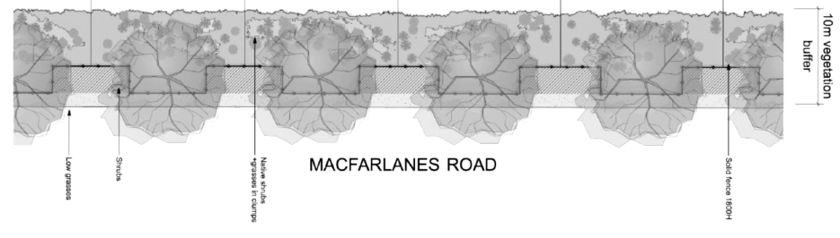
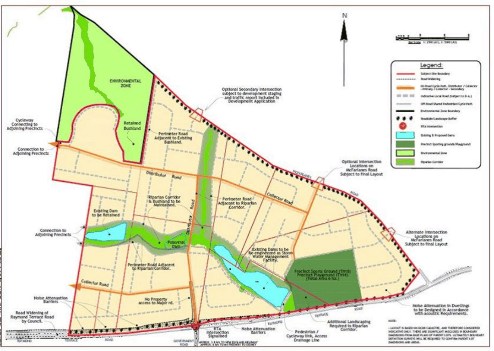

#### 10.4.5.40. Flora and Fauna

#### Objectives

O.250 To provide for the management and enhancement of vegetation, habitat and associated fauna.

| PRESCRIPTIVE CONTROLS AND ACCEPTABLE SOLUTIONS Development Applications that affect native vegetation communities are to include a detailed assessment of the flora and fauna characteristics of the site prepared by a qualified ecologist. Such an assessment is to consider retention of hollow bearing where practicable. buffers are to be maintained around identified watercourses, in accordance with Department of Water guidelines pertaining to minimum buffer widths. |  |
|---|---|
| PC.1 • O.250 suitably trees, |  |
| PC.2 | Riparian relevant NSW |
| • O.250 |  |

> [Picture on page 122: a picture, saved as a picture (images/ch-10-00-special-precincts-locality-plans-and-urban-release-page-122-1.gif, 150 dpi).]

#### Figure 10-56: Settlers Boulevard cross sections

> [Picture on page 123: a picture, saved as a picture (images/ch-10-00-special-precincts-locality-plans-and-urban-release-page-123-1.gif, 150 dpi).]

#### Figure 10-57: 10m Landscape Buffer Treatment (Mcfarlanes Road)

> [Picture on page 123: a picture, saved as a picture (images/ch-10-00-special-precincts-locality-plans-and-urban-release-page-123-3.gif, 150 dpi).]

#### Figure 10-58: Boundary Fencing Treatment (Mcfarlanes Road)

### Development Requirements – Raymond Terrace Road Eastern Precinct

The following section is the Precinct Plan provisions referred to in the general provisions above that applies to the Raymond Terrace Road Eastern Precinct. No specific requirements have been made for the following matters within the Raymond Terrace Road Eastern Precinct as they are already adequately addressed by other relevant provisions within the Maitland Local Environmental Plan 2011 and the Maitland Development Control Plan 2026:

• Residential Densities

• Neighbourhood Commercial and Retail Uses

• Provision of Public Facilities and Services

> [Picture on page 124: a picture, saved as a picture (images/ch-10-00-special-precincts-locality-plans-and-urban-release-page-124-10.gif, 150 dpi).]

#### Figure 10-59: Raymond Terrace Road Eastern Precinct Plan
