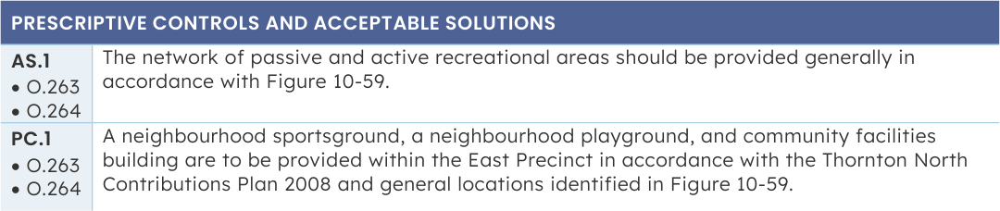

#### 10.4.5.44. Passive and Active Recreation Areas

#### Objectives

O.263 Neighbourhoods contain conveniently located open space areas that offer a range of recreational

opportunities for residents, accessible within walking distance from each residence.

O.264 To provide a safe and appropriate level of pedestrian and cycleway access linking new development

with established urban areas, parks and public transport, including a mix of on-road and off-road cycle routes.

> [Picture on page 126: a picture, saved as a picture (images/ch-10-00-special-precincts-locality-plans-and-urban-release-page-126-9.gif, 150 dpi).]
> Words printed on the picture (title and legend, copied from the PDF):
> accordance with Figure 10-59.
> • O.263
> • O.264
> • O.263
> • O.264

#### PRESCRIPTIVE CONTROLS AND ACCEPTABLE SOLUTIONS

The network of passive and active recreational areas should be provided generally in

#### AS.1

A neighbourhood sportsground, a neighbourhood playground, and community facilities building are to be provided within the East Precinct in accordance with the Thornton North Contributions Plan 2008 and general locations identified in Figure 10-59.

#### PC.1
