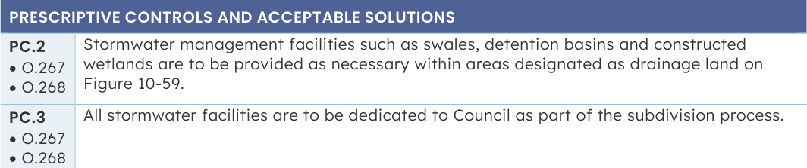

#### 10.4.5.45. Stormwater and Water Quality

#### Objectives

O.265 To provide for an integrated and sustainable approach to the design and provision of open space

and urban water management.

O.266 To protect and enhance the water quality, water quantity and habitat value of downstream

waterways and environment.

O.267 To prevent erosion and run-off during site preparation, construction and the ongoing use of the land

to minimise cumulative impact on receiving waterways.

O.268 To provide a coordinated stormwater management system for the whole of the precinct.

#### PRESCRIPTIVE CONTROLS AND ACCEPTABLE SOLUTIONS

Development applications for subdivisions are to be accompanied by a stormwater management strategy identifying both quality and quantity controls in accordance with Council’s MoES and to address timing of construction.

#### PC.1

• O.265

• O.266

> [Picture on page 127: a picture, saved as a picture (images/ch-10-00-special-precincts-locality-plans-and-urban-release-page-127-1.gif, 150 dpi).]
> Words printed on the picture (title and legend, copied from the PDF):
> • O.267
> • O.268
> • O.267
> • O.268

Figure 10-59.

#### PRESCRIPTIVE CONTROLS AND ACCEPTABLE SOLUTIONS

Stormwater management facilities such as swales, detention basins and constructed wetlands are to be provided as necessary within areas designated as drainage land on

#### PC.2

All stormwater facilities are to be dedicated to Council as part of the subdivision process.

#### PC.3
