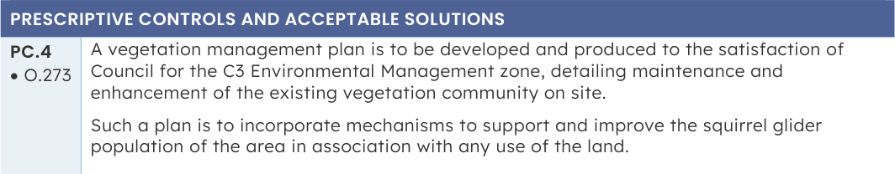
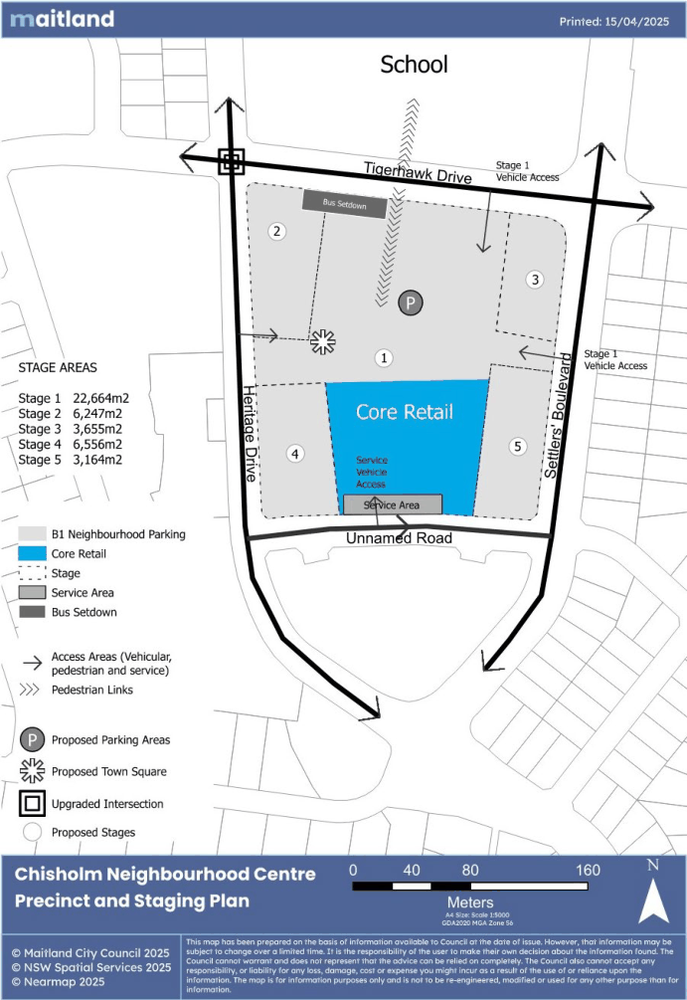

#### C3 Environmental Management Zoned Land

> [Picture on page 128: a picture, saved as a picture (images/ch-10-00-special-precincts-locality-plans-and-urban-release-page-128-3.gif, 150 dpi).]
> Words printed on the picture (title and legend, copied from the PDF):
> • O.273

#### PRESCRIPTIVE CONTROLS AND ACCEPTABLE SOLUTIONS PC.4

A vegetation management plan is to be developed and produced to the satisfaction of Council for the C3 Environmental Management zone, detailing maintenance and enhancement of the existing vegetation community on site. Such a plan is to incorporate mechanisms to support and improve the squirrel glider population of the area in association with any use of the land.

### Development Requirements – Chisholm Neighbourhood Centre

### Precinct

The following section is the Precinct Plan provisions referred to in the general provisions above that applies to the Chisholm Neighbourhood Centre Precinct. No specific requirements have been made for the following matters within the Chisholm Neighbourhood Centre Precinct as they are already adequately addressed by other relevant provisions within the Maitland Local Environmental Plan 2011 and the Maitland Development Control Plan 2026:

• Overall Landscaping Strategy

• Stormwater and Water Quality

• Amelioration of Natural and Environmental Hazards

> [Picture on page 129: a picture, saved as a picture (images/ch-10-00-special-precincts-locality-plans-and-urban-release-page-129-11.gif, 150 dpi).]

• Key Development Sites

• Residential Densities

#### Figure 10-60: Chisholm Neighbourhood Centre Precinct and Staging Plan

Located within one of Maitland’s newest residential neighbourhoods, the Chisholm Neighbourhood Centre is important to contribute to the development of a sustainable community. The Chisholm Neighbourhood Centre will provide for the convenience needs of the Thornton North Urban Release Area. The centre is located on the street block bound by Settlers Boulevard, Tigerhawk Drive, Heritage Drive, and an unnamed and unformed southern road. The centre’s central location will enhance accessibility supported by public transport, an adequate road network and safe, pleasant pedestrian and cycleway links. The centre will provide a central place where residents can meet and connect will foster a strong sense of place. The centre will help defined the character and identify of the suburb and urban release area.

#### Guiding design principles

The following guiding principles are to inform the future design of the neighbourhood centre:

• Spaciousness, reflective of local/regional character.

• Accessibility and convenience.

• Innovative architecture and an urban design which integrates with the master planned nature of the

Precinct.

• Creation of a distinctive sense of place reflective of its topography, outlook and enhances the

Centre’s relationship to neighbouring land uses.
