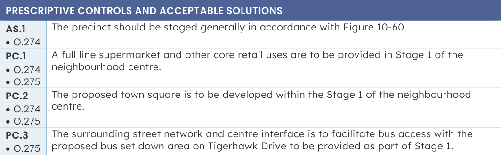

#### 10.4.5.48. Staging Plan

#### Objectives

O.274 A new planned neighbourhood centre is created to support the growing residential population of the

Thornton Urban Release Area by providing a range of convenience-based retail facilities and other complementary land uses.

O.275 The development staging is to be responsive to market demands and reflective of the growing

population and needs of the Chisholm Release Area.

> [Picture on page 130: a picture, saved as a picture (images/ch-10-00-special-precincts-locality-plans-and-urban-release-page-130-25.gif, 150 dpi).]
> Words printed on the picture (title and legend, copied from the PDF):
> • O.274
> neighbourhood centre.
> • O.274
> • O.275
> centre.
> • O.274
> • O.275
> • O.275

#### PRESCRIPTIVE CONTROLS AND ACCEPTABLE SOLUTIONS

The precinct should be staged generally in accordance with Figure 10-60.

#### AS.1

A full line supermarket and other core retail uses are to be provided in Stage 1 of the

#### PC.1

The proposed town square is to be developed within the Stage 1 of the neighbourhood

#### PC.2

The surrounding street network and centre interface is to facilitate bus access with the proposed bus set down area on Tigerhawk Drive to be provided as part of Stage 1.

#### PC.3
