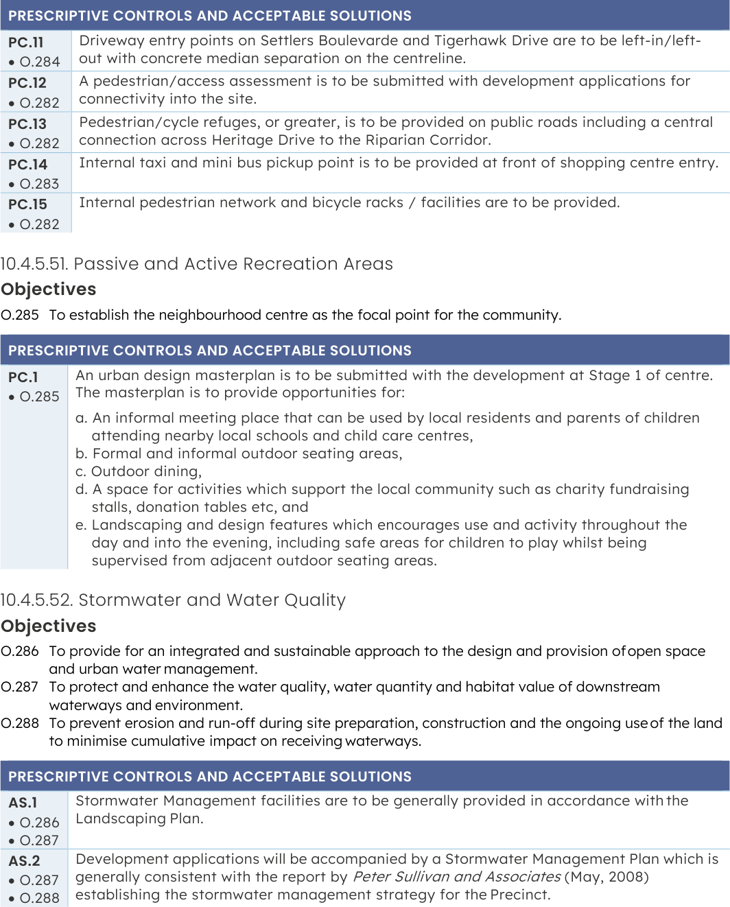

#### 10.4.5.50. Transport Movement Hierarchy

#### Objectives

O.278 A simple and safe movement system for private vehicles, public transport, pedestrians and cyclists is

achieved.

O.279 Centres are conveniently located and easily accessible by private vehicles, public transport,

pedestrians and cyclists.

O.280 The release of urban land and necessary infrastructure is logically sequenced.

O.281 Excellent connectivity and integration between the neighbourhood centre and the Thornton North

Urban Release Area is achieved.

O.282 Pedestrian and cycle routes connect the neighbourhood centre to the surrounding residential

neighbourhood and local features such as the primary school; open spaces and community uses.

O.283 Good connectivity with public transport is provided.

O.284 Connections are logical and well defined.

| PRESCRIPTIVE CONTROLS AND ACCEPTABLE SOLUTIONS |  |
|---|---|
| PC.1 | The link between the Investa and Waterford estates via Harvest Boulevard and Dragonfly Drive is to be completed prior to the issue of an occupation certificate for development in the neighbourhood centre. |
| • O.278 |  |
| • O.280 |  |
| • O.281 |  |
| PC.2 | The development application for Stage 1 is to include a Traffic Impact Assessment and Access Strategy prepared by a suitably qualified consultant. |
| • O.280 |  |
| PC.3 | The Traffic Impact Assessment and Access Strategy is to consider the full development scenario of the centre. |
| • O.280 |  |
| • O.281 |  |
| PC.4 • O.279 • O.281 | This assessment is to include details relating to the overall traffic and pedestrian management, access to parking areas, pedestrian access provisions, assessment of the proposed car parking designs and traffic generation including an assessment on the surrounding road network and key intersections. |
| PC.5 | The intersection of Tigerhawk and Heritage Drives is to be upgraded to cater for pedestrian safety, bus and heavy vehicles and traffic movements. Traffic lights are envisaged for this intersection. |
| • O.279 |  |
| • O.281 |  |
| • O.283 |  |
| PC.6 | Pedestrian linkages are to be provided in every direction. |
| • O.282 |  |
| PC.7 | The assessment is to consider the safety and functionality of the pedestrian focal point and the public and school bus services that will congregate on Tigerhawk Drive. |
| • O.282 |  |
| • O.283 |  |
| PC.8 | Development applications are to include a shared path connectivity plan linking all external paths to the entry point of the development. |
| • O.282 |  |
| PC.9 | Regrading of the kerb return and verge on the Heritage Tigerhawk Drives intersection is to occur in order to provide adequate longitudinal and transverse cross falls. |
| • O.278 |  |
| • O.284 |  |
| PC.10 | Development applications are to include details of recommended regulatory signage for existing and proposed roads. i.e. parking controls, loading zones, bus and taxi zones, etc |
| • O.284 |  |

> [Picture on page 132: a picture, saved as a picture (images/ch-10-00-special-precincts-locality-plans-and-urban-release-page-132-1.gif, 150 dpi).]
> Words printed on the picture (title and legend, copied from the PDF):
> • O.284
> • O.282
> • O.282
> • O.283
> • O.282

#### PRESCRIPTIVE CONTROLS AND ACCEPTABLE SOLUTIONS

Driveway entry points on Settlers Boulevarde and Tigerhawk Drive are to be left-in/left-out with concrete median separation on the centreline.

#### PC.11

A pedestrian/access assessment is to be submitted with development applications for connectivity into the site.

#### PC.12

Pedestrian/cycle refuges, or greater, is to be provided on public roads including a central connection across Heritage Drive to the Riparian Corridor.

#### PC.13

Internal taxi and mini bus pickup point is to be provided at front of shopping centre entry.

#### PC.14

Internal pedestrian network and bicycle racks / facilities are to be provided.

#### PC.15
