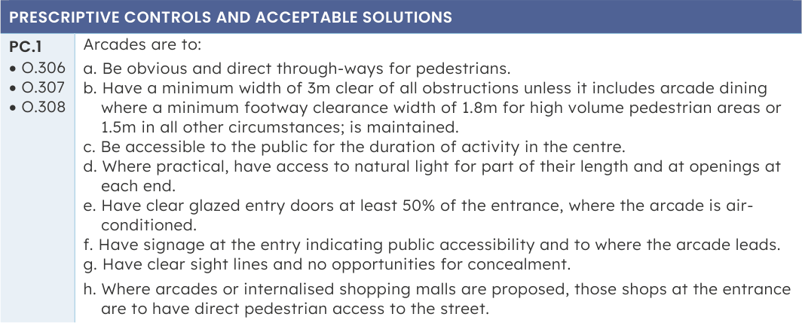
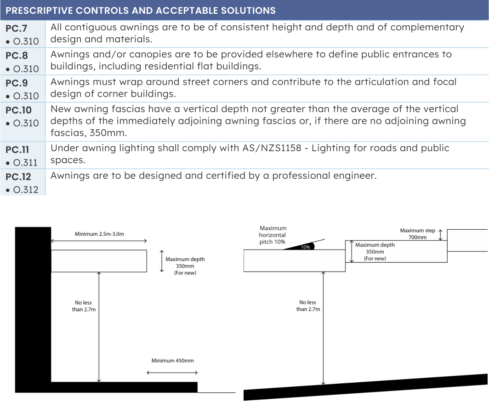
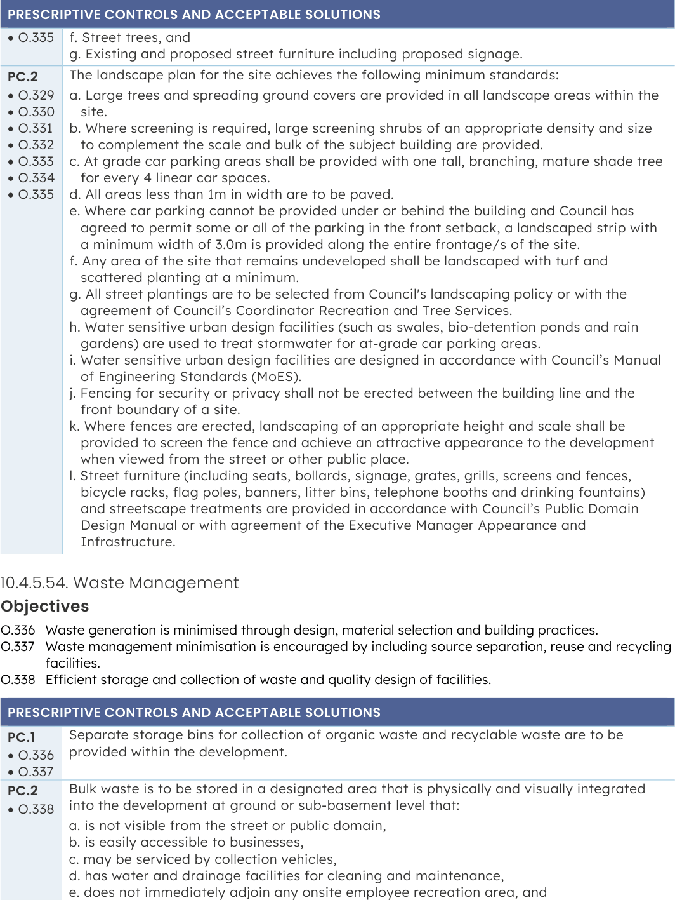

#### 10.4.5.52. Stormwater and Water Quality

#### Objectives

O.286 To provide for an integrated and sustainable approach to the design and provision of open space

and urban water management.

O.287 To protect and enhance the water quality, water quantity and habitat value of downstream

waterways and environment.

O.288 To prevent erosion and run-off during site preparation, construction and the ongoing use of the land

to minimise cumulative impact on receiving waterways.

#### PRESCRIPTIVE CONTROLS AND ACCEPTABLE SOLUTIONS

Stormwater Management facilities are to be generally provided in accordance with the

#### AS.1

Development applications will be accompanied by a Stormwater Management Plan which is generally consistent with the report by Peter Sullivan and Associates (May, 2008) establishing the stormwater management strategy for the Precinct.

#### AS.2

#### Building Design Objectives

O.289 The design of the centre (including the height of buildings) should respond to the existing

topography and capture important local views including views to adjacent open space.

O.290 The centre should be scaled to positively contribute to the surrounding neighbourhood and open

space areas.

O.291 Buildings are sited and designed in a manner that present a unified, coherent appearance that

integrates with its context and takes advantage of its physical attributes.

O.292 Visually interesting, harmonious roof scapes and skylines are provided.

O.293 Roofs are used for recreation where practical and desirable.

O.294 A positive sense of space, safety and openness is created in the public domain.

O.295 Building security is achieved without compromising the streetscape.

| PRESCRIPTIVE CONTROLS AND ACCEPTABLE SOLUTIONS |  |
|---|---|
| PC.1 | Where more than 2-storeys are proposed, the third and higher storeys are to be setback further by a minimum of 3m compared to the ground floor. |
| • O.289 |  |
| PC.2 | Variations in roof form including the use of skillions, gables and hips are to be provided in the development or between developments. |
| • O.291 |  |
| • O.292 |  |
| • O.293 |  |
| PC.3 | Flat roofs are to be avoided unless they are behind a parapet. |
| • O.292 |  |
| PC.4 | Lift over-runs and service plant must be concealed within roof structures. |
| • O.292 |  |
| PC.5 | All roof plant is to be shown on plans and elevations. |
| • O.290 |  |
| PC.6 | Outdoor recreation areas on flat roofs are to be landscaped and incorporate shade structures and wind screens to encourage use. |
| • O.293 |  |
| AS.1 | Security grills (e.g. for roll-up doors) should be avoided. If installed, security grilles are to be provided within the building, behind the glazing and be constructed of material that allows the interior to be visible. |
| • O.294 |  |
| • O.295 |  |

#### Setbacks

#### Objectives

O.296 The established character of the street is reinforced.

O.297 The existing rhythm of the street and its built form is maintained.

O.298 The development provides adequate pedestrian areas and integrates into the adjoining sites.

O.299 A consistent streetscape is achieved.

O.300 Structures and queues do not impede pedestrian movement.

O.301 Any ramps are to be integrated into the overall building and landscape design.

| PRESCRIPTIVE CONTROLS AND ACCEPTABLE SOLUTIONS |  |
|---|---|
| PC.1 | Development along identified active streets must be built-to-boundary. |
| • O.296 |  |
| • O.297 |  |
| PC.2 | In all other cases, buildings are to be setback within 20% of the average of the adjoining buildings. |
| • O.297 |  |
| • O.299 |  |

| PRESCRIPTIVE CONTROLS AND ACCEPTABLE SOLUTIONS |  |
|---|---|
| PC.3 • O.298 • O.300 | All pedestrian paved areas along an active street are to have a minimum paved width of 3.5m and is to adhere to the following design criteria: a. is clear and accessible for pedestrians for its entire length and width, b. is clear of columns (other than awning posts where provided) and other obstructions, c. may include outdoor dining where a minimum footway clearance width of: i. 1.8m for high volume pedestrian areas, or ii. 1.5m in all other circumstances; is maintained. d. has a pavement matching the gradient of the adjoining footpath and connects to pedestrian areas on neighbouring sites, and e. connects without any lip or step to adjoining footpaths or abutting pedestrian areas on neighbouring sites. |
| PC.4 | Pavements, furniture and landscaping are to be designed in accordance the Council’s requirements. |
| • O.299 |  |
| PC.5 | Steps, escalators, ramps or lifts are not to be located within the 3.5m paved pedestrian area. |
| • O.301 |  |
| PC.6 • O.299 | Any automatic teller machine provided is to be: • inset 1.5m into the building line, and • well illuminated at all times. |
| PC.7 | Ramps are constructed and finished with materials that are similar or complementary to those used on the building or in the street. |
| • O.301 |  |

#### Active Frontages

#### Objectives

O.302 To provide active uses along identified frontages.

O.303 To promote uses that attract pedestrian traffic along certain ground floor street frontages.

O.304 To ensure a vibrant and safe public domain is provided.

O.305 To ensure direct contact (visual and physical) between the street and the interior of a building is

achieved.

| PRESCRIPTIVE CONTROLS AND ACCEPTABLE SOLUTIONS |  |
|---|---|
| PC.1 • O.302 | Active frontages are to consist of one or more of the following: a. a shop front, b. commercial and residential lobbies, c. café or restaurant, or d. a public building if accompanied by an entry from the street. |
| PC.2 | A minimum of 80% of the ground floor level front facade must be clear glazed. |
| • O.303 |  |
| PC.3 | The reflexivity index for glass is not to exceed 20%. |
| • O.303 |  |
| PC.4 | Restaurants and cafés are to provide openable shop fronts (for e.g. bi-fold doors) where practical to the public domain. |
| • O.304 |  |
| • O.305 |  |
| PC.5 • O.304 • O.305 | Colonnade structures are not to be used unless it is demonstrated that the design: • would not restrict visibility into the shop or commercial premises; and • not limit natural daylight along footpaths; and • does not create opportunities for concealment. |

#### Arcades

#### Objectives

O.306 Connections to enhance the pedestrian network and to link between shopping areas, public spaces

and car parking are provided.

O.307 Parking at the rear of the development is encouraged by providing good permeability to the front of

the site.

O.308 Activity within arcades is encouraged.

> [Picture on page 135: a picture, saved as a picture (images/ch-10-00-special-precincts-locality-plans-and-urban-release-page-135-8.gif, 150 dpi).]
> Words printed on the picture (title and legend, copied from the PDF):
> • O.306
> • O.307
> each end.
> conditioned.

#### PRESCRIPTIVE CONTROLS AND ACCEPTABLE SOLUTIONS

Arcades are to:

a. Be obvious and direct through-ways for pedestrians.

b. Have a minimum width of 3m clear of all obstructions unless it includes arcade dining

#### PC.1

• O.308 where a minimum footway clearance width of 1.8m for high volume pedestrian areas or

1.5m in all other circumstances; is maintained.

c. Be accessible to the public for the duration of activity in the centre.

d. Where practical, have access to natural light for part of their length and at openings at

e. Have clear glazed entry doors at least 50% of the entrance, where the arcade is air-

f. Have signage at the entry indicating public accessibility and to where the arcade leads.

g. Have clear sight lines and no opportunities for concealment.

h. Where arcades or internalised shopping malls are proposed, those shops at the entrance

are to have direct pedestrian access to the street.

#### Awnings Objectives

O.309 Weather protection is provided along key streets.

O.310 A consistent and complementary streetscape is maintained.

O.311 Active streets are well lit at all times.

O.312 Awnings are structurally sound.

| PRESCRIPTIVE CONTROLS AND ACCEPTABLE SOLUTIONS |  |
|---|---|
| PC.1 | Continuous shelter from the weather is to be provided for the full extent of the active street frontage. |
| • O.309 |  |
| PC.2 | Awnings are to be horizontal or near horizontal (maximum pitch of 10%). |
| • O.309 |  |
| PC.3 | Awnings heights shall be no less than 2.7m high at any point measured above the existing ground level. |
| • O.310 |  |
| • O.312 |  |
| PC.4 | A minimum awning width of 2.5m-3.0m is required unless this cannot be achieved because of narrow pavements and street tree planting, traffic signals, traffic signage or utility poles. |
| • O.310 |  |
| • O.312 |  |
| PC.5 | New awnings must be set back a minimum of 450mm from the kerb line. |
| • O.310 |  |
| • O.312 |  |
| PC.6 | Awnings along sloping streets must step down in horizontal steps (a maximum of 700mm per step) to follow the slope of the street. |
| • O.310 |  |
| • O.312 |  |

> [Picture on page 136: a picture, saved as a picture (images/ch-10-00-special-precincts-locality-plans-and-urban-release-page-136-1.gif, 150 dpi).]
> Words printed on the picture (title and legend, copied from the PDF):
> • O.310
> • O.310
> • O.310
> • O.310
> • O.311
> • O.312

#### PRESCRIPTIVE CONTROLS AND ACCEPTABLE SOLUTIONS

All contiguous awnings are to be of consistent height and depth and of complementary design and materials.

#### PC.7

Awnings and/or canopies are to be provided elsewhere to define public entrances to buildings, including residential flat buildings.

#### PC.8

Awnings must wrap around street corners and contribute to the articulation and focal design of corner buildings.

#### PC.9 PC.10

New awning fascias have a vertical depth not greater than the average of the vertical depths of the immediately adjoining awning fascias or, if there are no adjoining awning fascias, 350mm. Under awning lighting shall comply with AS/NZS1158 - Lighting for roads and public spaces.

#### PC.11

Awnings are to be designed and certified by a professional engineer.

#### PC.12

#### Figure 10-61: Chisholm Neighbourhood Centre - Awning details

#### Gateway, corner and landmark sites Objectives

O.313 An innovative architectural style is achieved with building heights that emphasise prominent corners

of the development to promote a unique sense of identity for the centre.

| PRESCRIPTIVE CONTROLS AND ACCEPTABLE SOLUTIONS |  |
|---|---|
| PC.1 | The design of buildings on corner sites or at the ends of business or commercial zones must emphasise the importance of the corner as a focal point. |
| • O.313 |  |
| PC.2 | Corner sites or at the ends of business or commercial zones are to be constructed to boundary with no car parking or servicing between the street boundary and the building. |
| • O.313 |  |
| PC.3 • O.313 | Corner buildings are to include design devices such as: • Increased wall heights, • Splayed corner details, • Expression of junction of building planes, • Contrasting building materials, and • Other architectural features, To reinforce the prominence and distinctiveness of the building. |
| PC.4 | Shopfronts are to wrap around corners and entrances located centrally to the corner. |
| • O.313 |  |
| PC.5 | The tallest portion of the building is to be on the corner. |
| • O.313 |  |

#### Pedestrian Entries and Access Objectives

O.314 Equity for all street users is provided.

O.315 Pedestrian and vehicle access ways are separated where possible and visually distinguishable.

O.316 Conflict between pedestrians and vehicles is minimised during the day and at night.

O.317 The design of buildings and spaces shall promote legibility to help users find their way.

O.318 To encourage walking and cycling.

O.319 To ensure that secure and convenient parking is provided for bicycles.

| PRESCRIPTIVE CONTROLS AND ACCEPTABLE SOLUTIONS |  |
|---|---|
| PC.1 | The development complies with AS1428 - Design for Access and Mobility. |
| • O.314 |  |
| PC.2 | Pedestrian and vehicle movement areas are to be separated and defined by changes in pavement material, levels, lining or tactile treatments. |
| • O.315 |  |
| • O.316 |  |
| PC.3 | Parking areas are illuminated (naturally and/or artificially) during the time period the centre is open. |
| • O.317 |  |
| PC.4 | Signage is provided at the entries to the development detailing the services available within the centre and where they are located. |
| • O.317 |  |
| PC.5 | Signage to key public spaces accessible from the centre such as car parks, food courts are to be provided within the centre. |
| • O.317 |  |
| PC.6 | Signage to key facilities such as rest rooms, centre management, baby change rooms shall be provided within the centre. |
| • O.317 |  |
| PC.7 | Secure and convenient parking/storing for bicycles is provided close to the entrance of the development and with good surveillance. |
| • O.318 |  |
| • O.319 |  |

#### Parking, Loading and Servicing

#### Objectives

O.320 Parking, loading and servicing areas are provided that are functional, safe and do not dominate the

site or streetscape.

O.321 Vehicular conflicts are minimised through the separation of delivery vehicle access from the main

public spaces and car park areas.

O.322 Servicing areas are appropriately screened to minimise amenity impacts on nearby sensitive land

uses.

O.323 The established structure of town centre streetscapes is maintained.

O.324 Car parking provision does not undermine an existing streetscape.

| PRESCRIPTIVE CONTROLS AND ACCEPTABLE SOLUTIONS |  |
|---|---|
| PC.1 | Garage doors and loading docks shall be located at the rear of development, so that they are not a dominant element in the overall presentation of the development to key streets. |
| • O.320 |  |
| • O.322 |  |
| PC.2 | Signage shall be provided to direct visitors to the centre and to car parking areas. |
| • O.320 |  |
| PC.3 • O.322 | Rear or internalised car parks shall be designed and constructed in a manner which enables future expansion and connection with potential future car parks in neighbouring sites. This includes consideration of levels, drainage and location of existing and future driveways and crossovers. |
| PC.4 | All vehicles must be able to enter and leave any development in a forward direction. |
| • O.322 |  |
| PC.5 • O.321 | Loading and manoeuvring areas for service vehicles shall be separated from car parks and pedestrian paths. Where shared access is provided, no loading or unloading shall be carried out over car parking spaces and access aisles. |
| PC.6 | External service areas (for e.g. areas for rubbish storage, cardboard compacting etc) shall not be visible from roadways or public open space areas. |
| • O.320 |  |
| • O.322 |  |
| • O.323 |  |
| PC.7 | External storage and service areas shall be suitably screened from view from roads, parking areas and pedestrian areas. |
| • O.320 |  |
| • O.322 |  |
| • O.323 |  |
| PC.8 | Deep soil planted landscaped setback areas must be provided. |
| • O.323 |  |
| PC.9 | Basement car parks are to be setback a minimum of 3m from the street boundary. |
| • O.324 |  |

#### Vehicular Access

#### Objectives

O.325 In centres, pedestrians are prioritised over vehicles.

O.326 Conflict points between pedestrians and vehicles are minimised.

O.327 Car parking does not deactivate public space, including streets, laneways and share ways.

O.328 Underground car parking is integrated into the building design and streetscape.

#### PRESCRIPTIVE CONTROLS AND ACCEPTABLE SOLUTIONS

The number of vehicular crossovers are to be kept to a minimum.

#### PC.1

• O.326

| PRESCRIPTIVE CONTROLS AND ACCEPTABLE SOLUTIONS |  |
|---|---|
| PC.2 | Access and egress points are to be designed so that exiting vehicles have clear sight of pedestrians and cyclists. |
| • O.325 |  |
| • O.326 |  |
| PC.3 | Any car park ramps are to be located within the building footprint. |
| • O.327 |  |
| PC.4 | Access and egress to car parks is to be in a forward direction. |
| • O.326 |  |
| PC.5 • O.327 • O.328 | Vehicular entrances to underground car parks are: a. located on minor streets, b. have a maximum crossover width of 6.0m, c. signed and lit appropriately, and d. designed so that exiting vehicles have clear sight of pedestrians and cyclists. |
| PC.6 | All stairs and elevators in the parking structure are clearly visible. |
| • O.326 |  |
| PC.7 • O.327 | The street level frontage of car parking structures (including multi-level car parks) where adjoining public places, including active streets, share ways and laneways, are to present an active frontage along the entire frontage less any car park entry. |
| PC.8 | Internal finishes of underground car parks shall be consistent with the external materials where they are visible from the public realm. |
| • O.327 |  |
| PC.9 | Underground car parks are to be designed to utilise natural ventilation rather than mechanical. |
| • O.328 |  |
| PC.10 | Ventilation ducts/grilles are to integrate with the streetscape and be unobtrusive and/or appropriately screened. |
| • O.328 |  |
| PC.11 | Garage doors to underground parking are to be designed to complement the materials used elsewhere on the development. |
| • O.328 |  |

#### Public Art, Landscaping and Domain Works Objectives

O.329 To ensure that planting is provided to shade, soften built form and enhance its appearance from

public viewpoints.

O.330 To ensure that medium and large trees are retained or planted to improve the amenity of the site.

O.331 To ensure that undeveloped areas of the site positively contribute to the quality of the development.

O.332 To ensure that plant species that minimises Council’s maintenance and liability responsibility are

used in landscaping.

O.333 To ensure that Water sensitive urban design is used where appropriate to assist with stormwater

management and water quality.

O.334 To ensure that fencing does not detract from the streetscape or internal areas.

O.335 To ensure that street furniture is coordinated with existing street furniture and that it does not create

clutter and obstacles in the public realm.

| PRESCRIPTIVE CONTROLS AND ACCEPTABLE SOLUTIONS |  |
|---|---|
| PC.1 | A landscape plan is to be submitted with any development application for initial commercial development that shows: a. Existing vegetation, b. Vegetation proposed to be removed, c. Proposed general planting landscape treatment, d. Design details of hard landscaping elements, e. Major earth cuts, fills and any mounding, |
| • O.329 |  |
| • O.330 |  |
| • O.331 |  |
| • O.332 |  |
| • O.333 |  |
| • O.334 |  |

> [Picture on page 140: a picture, saved as a picture (images/ch-10-00-special-precincts-locality-plans-and-urban-release-page-140-1.gif, 150 dpi).]
> Words printed on the picture (title and legend, copied from the PDF):
> site.
> • O.329
> • O.330
> • O.331
> • O.332
> • O.333
> • O.334
> • O.335
> of Engineering Standards (MoES).
> Infrastructure.

#### PRESCRIPTIVE CONTROLS AND ACCEPTABLE SOLUTIONS

• O.335 f. Street trees, and

g. Existing and proposed street furniture including proposed signage. The landscape plan for the site achieves the following minimum standards:

a. Large trees and spreading ground covers are provided in all landscape areas within the

b. Where screening is required, large screening shrubs of an appropriate density and size

to complement the scale and bulk of the subject building are provided.

c. At grade car parking areas shall be provided with one tall, branching, mature shade tree

#### PC.2

for every 4 linear car spaces.

d. All areas less than 1m in width are to be paved.

e. Where car parking cannot be provided under or behind the building and Council has

agreed to permit some or all of the parking in the front setback, a landscaped strip with a minimum width of 3.0m is provided along the entire frontage/s of the site.

f. Any area of the site that remains undeveloped shall be landscaped with turf and

scattered planting at a minimum.

g. All street plantings are to be selected from Council's landscaping policy or with the

agreement of Council’s Coordinator Recreation and Tree Services.

h. Water sensitive urban design facilities (such as swales, bio-detention ponds and rain

gardens) are used to treat stormwater for at-grade car parking areas.

i. Water sensitive urban design facilities are designed in accordance with Council’s Manual

j. Fencing for security or privacy shall not be erected between the building line and the

front boundary of a site.

k. Where fences are erected, landscaping of an appropriate height and scale shall be

provided to screen the fence and achieve an attractive appearance to the development when viewed from the street or other public place.

l. Street furniture (including seats, bollards, signage, grates, grills, screens and fences,

bicycle racks, flag poles, banners, litter bins, telephone booths and drinking fountains) and streetscape treatments are provided in accordance with Council’s Public Domain Design Manual or with agreement of the Executive Manager Appearance and
