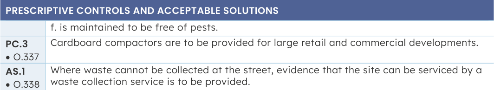
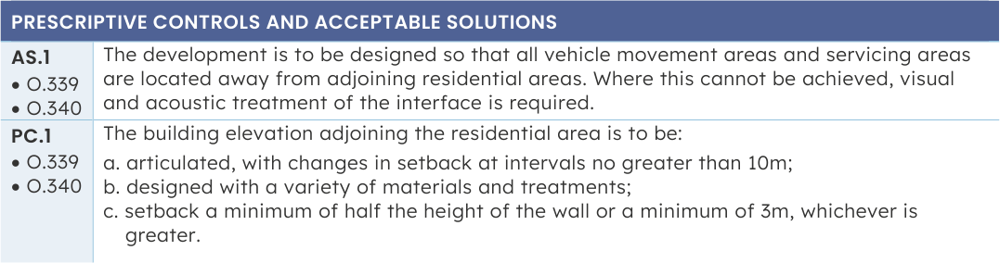
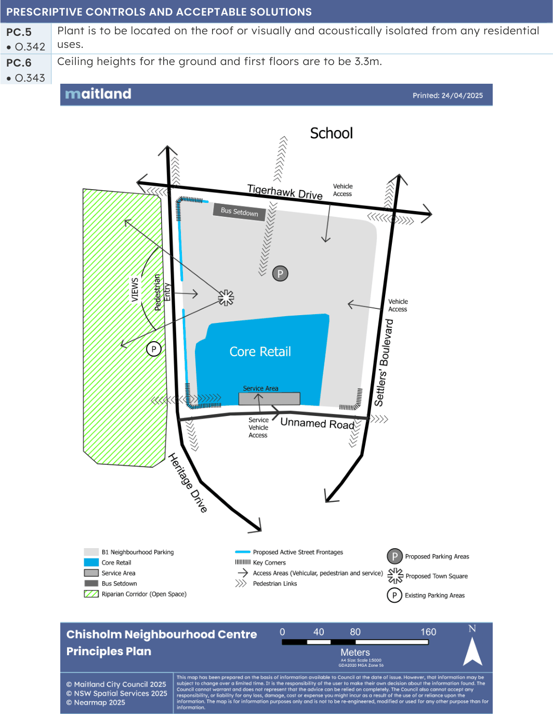
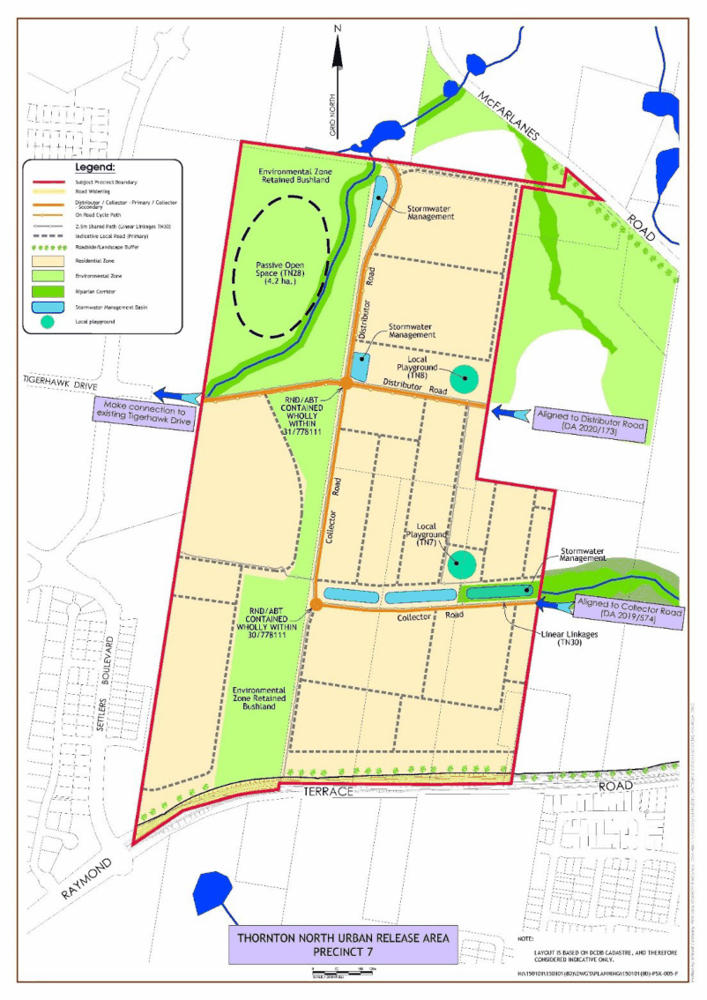

#### 10.4.5.54. Waste Management

#### Objectives

O.336 Waste generation is minimised through design, material selection and building practices.

O.337 Waste management minimisation is encouraged by including source separation, reuse and recycling

facilities.

O.338 Efficient storage and collection of waste and quality design of facilities.

> Words printed on the picture (title and legend, copied from the PDF):
> provided within the development.

#### PRESCRIPTIVE CONTROLS AND ACCEPTABLE SOLUTIONS

Separate storage bins for collection of organic waste and recyclable waste are to be

#### PC.1

Bulk waste is to be stored in a designated area that is physically and visually integrated into the development at ground or sub-basement level that:

#### PC.2

a. is not visible from the street or public domain,

b. is easily accessible to businesses,

c. may be serviced by collection vehicles,

d. has water and drainage facilities for cleaning and maintenance,

e. does not immediately adjoin any onsite employee recreation area, and

> [Picture on page 141: a picture, saved as a picture (images/ch-10-00-special-precincts-locality-plans-and-urban-release-page-141-1.gif, 150 dpi).]
> Words printed on the picture (title and legend, copied from the PDF):
> • O.337
> • O.338

#### PRESCRIPTIVE CONTROLS AND ACCEPTABLE SOLUTIONS

f. is maintained to be free of pests. Cardboard compactors are to be provided for large retail and commercial developments.

#### PC.3

Where waste cannot be collected at the street, evidence that the site can be serviced by a waste collection service is to be provided.

#### AS.1

#### Development adjoining Sensitive Land Uses

#### Objectives

O.339 Commercial and retail development does not unreasonably affect the amenity of adjoining sensitive

uses.

O.340 The interface between business and commercial development and adjoining residential areas is of a

high quality and achieves adequate visual and acoustic privacy.

> [Picture on page 141: a picture, saved as a picture (images/ch-10-00-special-precincts-locality-plans-and-urban-release-page-141-15.gif, 150 dpi).]
> Words printed on the picture (title and legend, copied from the PDF):
> • O.339
> • O.340
> • O.339
> • O.340
> greater.

#### PRESCRIPTIVE CONTROLS AND ACCEPTABLE SOLUTIONS

The development is to be designed so that all vehicle movement areas and servicing areas are located away from adjoining residential areas. Where this cannot be achieved, visual and acoustic treatment of the interface is required.

#### AS.1

The building elevation adjoining the residential area is to be:

#### PC.1

a. articulated, with changes in setback at intervals no greater than 10m;

b. designed with a variety of materials and treatments;

c. setback a minimum of half the height of the wall or a minimum of 3m, whichever is

#### Mixed Use Development

Note: This section applies to mixed-use development within the Chisholm Neighbourhood Centre.

#### Objectives

O.341 Residential development is integrated with compatible retail and commercial uses.

O.342 To ensure that the design of mixed-use developments maintains a reasonable level of residential

amenity and preserves compatibility between uses.

O.343 Flexible building design to accommodate a range of uses and to allow for changes to uses over time

is encouraged.

| PRESCRIPTIVE CONTROLS AND ACCEPTABLE SOLUTIONS |  |
|---|---|
| PC.1 • O.342 | Mixed-use developments are to be designed so that loading bays, garbage collection areas, noise and odour generating aspects of buildings are located away from residential components. |
| PC.2 | Vehicular circulation systems are to differentiate between commercial service requirements, such as loading docks, and residential access. |
| • O.342 |  |
| PC.3 • O.341 | All mixed-use buildings are to be provided with a separate entry to the residential component of the development. The entry must be directly visible from a trafficable street and clearly demarcated from entries to commercial premises. |
| PC.4 | Secure entrances are to be provided to all entrances into private areas, including car parks and internal courtyards. |
| • O.342 |  |
| AS.1 • O.343 | Where possible, acoustic separation between loud commercial uses (such as cafés and restaurants) and residential uses is to be achieved by utilising an intermediate quiet-use barrier, such as offices. |

> [Picture on page 142: a picture, saved as a picture (images/ch-10-00-special-precincts-locality-plans-and-urban-release-page-142-1.gif, 150 dpi).]
> Words printed on the picture (title and legend, copied from the PDF):
> • O.342
> • O.343

#### PRESCRIPTIVE CONTROLS AND ACCEPTABLE SOLUTIONS

Plant is to be located on the roof or visually and acoustically isolated from any residential uses.

#### PC.5

Ceiling heights for the ground and first floors are to be 3.3m.

#### PC.6

#### Figure 10-62: Chisholm Neighbourhood Centre Principles Plan

### Development Requirements – Chisholm Central Precinct

The following section is the Precinct Plan provisions referred to in the general provisions above that applies to the Chisholm Central Precinct. No specific requirements have been made for the following matters within the Chisholm Central Precinct as they are already adequately addressed by other relevant provisions within the Maitland Local Environmental Plan 2011 and the Maitland Development Control Plan 2026:

• Neighbourhood Commercial and Retail Uses

• Provision of Public Facilities and Services

> [Picture on page 143: a picture, saved as a picture (images/ch-10-00-special-precincts-locality-plans-and-urban-release-page-143-9.gif, 150 dpi).]

#### Figure 10-63: Chisholm Central Precinct Plan

#### Objectives

O.344 To provide for the timely and efficient release of urban land making provision for necessary

infrastructure and sequencing.

#### PRESCRIPTIVE CONTROLS AND ACCEPTABLE SOLUTIONS

All development applications for subdivisions are to include a staged construction plan in cases where the development is intended to be constructed in stages.

#### PC.1

• O.344
