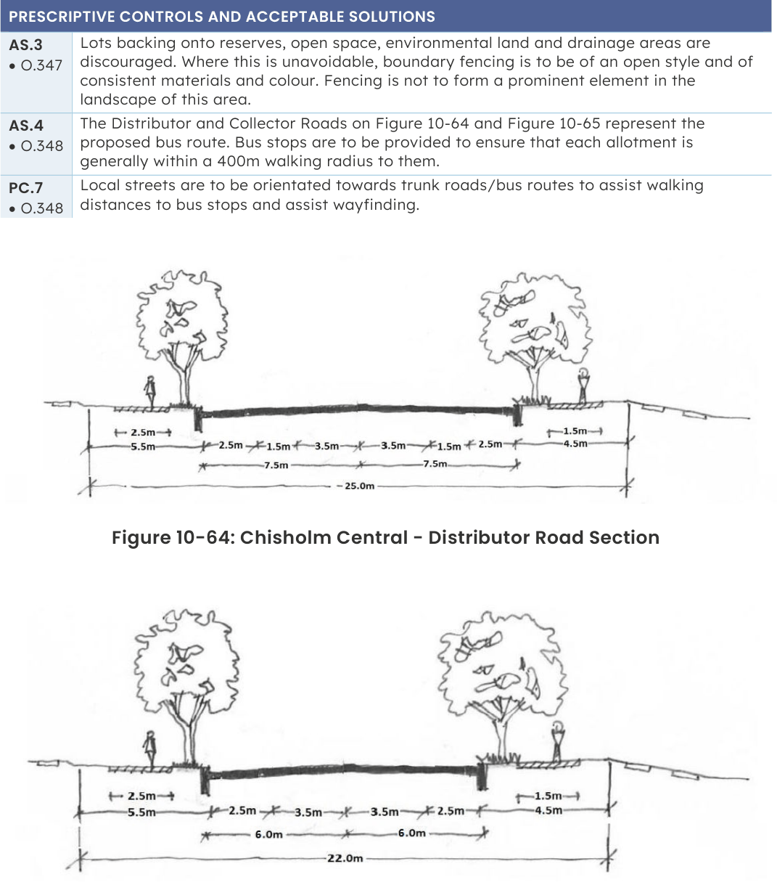

#### 10.4.5.56. Transport Movement Hierarchy

#### Objectives

O.345 To achieve a simple and safe movement system for private vehicles, public transport, pedestrians

and cyclists.

O.346 To provide walkable neighbourhoods with convenient access to neighbourhood shops, community

facilities and other services, with less dependence on cars for travel

O.347 To provide for access generally by way of an interconnected network of streets and paths which

facilitate safe, efficient and pleasant walking, cycling and driving.

O.348 To facilitate new development which supports the efficiency of public transport systems, and

provides safe, direct access to the system for residents.

| PRESCRIPTIVE CONTROLS AND ACCEPTABLE SOLUTIONS |  |
|---|---|
| AS.1 | The layout, hierarchy and design of major streets within the precinct should be generally consistent with Figure 10-63. |
| • O.345 |  |
| AS.2 • O.345 | Adjustments to the location of local roads will be considered as part of the relevant development application where it can be demonstrated they result in improved lot layout and orientation, better integration with adjoining subdivisions, improved pedestrian movements and greater regard for the natural environment. |
| PC.1 | Pedestrian paths, cycleways and off-road shared pathways are to be provided within the Precinct to link the residential areas to proposed playground and passive open space and to link to adjoining precincts generally as shown on Figure 10-63. |
| • O.346 |  |
| • O.347 |  |
| PC.2 • O.347 | A distributor road including on road cycleway and off-road shared pathway are to be provided through the site from Tigerhawk Drive through to the approved developments to the east within the Thornton North – Raymond Terrace Road – Eastern Precinct generally in the location identified on Figure 10-63 (“East/West Distributor Road”). |
| PC.3 • O.347 | A distributor road including on road cycleway and off-road shared pathway, but excluding a dedicated on-road parking lane opposite C3 Environmental Management zoned land, is to be provided from the East/West Distributor Road through to the approved development to the north within the Waterford County North Precinct in the location identified on Figure 10-63 (“North/South Distributor Road”). |
| PC.4 • O.347 | A collector road is to be provided through the site from the approved developments to the east within the Thornton North–Raymond Terrace Road– Eastern Precinct through to the distributor road in the location identified on Figure 10-63. |
| PC.5 • O.347 | Roundabouts, including concrete islands, are to be provided at the intersections of distributor and/or collector roads as shown on Figure 10-63. These are to be contained wholly within one development site. |
| PC.6 | Subdivision design is to provide for lot frontages that address streets, reserves, open space and drainage areas. |
| • O.348 |  |

> [Picture on page 145: a picture, saved as a picture (images/ch-10-00-special-precincts-locality-plans-and-urban-release-page-145-1.gif, 150 dpi).]
> Words printed on the picture (title and legend, copied from the PDF):
> • O.347
> • O.348
> • O.348

#### PRESCRIPTIVE CONTROLS AND ACCEPTABLE SOLUTIONS AS.3

Lots backing onto reserves, open space, environmental land and drainage areas are discouraged. Where this is unavoidable, boundary fencing is to be of an open style and of consistent materials and colour. Fencing is not to form a prominent element in the landscape of this area.

#### AS.4

The Distributor and Collector Roads on Figure 10-64 and Figure 10-65 represent the proposed bus route. Bus stops are to be provided to ensure that each allotment is generally within a 400m walking radius to them. Local streets are to be orientated towards trunk roads/bus routes to assist walking distances to bus stops and assist wayfinding.

#### PC.7

#### Figure 10-64: Chisholm Central - Distributor Road Section

#### Figure 10-65: Chisholm Central - Collector Road Section

#### Objectives

O.349 To soften the visual impact of all built elements, creating attractive and consistent streetscapes

when viewed by passing traffic and pedestrians.

O.350 To establish an attractive visual appearance to the development by street tree planting and

providing additional landscaping in public areas.

O.351 To ensure key environmental areas such as waterways, vegetation, land resources, and areas of

cultural significance and scenic value are protected.

O.352 To provide landscaping appropriate to the nature and scale of development that enhances the local

character and streetscape, supports retention and regeneration of ecological corridors and provides visual interest and a suitable backdrop to the built form.

O.353 To provide landscaped buffers around the site perimeter adjoining major roads.

O.354 To provide a quality landscaped gateway to this part of the Thornton North Release Area.

O.355 To retain appropriate riparian corridors and integrate them with open space.

| PRESCRIPTIVE CONTROLS AND ACCEPTABLE SOLUTIONS |  |
|---|---|
| AS.1 | Landscaping is to be provided in locations generally in accordance with Figure 10-63. |
| • O.349 |  |
| • O.350 |  |
| PC.1 | A detailed landscape strategy is to be provided to address acoustic buffer areas; riparian/drainage corridors; and open space areas generally in accordance with Figure 10- 63. |
| • O.351 |  |
| • O.352 |  |
| • O.353 |  |
| • O.355 |  |
| PC.2 | A vegetation management plan is to be developed prior to the issue of a Subdivision Works Certificate for the riparian/drainage corridors detailing management and enhancement of vegetation communities and habitat. |
| • O.351 |  |
| • O.355 |  |
| PC.3 | The vegetation management plan is to specifically address feed tree species associated with the squirrel glider habitat and include a ‘nest box’ program. |
| • O.354 |  |
| • O.355 |  |
