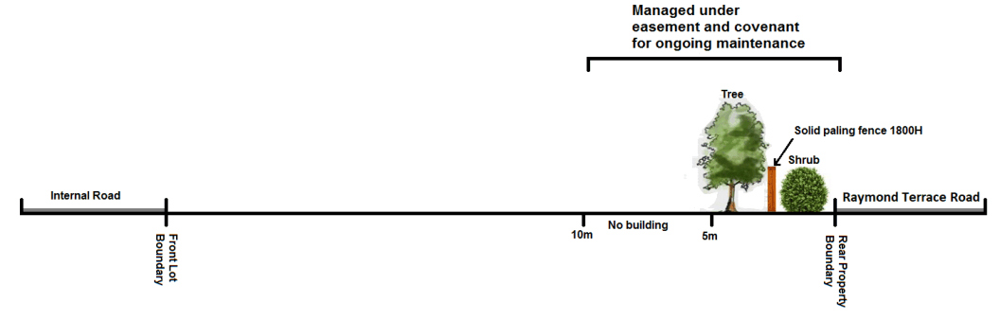
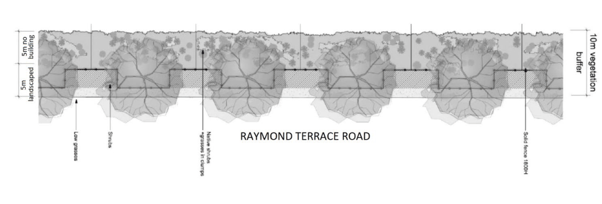

#### 10.4.5.61. Key Development Sites

#### Raymond Terrace Road

#### Objectives

O.365 To ensure that detailed urban design controls are provided for significant development sites.

O.366 To ensure that development does not result in significant detrimental visual impact at a key gateway

to the Thornton North release area.

| PRESCRIPTIVE CONTROLS AND ACCEPTABLE SOLUTIONS |  |
|---|---|
| PC.1 • O.365 • O.366 | A 10m wide landscape buffer is to be provided within the rear of properties adjoining Raymond Terrace Road and can include a combination of earth mounding, acoustic fencing and vegetation in accordance with Figure 10-66 and Figure 10-67. Details are to be submitted with any DA for subdivision of the land. Covenants are to be placed on affected land ensuring ongoing maintenance of the required landscaping and associated structures. |

#### PRESCRIPTIVE CONTROLS AND ACCEPTABLE SOLUTIONS

Individual developments adjacent to Raymond Terrace Road will require an acoustic report for the development of the land that identifies detailed requirements for noise attenuation.

#### PC.2

• O.365

• O.366

> [Picture on page 149: a picture, saved as a picture (images/ch-10-00-special-precincts-locality-plans-and-urban-release-page-149-8.gif, 150 dpi).]

#### Figure 10-66: Chisholm Central - Raymond Terrace Road Landscape Treatment

#### Section

> [Picture on page 149: a picture, saved as a picture (images/ch-10-00-special-precincts-locality-plans-and-urban-release-page-149-11.gif, 150 dpi).]

#### Figure 10-67: Chisholm Central - Raymond Terrace Road Landscape Treatment

#### Plan
