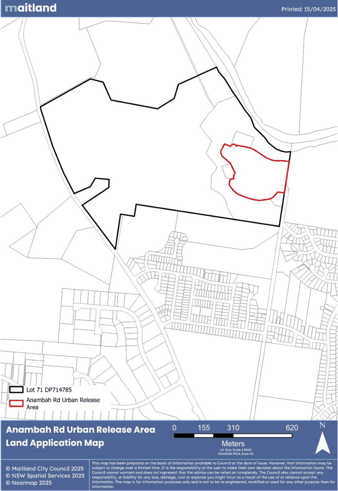
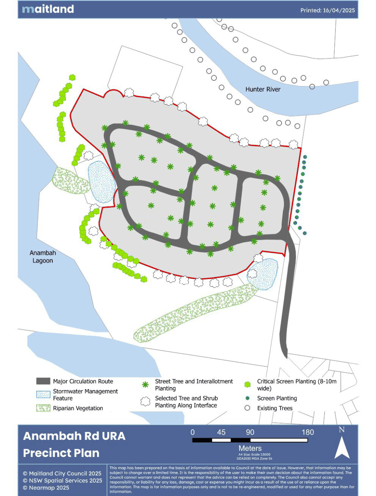
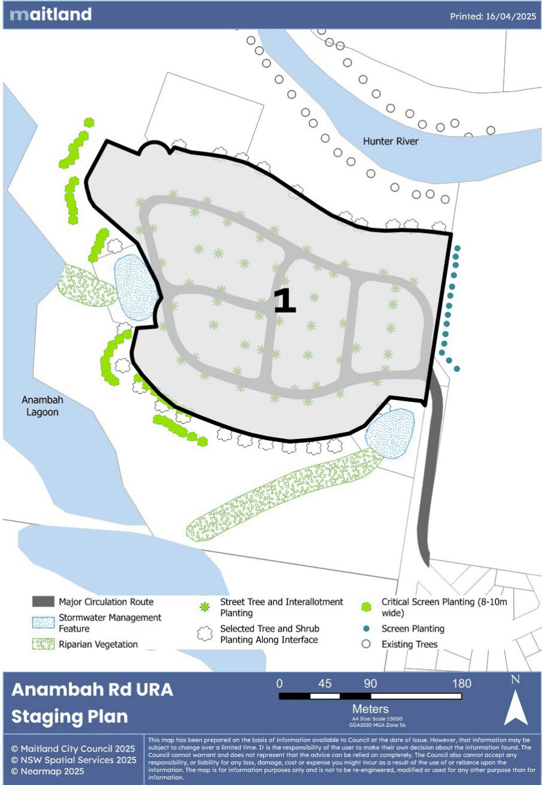

#### 10.4.6. Anambah Road Urban Release Area

> [Picture on page 151: a picture, saved as a picture (images/ch-10-00-special-precincts-locality-plans-and-urban-release-page-151-2.gif, 150 dpi).]

#### Figure 10-68: Anambah Road Urban Release Area

The Anambah Road Urban Release Area has been developed as a low-density residential area with a range of lot sizes that reflect the constraints and opportunities of the site. Multi-dwelling or dual occupancy housing is to ensure that potential impacts to privacy, solar access, visual amenity, and its relationship to the form and type of adjoining development have been taken into account. As there is a scarcity of native vegetation on site, the establishment of additional landscaping will enhance the visual appearance of the area from surrounding urban and rural vantage points.

The Anambah Road Urban Release Area is made up of one precinct, which utilises the general provisions of this section.

> [Picture on page 152: a picture, saved as a picture (images/ch-10-00-special-precincts-locality-plans-and-urban-release-page-152-3.gif, 150 dpi).]

#### Figure 10-69: Anambah Road Urban Release Area Precinct Plan

> [Picture on page 153: a picture, saved as a picture (images/ch-10-00-special-precincts-locality-plans-and-urban-release-page-153-1.gif, 150 dpi).]

#### Figure 10-70: Anambah Road Urban Release Area Staging Plan

No specific requirements have been made for the following matters within the General Provisions for the Anambah Road Urban Release Area as they are already adequately addressed by other relevant provisions within the Maitland Local Environmental Plan 2011 and the Maitland Development Control Plan 2026:

• Transport Movement Hierarchy

• Passive and Active Recreation Areas

• Key Development Sites

• Residential Densities

• Neighbourhood Commercial and Retail Uses
