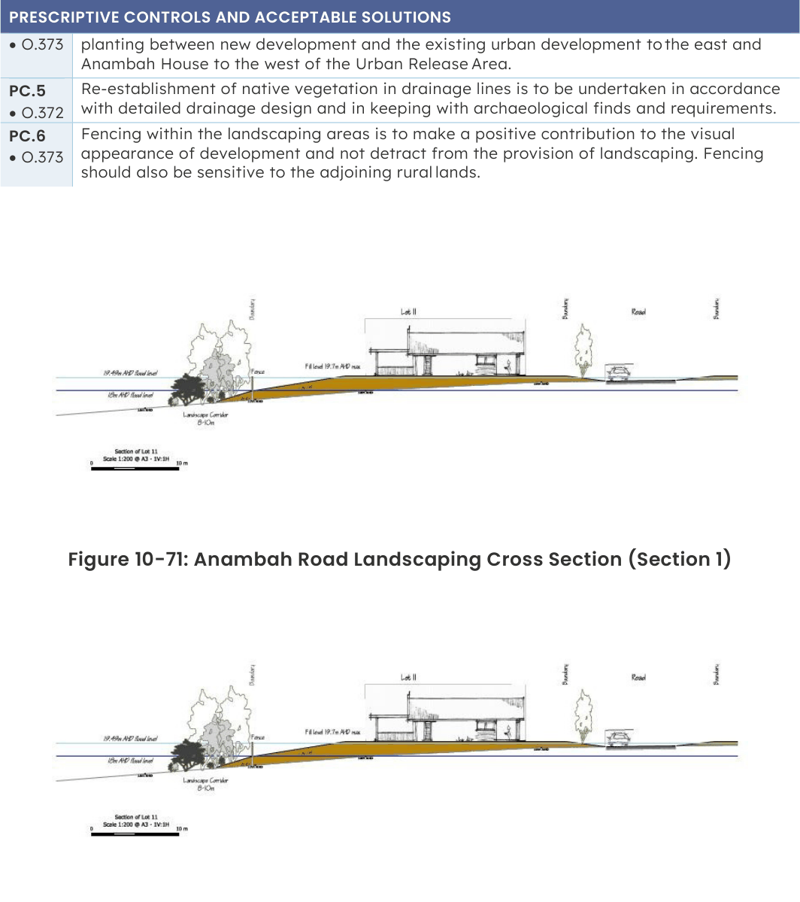

#### 10.4.6.2. Overall Landscaping Strategy

#### Objectives

O.371 To soften the visual impact of all built elements, creating attractive and consistent streetscapes

when viewed by passing traffic and pedestrians.

O.372 To ensure key environmental areas such as waterways, vegetation, land resources, and areas of

cultural significance and scenic value are protected.

O.373 To provide landscaping appropriate to the nature and scale of development that enhances the local

character and streetscape, supports retention and regeneration of ecological corridors and provides visual interest and a suitable backdrop to the built form.

| PRESCRIPTIVE CONTROLS AND ACCEPTABLE SOLUTIONS |  |
|---|---|
| PC.1 | A landscape concept plan is to be submitted with all development applications for subdivision. |
| • O.371 |  |
| • O.372 |  |
| PC.2 • O.371 | Plantings to achieve visual amenity provisions and objectives are to be protected via mechanisms such as protective covenants, use of road or drainage reserves or other options to the satisfaction of the Council. |
| AS.1 | Landscaping and visual amenity provisions should be consistent with drainage designs and archaeological constraints. |
| • O.372 |  |
| PC.3 | Tree and shrub planting, utilising locally occurring native species, are to be in accordance with Figure 10-69 and the Landscaping Cross Sections in Figure 10-71 and Figure 10-72. |
| • O.373 |  |
| AS.2 • O.371 | The use of lightly coloured and/or highly reflective roofing and fencing materials should be avoided to assist in minimising the visual impacts of new development. Consideration is to be given to the use of timber fencing or fencing materials with the following colours preferred: browns; greens; muted yellow; reds and terracotta. Whites and creams should be avoided. |
| PC.4 | Boundary planting to be in accordance with the Precinct Plan and the Landscaping Cross Sections in Figure 10-71 and Figure 10-72, with reference to the provisions of screen |
| • O.372 |  |

> [Picture on page 155: a picture, saved as a picture (images/ch-10-00-special-precincts-locality-plans-and-urban-release-page-155-1.gif, 150 dpi).]
> Words printed on the picture (title and legend, copied from the PDF):
> • O.372
> • O.373

#### PRESCRIPTIVE CONTROLS AND ACCEPTABLE SOLUTIONS

• O.373 planting between new development and the existing urban development to the east and

Anambah House to the west of the Urban Release Area. Re-establishment of native vegetation in drainage lines is to be undertaken in accordance with detailed drainage design and in keeping with archaeological finds and requirements.

#### PC.5 PC.6

Fencing within the landscaping areas is to make a positive contribution to the visual appearance of development and not detract from the provision of landscaping. Fencing should also be sensitive to the adjoining rural lands.

#### Figure 10-71: Anambah Road Landscaping Cross Section (Section 1)

#### Figure 10-72: Anambah Road Landscaping Cross Section (Section 2)

#### Objectives

O.374 To provide for an integrated and sustainable approach to the design and provision of open space

and urban water management.

O.375 To protect and enhance the water quality, water quantity and habitat value of downstream

waterways and environment.

O.376 To prevent erosion and run-off during site preparation, construction and the ongoing use of the land

to minimise cumulative impact on receiving waterways.

| PRESCRIPTIVE CONTROLS AND ACCEPTABLE SOLUTIONS |  |
|---|---|
| PC.1 • O.374 | Stormwater management facilities are to be located in accordance with a stormwater strategy to be submitted with any development application proposing stormwater management facilities and approved by Council. |
| PC.2 | All development applications are to demonstrate that there will no detrimental impacts on receiving waters, namely Anambah Lagoon and Hunter River, as a result of new development. |
| • O.375 |  |
| • O.376 |  |
