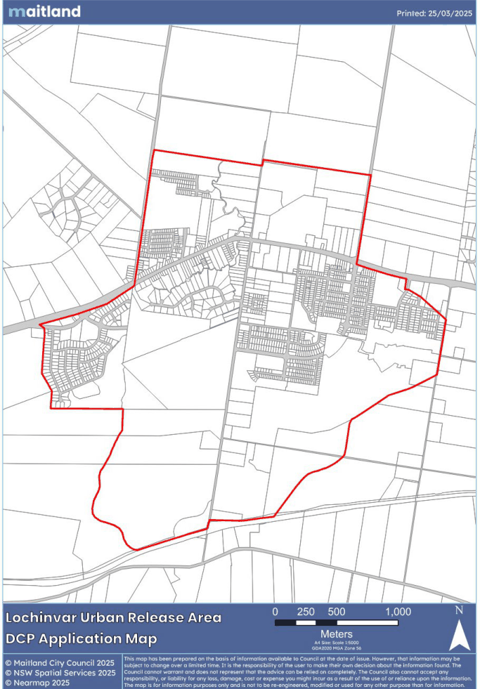
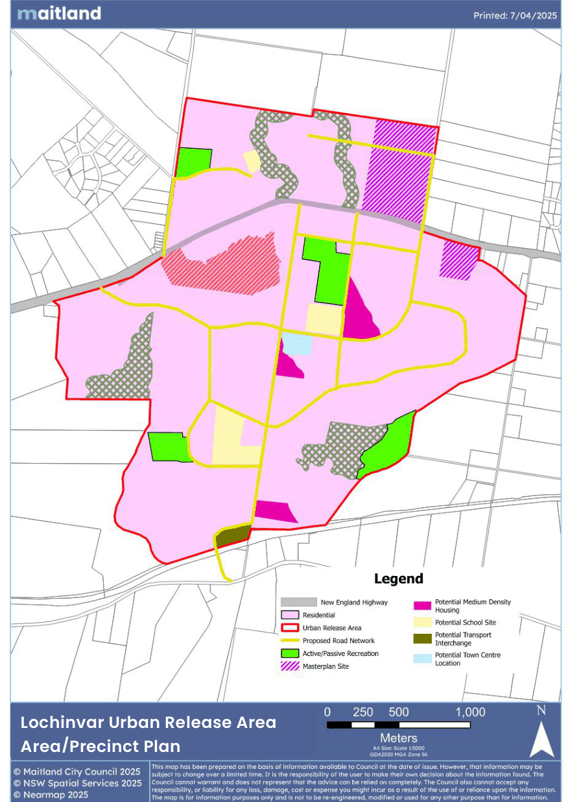
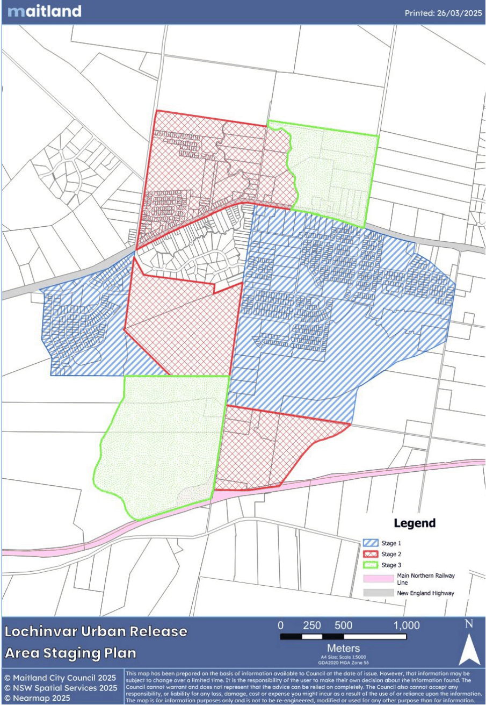

#### 10.4.7. Lochinvar Urban Release Area

> [Picture on page 157: a picture, saved as a picture (images/ch-10-00-special-precincts-locality-plans-and-urban-release-page-157-2.gif, 150 dpi).]

#### Figure 10-73: Lochinvar Urban Release Area

The Lochinvar Urban Release Area (URA) comprises a total of 650 hectares of land, with an approximate residential yield of 5,000 lots. The Lower Hunter Regional Strategy (Department of Planning, 2006) identified the Lochinvar URA as a regionally significant development area and as a key site to achieve the dwelling targets for population growth in the Lower Hunter. This identification has been transformed as part of the Hunter Regional Plan 2041 (Department of Planning & Environment, 2022) into forming the western end of the ‘New England Growth Corridor’, an area of concentrated urban release areas that stretch from Lochinvar to Rutherford. The proximity of the Lochinvar URA to regional transport systems, including the Main Northern Railway Line, the New England Highway and the Hunter Expressway, are key elements to the identification of this area for urban development. A Structure Plan was adopted by Council in 2007 for the Lochinvar URA, while a site-specific Section 7.11 Contributions Plan has also been prepared for this URA.

#### Lochinvar Area/Precinct Plan

The Lochinvar Urban Release Area is made up of one precinct, which utilises the general provisions of

> [Picture on page 158: a picture, saved as a picture (images/ch-10-00-special-precincts-locality-plans-and-urban-release-page-158-3.gif, 150 dpi).]

this section.

#### Lochinvar Urban Release Area

#### Area/Precinct Plan

#### Figure 10-74: Lochinvar URA Area/Precinct Plan

> [Picture on page 159: a picture, saved as a picture (images/ch-10-00-special-precincts-locality-plans-and-urban-release-page-159-1.gif, 150 dpi).]

#### Figure 10-75: Lochinvar Urban Release Area Staging Plan

No specific requirements have been made for the following matters within the General Provisions for the Lochinvar Urban Release Area as they are already adequately addressed by other relevant provisions within the Maitland Local Environmental Plan 2011 and the Maitland Development Control Plan 2026:

• Residential Densities
