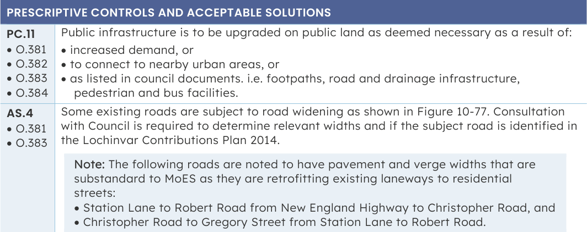
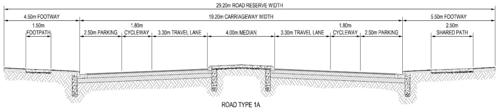
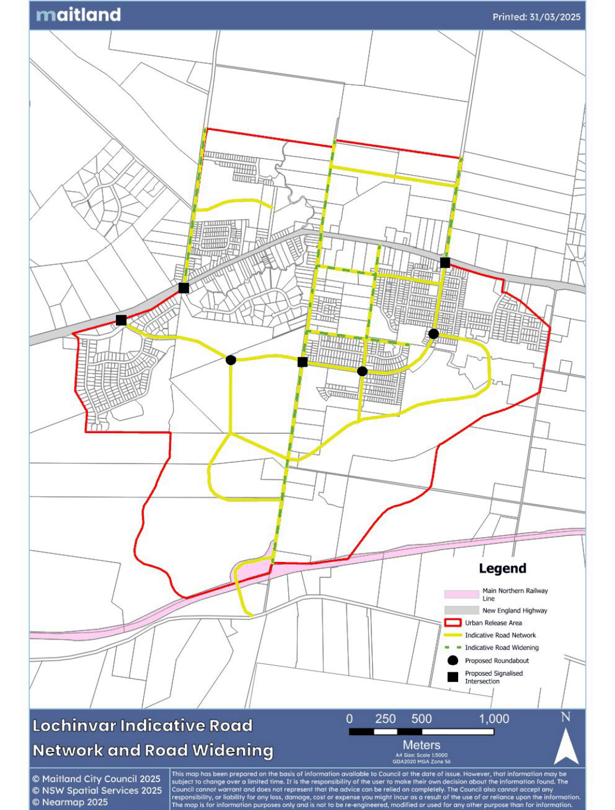
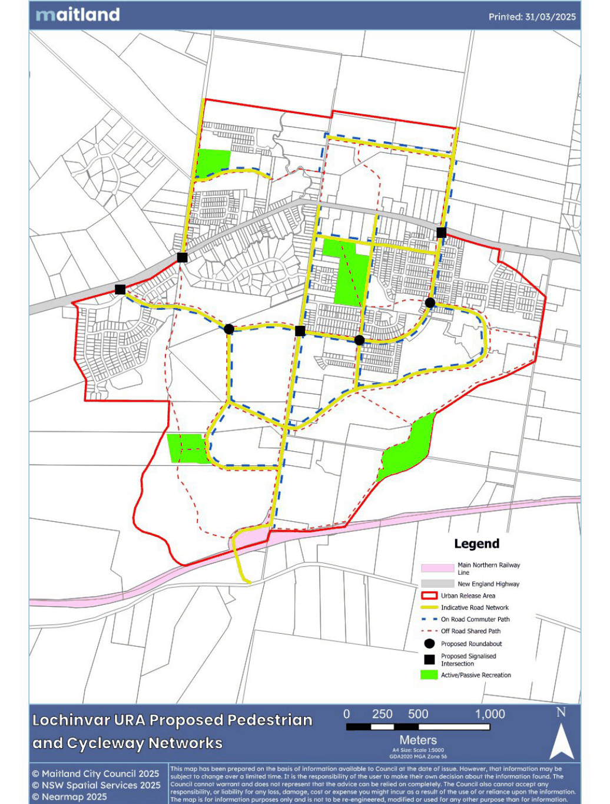
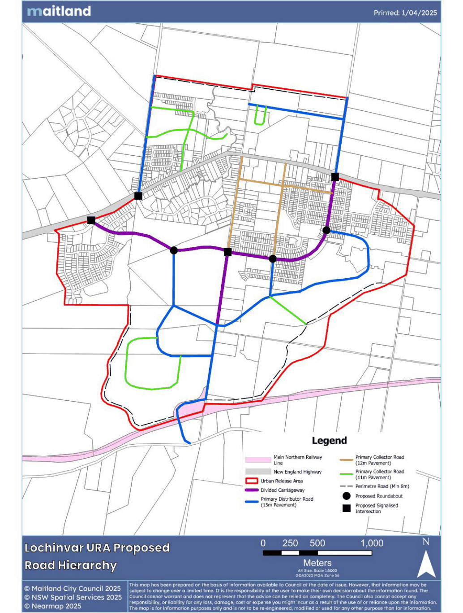
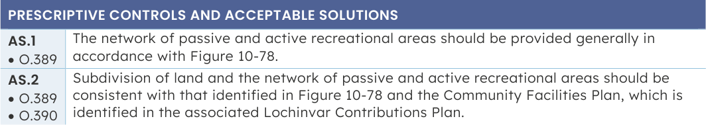

#### 10.4.7.2. Transport Movement Hierarchy

#### Objectives

O.381 To achieve a simple and safe movement system for private vehicles, public transport, pedestrians

and cyclists.

O.382 To provide walkable neighbourhoods with convenient access to neighbourhood shops, community

facilities and other services, with less dependence on cars for travel.

O.383 To provide for access generally by way of an interconnected network of streets and paths which

facilitate safe, efficient and pleasant walking, cycling and driving.

O.384 To facilitate new development which supports the efficiency of public transport systems, and

provides safe, direct access to the system for residents.

#### PRESCRIPTIVE CONTROLS AND ACCEPTABLE SOLUTIONS

The overall movement hierarchy for each Development Application for urban development should be consistent with Figure 10-77 and Figure 10-78.

#### AS.1

• O.381

• O.382

| PRESCRIPTIVE CONTROLS AND ACCEPTABLE SOLUTIONS |  |
|---|---|
| • O.383 |  |
| • O.384 |  |
| AS.2 | The overall pedestrian and cycleway links should be consistent with Figure 10-78, and the Recreation and Community Facilities Plan, which is identified in the associated Lochinvar Contributions Plan. |
| • O.381 |  |
| • O.382 |  |
| • O.383 |  |
| PC.1 | The primary access for residential development in Stage 1 of the Lochinvar Urban Release Area is to be provided off the New England Highway, in accordance with Figure 10-77. |
| • O.381 |  |
| • O.383 |  |
| PC.2 | Perimeter roads as per Figure 10-79 are to have a minimum pavement width of 8m. Pavement width may need to be increased subject to lot catchment yield. Additional parking in between the road pavement and off-road shared path are to be provided at points of interest, e.g. parks, open space. |
| • O.381 |  |
| • O.382 |  |
| • O.383 |  |
| • O.384 |  |
| PC.3 | No new lot is to have direct vehicular access to the New England Highway or Winders Lane. |
| • O.381 |  |
| • O.383 |  |
| • O.384 |  |
| AS.3 | Subdivisions adjacent to the New England Highway should orientate allotments and dwellings to face the main road, with suitable internal roads providing access, and suitable landscaping separating the allotment boundaries and main road. |
| • O.381 |  |
| • O.382 |  |
| • O.384 |  |
| PC.4 • O.382 | Development Applications are to consider the proximity of the nominated community facilities and recreation areas identified in the subject DCP chapter and the relevant Lochinvar Contributions Plan when designing subdivision layouts and movement linkages between adjoining sites. |
| PC.5 | Land is to be developed in walkable distances of up to 400m to a bus route, pedestrian network and local park, to promote sustainable communities. |
| • O.382 |  |
| • O.384 |  |
| PC.6 | Development Applications must incorporate road networks that support the overarching traffic study for the Lochinvar URA in accordance with Figure 10-77, Figure 10-78 and Figure 10-79 of this DCP. |
| • O.381 |  |
| • O.382 |  |
| • O.383 |  |
| PC.7 | Traffic management facilities for the Lochinvar URA are to be provided in accordance with Figure 10-77 and the relevant provisions of the Lochinvar Contributions Plan. |
| • O.381 |  |
| PC.8 | The subdivision layout is to provide well connected and multiple route options for all modes of transport (pedestrian, cycle, bus and vehicle). The design of pedestrian, cycle and bus routes will take precedence over vehicle routes. The provision of roads suitable for bus services is to provide for an adaptable growing network. |
| • O.381 |  |
| • O.382 |  |
| • O.383 |  |
| • O.384 |  |
| PC.9 | Bus routes are to be provided in a manner that facilitates 400m maximum walking distance for primary routes, with bus stop locations generally being spaced 300m apart. |
| • O.381 |  |
| • O.384 |  |
| PC.10 | Proposed Medium or Large subdivision is to provide transport infrastructure such as pedestrian facilities (i.e. refuges/crossing points, footpath and cycle routes) and bus facilities (i.e. laybys, stops, shelters) for future and current school and public bus services. |
| • O.381 |  |
| • O.382 |  |
| • O.383 |  |
| • O.384 |  |

> [Picture on page 162: a picture, saved as a picture (images/ch-10-00-special-precincts-locality-plans-and-urban-release-page-162-1.gif, 150 dpi).]
> Words printed on the picture (title and legend, copied from the PDF):
> pedestrian and bus facilities.
> • O.381
> • O.382
> • O.383
> • O.384
> • O.381
> • O.383
> streets:

#### PRESCRIPTIVE CONTROLS AND ACCEPTABLE SOLUTIONS

Public infrastructure is to be upgraded on public land as deemed necessary as a result of:

• increased demand, or

• to connect to nearby urban areas, or

• as listed in council documents. i.e. footpaths, road and drainage infrastructure,

#### PC.11

Some existing roads are subject to road widening as shown in Figure 10-77. Consultation with Council is required to determine relevant widths and if the subject road is identified in the Lochinvar Contributions Plan 2014.

#### AS.4

Note: The following roads are noted to have pavement and verge widths that are substandard to MoES as they are retrofitting existing laneways to residential

• Station Lane to Robert Road from New England Highway to Christopher Road, and

• Christopher Road to Gregory Street from Station Lane to Robert Road.

> [Picture on page 162: a picture, saved as a picture (images/ch-10-00-special-precincts-locality-plans-and-urban-release-page-162-16.gif, 150 dpi).]

#### Figure 10-76: Lochinvar URA - Cross-Section for Divided Carriageway.

> [Picture on page 163: a picture, saved as a picture (images/ch-10-00-special-precincts-locality-plans-and-urban-release-page-163-1.gif, 150 dpi).]

#### Figure 10-77: Lochinvar URA Proposed Road Network and Road Widening

> [Picture on page 164: a picture, saved as a picture (images/ch-10-00-special-precincts-locality-plans-and-urban-release-page-164-1.gif, 150 dpi).]

#### Figure 10-78: Lochinvar URA Pedestrian and Cycleway Networks

> [Picture on page 165: a picture, saved as a picture (images/ch-10-00-special-precincts-locality-plans-and-urban-release-page-165-1.gif, 150 dpi).]

#### Figure 10-79: Lochinvar URA Proposed Road Hierarchy and Bus Routes

#### Objectives

O.385 To soften the visual impact of all built elements, creating attractive and consistent streetscapes

when viewed by passing traffic and pedestrians.

O.386 To ensure key environmental areas such as waterways, vegetation, land resources, and areas of

cultural significance and scenic value are protected.

O.387 To provide landscaping appropriate to the nature and scale of development that enhances the local

character and streetscape, supports retention and regeneration of ecological corridors and provides visual interest and a suitable backdrop to the built form.

O.388 A series of residential neighbourhoods are to be designed throughout the Urban Release Area to

create a sense of identity, through distinct landscape and built form elements.

| PRESCRIPTIVE CONTROLS AND ACCEPTABLE SOLUTIONS |  |
|---|---|
| PC.1 • O.385 • O.386 • O.387 | Each Development Application for a new Medium or Major subdivision is to include a landscaping strategy for the protection and enhancement of riparian areas and remnant vegetation, visually prominent locations, noise sensitive areas, and detailed landscaping requirements for the public and private realm. Note: Medium subdivisions are defined as the creation of 10 – 49 new lots, and/or where a new road is required. Major subdivisions are defined as the creation of 50 or more new lots. Refer to Chapter 5: Subdivision for further information. |
| PC.2 • O.385 | Landscaping is to be provided on land adjacent to major intersections, all collector roads, Station Lane, Northern access roads and Southern Ring Road so as to soften the visual impact of all built elements, creating attractive streetscapes when viewed by passing traffic and pedestrians. |
| AS.1 | Avenue type plantings should be provided on the western and eastern approaches into Lochinvar along the New England Highway. |
| • O.385 |  |
| • O.387 |  |
| • O.388 |  |
| PC.3 • O.387 • O.388 | Where applicable, the landscaping strategy is to provide a 15m landscaping buffer adjoining the Southern extent of the Freeman Drive large lot residential subdivision, within the nominated ‘Freeman Drive 15m vegetation buffer’ shown in Figure 10-81. |
| PC.4 • O.386 | The landscaping strategy is to provide extensive tree planting to the edge of existing riparian areas, with visual breaks where streets terminate in views to the riparian areas. |
| PC.5 • O.385 • O.387 | Subdivision design is to have regard to the integration of existing residences within the Lochinvar URA with any new development, including, where deemed necessary, the provision of suitable landscape treatments to provide visual relief and minor separation distance between existing and future residential developments. |
| PC.6 • O.385 • O.386 | Subdivision and housing design is to take advantage of significant and attractive views overlooking the surrounding rural lands by orienting streets and locating public space to capture views. |
| PC.7 • O.386 • O.387 | Future subdivision design is to incorporate the remnant areas of native vegetation within the Lochinvar URA into the character and design of the development and provide for links between areas of remnant vegetation, creating improved habitat value and filter strips along watercourses. |
| PC.8 • O.386 • O.387 | Future development and landscaping is to recognise the cultural plantings located at St Helena (along the New England Highway) and Clifton, and where necessary, is to be designed to complement rather than compete with established features. |

#### Objectives

O.389 To ensure that neighbourhoods have conveniently located open space areas that offer a range of

recreational opportunities for residents, accessible within walking distance from each residence.

O.390 To provide a safe and appropriate level of pedestrian and cycleway access linking new development

with established urban areas, parks and public transport, including a mix of on-road and off-road cycle routes.

> [Picture on page 167: a picture, saved as a picture (images/ch-10-00-special-precincts-locality-plans-and-urban-release-page-167-7.gif, 150 dpi).]
> Words printed on the picture (title and legend, copied from the PDF):
> • O.389
> • O.389
> • O.390

#### PRESCRIPTIVE CONTROLS AND ACCEPTABLE SOLUTIONS

The network of passive and active recreational areas should be provided generally in accordance with Figure 10-78.

#### AS.1

Subdivision of land and the network of passive and active recreational areas should be consistent with that identified in Figure 10-78 and the Community Facilities Plan, which is identified in the associated Lochinvar Contributions Plan.

#### AS.2
