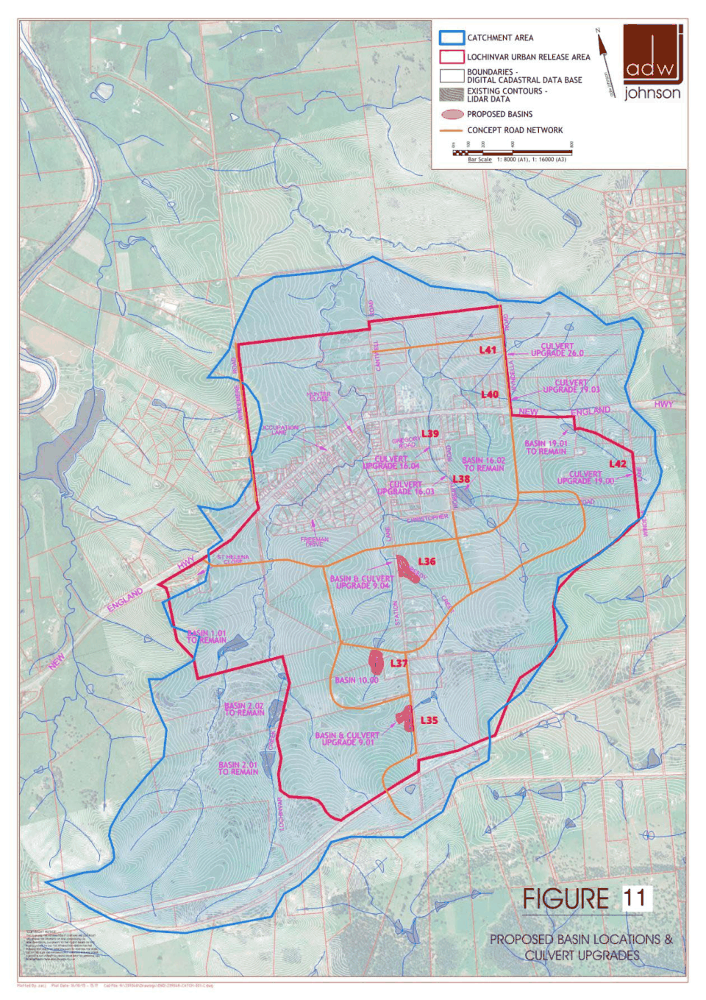
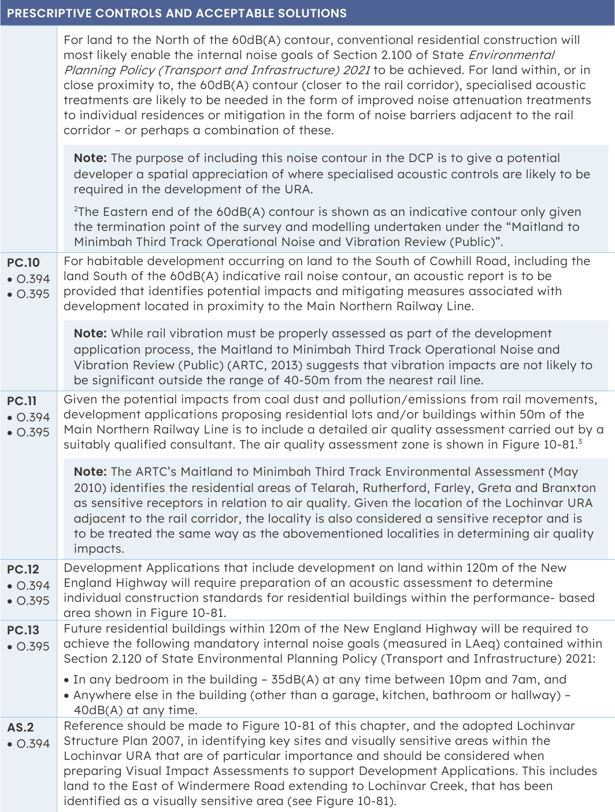
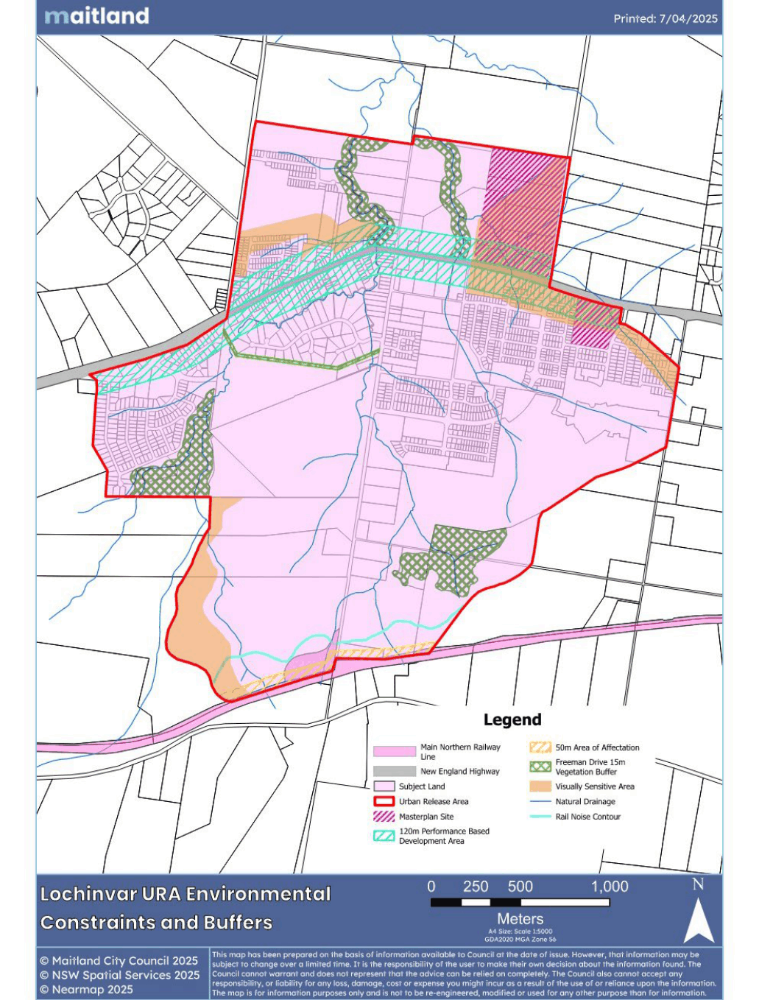

#### 10.4.7.5. Stormwater and Water Quality

#### Objectives

O.391 To provide for an integrated and sustainable approach to the design and provision of open space

and urban water management.

O.392 To protect and enhance the water quality, water quantity and habitat value of downstream

waterways and environment.

O.393 To prevent erosion and run-off during site preparation, construction and the ongoing use of the land

to minimise cumulative impact on receiving waterways.

| PRESCRIPTIVE CONTROLS AND ACCEPTABLE SOLUTIONS |  |
|---|---|
| PC.1 | The stormwater and water quality management controls are to be consistent with the principles of Water Sensitive Urban Design (WSUD) Targets in accordance with Council’s MoES. |
| • O.391 |  |
| • O.392 |  |
| • O.393 |  |
| AS.1 | The number and location of WSUD elements should be determined by modelling to develop the WSUD strategy for the site and be integrated with the overall design and wider catchment. |
| • O.391 |  |
| • O.392 |  |
| PC.2 | Long-term maintenance costs are to be identified in the design of the WSUD elements and are to be submitted to Council for consideration prior to acceptance of the WSUD strategy. |
| • O.391 |  |
| • O.392 |  |
| PC.4 • O.391 • O.392 | Development applications are to identify stormwater detention areas in accordance with the nominated locations identified in Figure 10-80. Note: the locations of the stormwater detention basins form part of the wider trunk drainage network, to which developers will be required to make contributions under the Lochinvar Contributions Plan 2014. |
| PC.5 • O.391 • O.392 | Stormwater calculations are to be based upon the ultimate development state of the catchment. The time of concentration is the time from the most remote section part of the catchment to the catchment outlet. (i.e. from the top of Greedy Creek and Lochinvar Creek to the New England Highway). |
| PC. 6 • O.392 | No development is to occur in the Greedy Creek or Lochinvar Creek catchments unless sufficient regional basin(s) are constructed to mitigate any impacts on Hunter Close catchment. |

| PRESCRIPTIVE CONTROLS AND ACCEPTABLE SOLUTIONS |  |
|---|---|
| AS.2 | Minimum road widths may need to be increased on account of WSUD features such as swales. |
| • O.392 |  |
| • O.393 |  |
| AS.3 | Swales may be accepted where it can be demonstrated that they will meet Council’s performance and maintenance objectives and facilitate safe and effective movement of pedestrians and vehicles. |
| • O.392 |  |
| • O.393 |  |
| AS.4 | Swales may be considered on the outside of perimeter roads where no residential access is provided. These swales are not to exceed 4% gradient. |
| • O.392 |  |
| • O.393 |  |
| PC.7 | Flow control measures are to be used where grades in swales exceed 4%. |
| • O.392 |  |
| • O.393 |  |
| AS.5 | Where practical, WSUD elements may be incorporated in a centre depressed median of dual carriage roads. |
| • O.392 |  |
| • O.393 |  |
| AS.6 • O.391 • O.392 | Wherever possible, existing natural drainage gullies should form part of a stormwater and runoff drainage management system. Detention basins and / or wetlands to alleviate stormwater peaks and retain pollutants can be considered on-line only for 1st and 2nd order streams. |
| AS.7 • O.391 • O.392 | Wetlands should adhere to the following design criteria: a. be designed to create an attractive and safe amenity, and be highly visible for both the adjoining residents and passers-by, b. walking paths should have frequent contact adjacent to the wetland edge, c. vegetation should be planted such that generous unobstructed view of the wetland is available, d. emergent macrophytes should be minimal and manageable, e. slopes surrounding wetlands should be gentle and offer convenient tractor-mowing access, and f. flat grassed areas that potentially may be water-logged should be avoided. |
| PC.8 | Gullies intended to be left in their natural state are to be assessed, and if necessary enhanced in a manner that reduces the need for maintenance. |
| • O.391 |  |
| • O.392 |  |
| • O.393 |  |

> [Picture on page 169: a picture, saved as a picture (images/ch-10-00-special-precincts-locality-plans-and-urban-release-page-169-1.gif, 150 dpi).]

#### Figure 10-80: Proposed basin locations and culvert upgrades

#### Objectives

O.394 Amelioration of natural and environmental hazards, including bushfire, flooding and site

contamination and, in relation to natural hazards, the safe occupation of, and the evacuation from, any land so affected is achieved.

O.395 To ensure that future residential development is not adversely affected by any noise and vibration

from incompatible land uses, including road and rail corridors.

| PRESCRIPTIVE CONTROLS AND ACCEPTABLE SOLUTIONS |  |
|---|---|
| PC.1 | Development Applications are to provide for the amelioration of natural and environmental hazards, including bushfire, flooding and site contamination. |
| • O.394 |  |
| PC.2 | Development Applications will need to consider the safe occupation and evacuation from any natural hazards relating to the site. |
| • O.394 |  |
| PC.3 • O.394 | Submission of a bushfire threat assessment prepared by a qualified person is a requirement for any Development Application involving bushfire prone land within the Lochinvar URA. The assessment is to be of a quality to the satisfaction of Council. |
| PC.4 | Development Applications will need to prepare a geotechnical investigation report for the site investigating soil salinity levels, soil structure/stability and Acid Sulfate Soils. |
| • O.394 |  |
| PC.5 • O.394 | Development Applications for Medium and Major Subdivisions are to include a Preliminary Site Investigation (PSI) for the development. Any PSI undertaken should have regard to the site contamination assessment completed by Barker Harle Pty Ltd submitted with the rezoning proposal for the Lochinvar URA. Note: A Detailed Site Investigation (DSI) and Remediation Action Plan (RAP) may be required based on the PSI’s findings. |
| PC.6 • O.394 | The affected areas of those sites in the Northern extent of the Lochinvar URA that are prone to inundation as a result of either: a. the 1:100 Annual Exceedance Probability (AEP) plus 0.5m freeboard, or b. localised storm event flooding from Lochinvar Creek, are not to be further developed for residential purposes. |
| PC.7 • O.394 | Impacts from localised storm event flooding generated from Lochinvar Creek are to be considered as part of relevant Development Applications within the Lochinvar Creek Catchment, with reference to the overarching stormwater and flood study for the Lochinvar URA prepared by ADW Johnson (2015) as a basis for determining impacts from future development in the URA. |
| PC.8 • O.395 | Subdivision design and lot layout must ensure that any future residential housing will not be adversely affected by noise or vibrations from rail movements along the Main Northern Railway Line or from vehicle movements along the New England Highway. |
| PC.9 • O.395 | Rail noise is expected to impact the Southern extent of the Lochinvar URA, predominantly to the South of Cow Hill Road. The following design criteria is required for houses located in this region: a. Future residential buildings will be required to achieve the following mandatory internal noise goals (measured in LAeq) contained within Section 2.100 of State Environmental Planning Policy (Transport and Infrastructure) 2021: • In any bedroom in the building – 35dB(A) at any time between 10pm and 7am, and • Anywhere else in the building (other than a garage, kitchen, bathroom or hallway) – 40dB(A) at any time. b. An external amenity noise target of 80dB Lamax. |
| AS.1 • O.395 | Figure 10-81 shows the extent of the 60dB(A) Leq 9hr (night-time 2022) noise contour as extracted from the Australian Rail and Track Corporation Maitland to Minimbah Third Track Operational Noise and Vibration Review (Public) (June 2013)2. |

> [Picture on page 171: a picture, saved as a picture (images/ch-10-00-special-precincts-locality-plans-and-urban-release-page-171-1.gif, 150 dpi).]
> Words printed on the picture (title and legend, copied from the PDF):
> • O.394
> • O.395
> • O.394
> • O.395
> impacts.
> • O.394
> • O.395
> • O.395
> 40dB(A) at any time.
> • O.394

#### PRESCRIPTIVE CONTROLS AND ACCEPTABLE SOLUTIONS

For land to the North of the 60dB(A) contour, conventional residential construction will most likely enable the internal noise goals of Section 2.100 of State Environmental Planning Policy (Transport and Infrastructure) 2021 to be achieved. For land within, or in close proximity to, the 60dB(A) contour (closer to the rail corridor), specialised acoustic treatments are likely to be needed in the form of improved noise attenuation treatments to individual residences or mitigation in the form of noise barriers adjacent to the rail corridor – or perhaps a combination of these.

Note: The purpose of including this noise contour in the DCP is to give a potential

developer a spatial appreciation of where specialised acoustic controls are likely to be required in the development of the URA. 2The Eastern end of the 60dB(A) contour is shown as an indicative contour only given the termination point of the survey and modelling undertaken under the “Maitland to Minimbah Third Track Operational Noise and Vibration Review (Public)”.

#### PC.10

For habitable development occurring on land to the South of Cowhill Road, including the land South of the 60dB(A) indicative rail noise contour, an acoustic report is to be provided that identifies potential impacts and mitigating measures associated with development located in proximity to the Main Northern Railway Line.

Note: While rail vibration must be properly assessed as part of the development

application process, the Maitland to Minimbah Third Track Operational Noise and Vibration Review (Public) (ARTC, 2013) suggests that vibration impacts are not likely to be significant outside the range of 40-50m from the nearest rail line.

#### PC.11

Given the potential impacts from coal dust and pollution/emissions from rail movements, development applications proposing residential lots and/or buildings within 50m of the Main Northern Railway Line is to include a detailed air quality assessment carried out by a suitably qualified consultant. The air quality assessment zone is shown in Figure 10-81.3

Note: The ARTC’s Maitland to Minimbah Third Track Environmental Assessment (May

2010\) identifies the residential areas of Telarah, Rutherford, Farley, Greta and Branxton as sensitive receptors in relation to air quality. Given the location of the Lochinvar URA adjacent to the rail corridor, the locality is also considered a sensitive receptor and is to be treated the same way as the abovementioned localities in determining air quality

#### PC.12

Development Applications that include development on land within 120m of the New England Highway will require preparation of an acoustic assessment to determine individual construction standards for residential buildings within the performance- based area shown in Figure 10-81.

#### PC.13

Future residential buildings within 120m of the New England Highway will be required to achieve the following mandatory internal noise goals (measured in LAeq) contained within Section 2.120 of State Environmental Planning Policy (Transport and Infrastructure) 2021:

• In any bedroom in the building – 35dB(A) at any time between 10pm and 7am, and

• Anywhere else in the building (other than a garage, kitchen, bathroom or hallway) –

#### AS.2

Reference should be made to Figure 10-81 of this chapter, and the adopted Lochinvar Structure Plan 2007, in identifying key sites and visually sensitive areas within the Lochinvar URA that are of particular importance and should be considered when preparing Visual Impact Assessments to support Development Applications. This includes land to the East of Windermere Road extending to Lochinvar Creek, that has been identified as a visually sensitive area (see Figure 10-81).

| PRESCRIPTIVE CONTROLS AND ACCEPTABLE SOLUTIONS Consideration should also be given to any nearby master planned sites (see Figure 10-74) visually prominent features from the New England Highway, including: of Lochinvar, Homestead and cultural tree plantings, College St Joseph’s Campus, Church, Church, Hill/Winders Hill/Summer Hill, and that include land adjoining the New England Highway are to mechanisms for managing the interface between residential England Highway. This is to be informed by a visual impact which is determined by the scale of the proposed the rural amenity and entrance into Lochinvar. |
|---|
| AS.3 • O.394 and • Airds • St Helena • All Saints • St Patrick’s • Holy Trinity • Davron Hill/Jacobs • Greta Reserve. |
| PC.14 Development Applications • O.394 employ appropriate development and the New assessment (the complexity of development), in order to preserve |

> [Picture on page 173: a picture, saved as a picture (images/ch-10-00-special-precincts-locality-plans-and-urban-release-page-173-1.gif, 150 dpi).]

#### Figure 10-81: Lochinvar URA Constraints and Buffers
