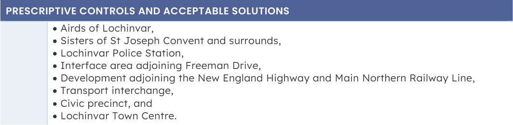
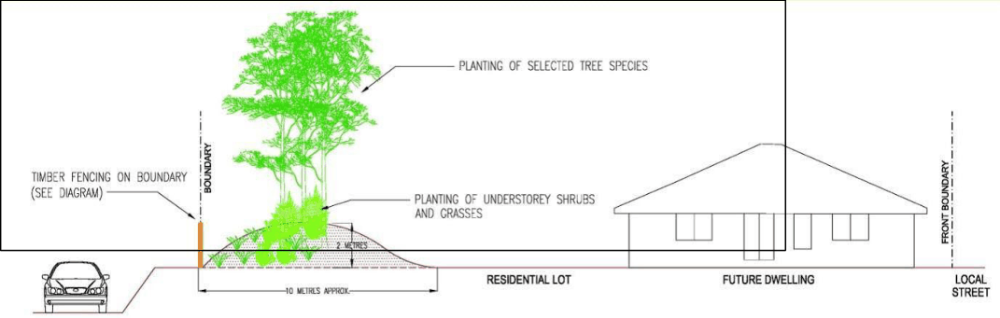
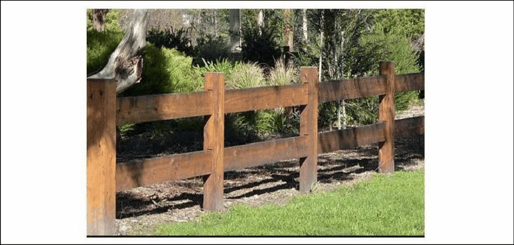

#### 10.4.7.8. Key Development Sites

#### Objectives

O.398 To ensure that detailed urban design controls are provided for significant development sites.

| PRESCRIPTIVE CONTROLS AND ACCEPTABLE SOLUTIONS |  |
|---|---|
| PC.1 • O.398 | Detailed urban design controls (including traffic management requirements and car parking designs where appropriate) are to be provided for the following Key Development Sites: • Schools, libraries and community facilities, • Gateway sites, • St Helena Village, |

> [Picture on page 175: a picture, saved as a picture (images/ch-10-00-special-precincts-locality-plans-and-urban-release-page-175-1.gif, 150 dpi).]
> Words printed on the picture (title and legend, copied from the PDF):
> • Airds of Lochinvar,
> • Lochinvar Police Station,
> • Transport interchange,
> • Civic precinct, and
> • Lochinvar Town Centre.

#### PRESCRIPTIVE CONTROLS AND ACCEPTABLE SOLUTIONS

• Sisters of St Joseph Convent and surrounds,

• Interface area adjoining Freeman Drive,

• Development adjoining the New England Highway and Main Northern Railway Line,

#### Adjoining land zoned for environmental protection

| PRESCRIPTIVE CONTROLS AND ACCEPTABLE SOLUTIONS |  |
|---|---|
| PC.2 • O.398 | Any development or works within, or adjacent to the land zoned C3 Environmental Management are to ensure clearing of vegetation is minimised, to the satisfaction of Council. |
| PC.3 • O.398 | Mechanisms are to be put in place with development to ensure the integrity and protection of established vegetation and riparian areas zoned C3 Environmental Management. Details of how vegetation and riparian areas are proposed to be managed are to be included in all Development Applications affecting the C3 Environmental Management zone. |
| PC.4 • O.398 | Development within residential zones must be designed and planned to ensure any Asset Protection Zones (APZs) and the like are not required or needed in the C3 Environmental Management zone. |
| PC.5 | Any APZs must be accommodated wholly within residential zones and are not to extend into the C3 Environmental Management zone. |
| • O.398 |  |

#### Interface area south of Freeman Drive

| PRESCRIPTIVE CONTROLS AND ACCEPTABLE SOLUTIONS |  |
|---|---|
| PC.6 • O.398 | Development on land adjoining the existing Freeman Drive subdivision to the South must be suitably located and designed so as to maintain view corridors and minimise any impacts on the existing neighbourhood amenity. |
| PC.7 • O.398 | A vegetation buffer for the purposes of screening and visual amenity must be provided and maintained for a depth of 15m (within the ‘no development’ buffer) from the rear of existing allotments currently serviced by Freeman Drive identified in Figure 10-81. |

#### Land adjoining the New England Highway and Winders Lane

| PRESCRIPTIVE CONTROLS AND ACCEPTABLE SOLUTIONS |  |
|---|---|
| PC.8 | No direct access will be permitted to the New England Highway or Winders Lane for new residential allotments. |
| • O.398 |  |
| PC.9 • O.398 | A landscape buffer, wholly contained within the allotments to be developed adjoining the New England Highway and Winders Lane, is to be implemented for: a. all allotments adjoining the New England Highway between Robert Road and the Eastern extent of the Lochinvar Urban Release Area that adjoins the New England Highway, and b. all allotments adjoining Winders Lane. |
| PC.10 | The landscape buffer adjoining the New England Highway is to include design elements and construction materials that assist with reducing traffic noise generated from vehicles |
| • O.398 |  |

| PRESCRIPTIVE CONTROLS AND ACCEPTABLE SOLUTIONS along the New England Highway. These design elements and construction materials must identified in a landscape plan supporting any Development Application upon land so respective landscape buffers adjoining the New England Highway and Winders Lane wholly contained within the affected allotments, with maintenance of the buffer being the responsibility of the individual owners of the respective 10-82 and Figure 10-83 illustrate the typical cross-section and possible for the affected land. New England Highway landscape buffer will be dependent on the undertaken for land within the ‘120 metre performance-based 10-81 of this DCP chapter, and, where applicable, the results of relating to the land. the New England Highway a minimum distance of 30m. are to be designed to be of sufficient depth to footprint. |
|---|
| be affected. |
| PC.11 The • O.398 are to be landscape allotments. Figure fencing arrangements |
| PC.12 The dimensions of the • O.398 results of acoustic modelling area’ illustrated in Figure any Visual Impact Assessment |
| PC.13 Dwellings are to be set back from • O.398 Residential allotments in this locality accommodate this set back and dwelling |

#### Airds of Lochinvar

| PRESCRIPTIVE CONTROLS AND ACCEPTABLE SOLUTIONS Any Development Application involving the ‘Airds of Lochinvar’ site is to incorporate appropriate mechanisms to enable the continued functioning of the ‘Airds of Lochinvar’ as a locally significant commercial premises, as the building and its surrounds are as a masterplan site (Figure 10-74). Only limited commercial activities at the site (as permitted in the R1 General Residential zone). |
|---|
| PC.14 • O.398 building identified are supported |

> [Picture on page 177: a picture, saved as a picture (images/ch-10-00-special-precincts-locality-plans-and-urban-release-page-177-1.gif, 150 dpi).]

#### Figure 10-82: Landscape Buffer Typical Cross Section for Allotments Adjoining

#### the New England Highway and Winders Lane.

> [Picture on page 177: a picture, saved as a picture (images/ch-10-00-special-precincts-locality-plans-and-urban-release-page-177-4.gif, 150 dpi).]

Figure 10-83: Typical Timber Boundary Fencing for Allotments Adjoining the

#### New England Highway and Winders Lane.

#### Objectives

O.399 To accommodate and control appropriate neighbourhood commercial and retail uses.

O.400 To foster a sense of community and strong local identity and sense of place in neighbourhoods.

| PRESCRIPTIVE CONTROLS AND ACCEPTABLE SOLUTIONS |  |
|---|---|
| AS.1 • O.399 | Development Applications that propose commercial and retail uses adjacent to residential uses are to consider buffers or screening to reduce noise, vibration and/or lighting impacts. |
| PC.2 • O.399 • O.400 | Any Development Application that includes the land nominated for neighbourhood shops north of the New England Highway will need to address issues such as traffic and access, potential intersection locations, carparking, signage and other pertinent elements associated with commercial development in the locality. |
| PC.3 | The Development Application for the future Lochinvar Town Centre is to include detailed urban design controls (including traffic management requirements and carparking designs). |
| • O.399 |  |
| • O.400 |  |
