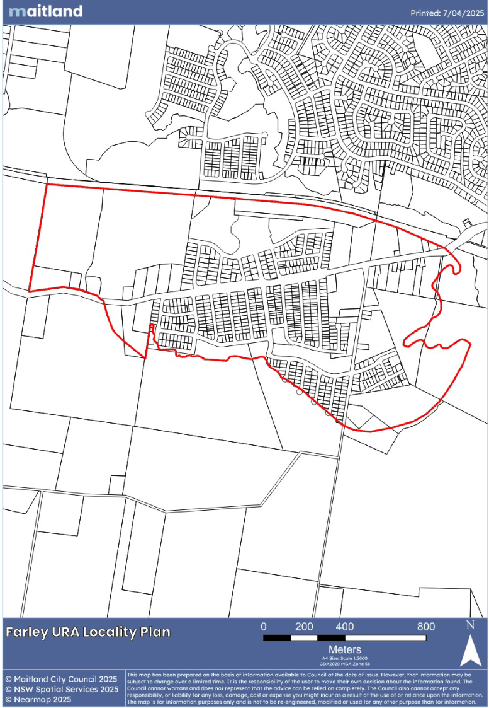
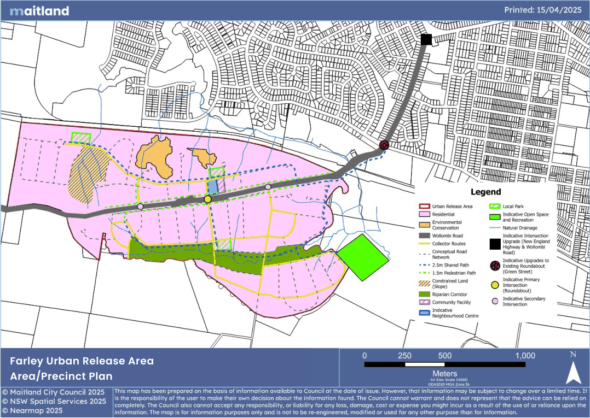
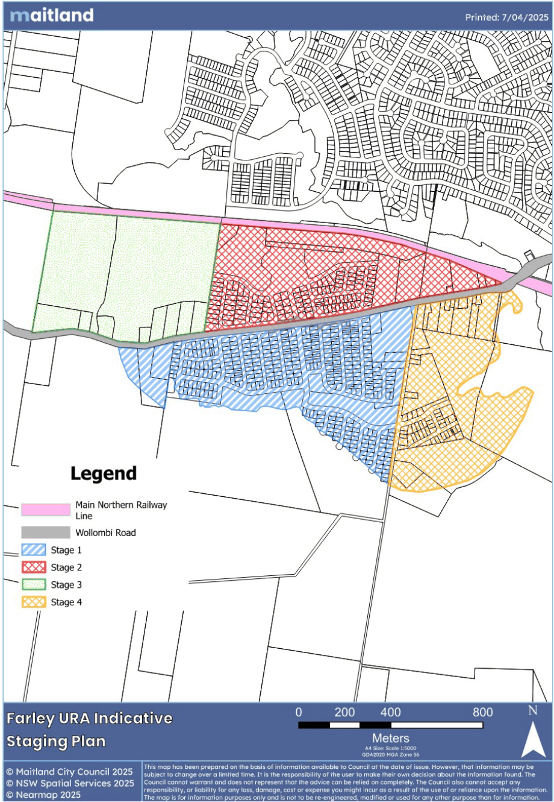

#### 10.4.8. Farley Urban Release Area

> [Picture on page 179: a picture, saved as a picture (images/ch-10-00-special-precincts-locality-plans-and-urban-release-page-179-2.gif, 150 dpi).]

#### Figure 10-84: Farley Urban Release Area

The Farley Urban Release Area (URA) comprises of a total of 160 hectares of land, with an approximate residential yield of 1,500 lots. The Lower Hunter Regional Strategy (Department of Planning, 2006) identified the Farley URA as a regionally significant development area and a key site to achieve the dwelling targets for population growth in the Lower Hunter. Further development within the Maitland LGA and the establishment of Farley as a residential suburb in years since has seen the URA integrated into the New England Growth Corridor as part of the Hunter Regional Plan 2041 (Department of Planning and Environment, 2022).

The Farley URA is located immediately South of the Main Northern Railway Line. While no railway station currently exists at Farley, the proximity of the Farley URA to regional transport systems including the New England Highway and the Hunter Expressway are key elements to the identification of this area for urban development.

#### Farley Area/Precinct Plan

The Farley Urban Release Area is made up of one precinct, which utilises the general provisions of this section.

> [Picture on page 180: a picture, saved as a picture (images/ch-10-00-special-precincts-locality-plans-and-urban-release-page-180-8.gif, 150 dpi).]
> Words printed on the picture (title and legend, copied from the PDF):
> Farley Urban Release Area
> Area/Precinct Plan

#### Figure 10-85: Farley Area/Precinct Plan

> [Picture on page 181: a picture, saved as a picture (images/ch-10-00-special-precincts-locality-plans-and-urban-release-page-181-1.gif, 150 dpi).]

#### Figure 10-86: Farley URA Staging Plan

No specific requirements have been made for the following matters within the General Provisions for the Farley Urban Release Area as they are already adequately addressed by other relevant provisions within the Maitland Local Environmental Plan 2011 and the Maitland Development Control Plan 2026:

• Residential Densities
