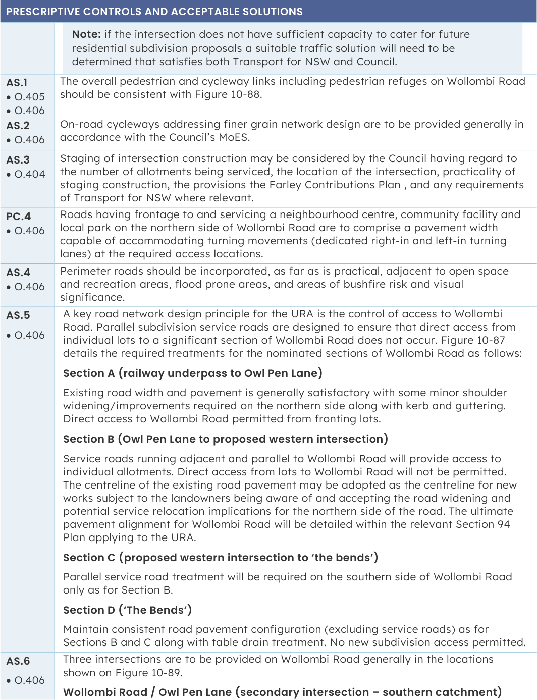
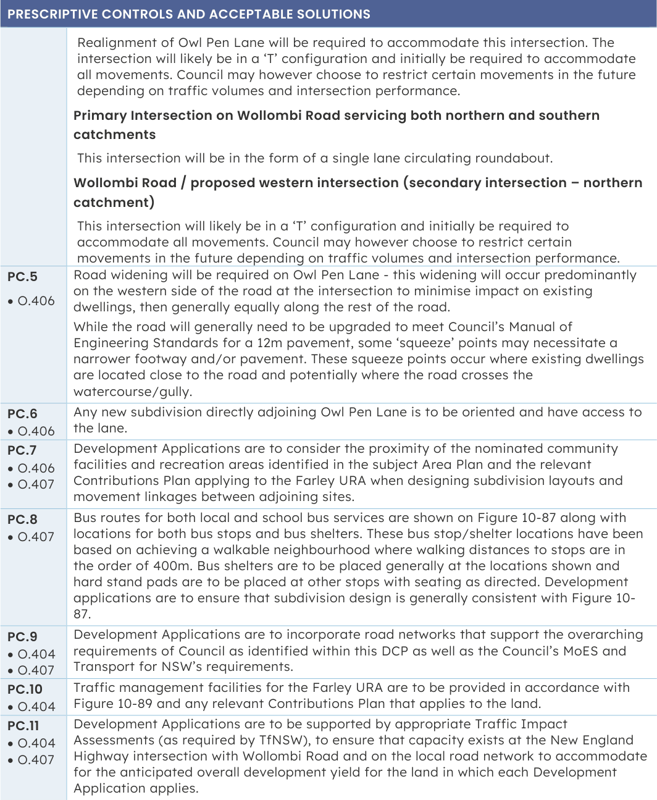
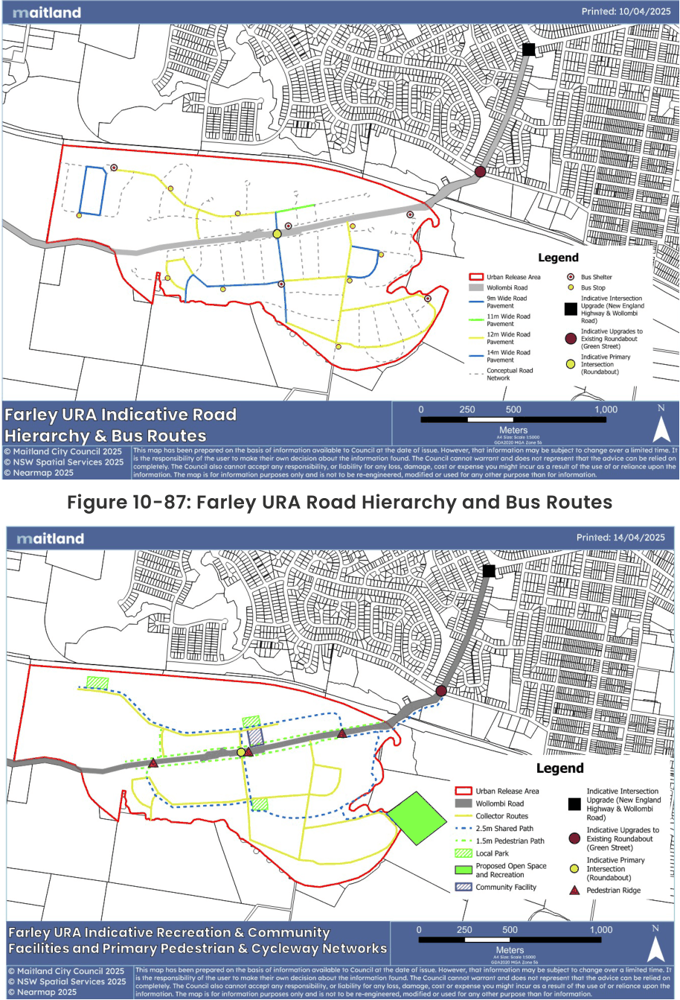
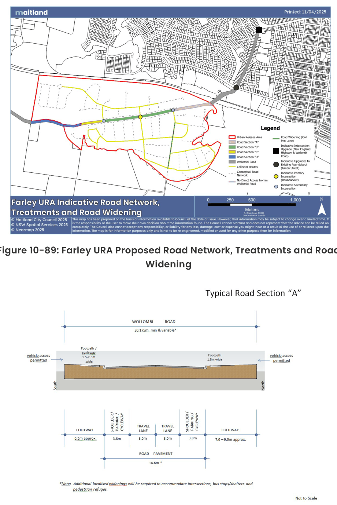
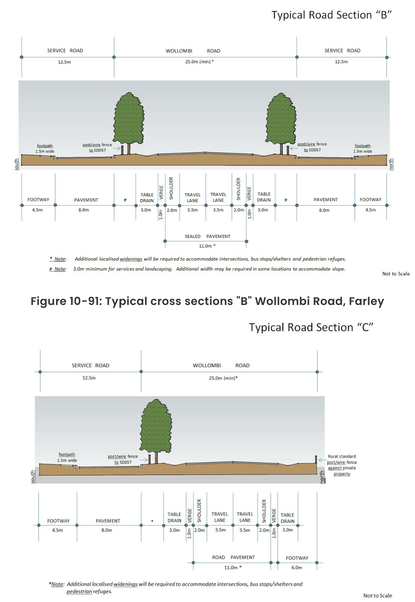
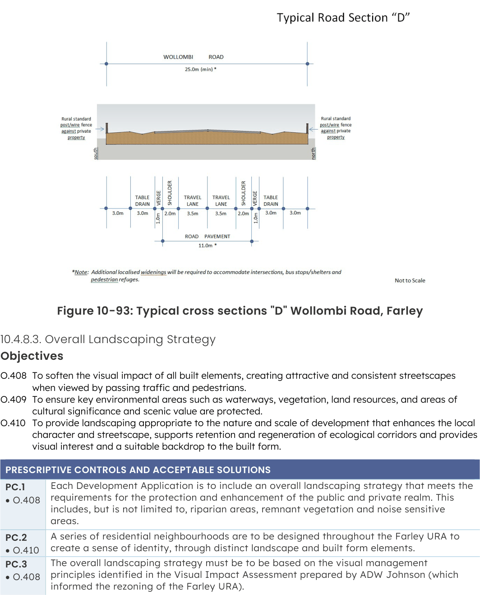

#### 10.4.8.2. Transport Movement Hierarchy

#### Objectives

O.404 To achieve a simple and safe movement system for private vehicles, public transport, pedestrians

and cyclists.

O.405 To provide walkable neighbourhoods with convenient access to neighbourhood shops, community

facilities and other services, with less dependence on cars for travel

O.406 To provide for access generally by way of an interconnected network of streets and paths which

facilitate safe, efficient and pleasant walking, cycling and driving.

O.407 To facilitate new development which supports the efficiency of public transport systems, and

provides safe, direct access to the system for residents.

| PRESCRIPTIVE CONTROLS AND ACCEPTABLE SOLUTIONS |  |
|---|---|
| PC.1 • O.404 | Development applications are to incorporate a transport movement hierarchy showing the major circulation routes and connections to achieve a simple and safe movement system for private vehicles, public transport, pedestrians and cyclists. The transport movement hierarchy is to be generally in accordance with Figure 10-87. |
| PC.2 • O.404 | The subdivision staging must consider the timely connection of the road network to adjoining properties and/or stages generally before completion of 75% of the developable lot area. |
| PC.3 • O.404 • O.407 | Any future residential subdivision will require a Transport Impact Assessment that demonstrates sufficient capacity at the intersection of the New England Highway and Wollombi Road. |

> [Picture on page 183: a picture, saved as a picture (images/ch-10-00-special-precincts-locality-plans-and-urban-release-page-183-1.gif, 150 dpi).]
> Words printed on the picture (title and legend, copied from the PDF):
> • O.405
> • O.406
> • O.406
> • O.404
> • O.406
> • O.406
> • O.406
> shown on Figure 10-89.
> • O.406

#### PRESCRIPTIVE CONTROLS AND ACCEPTABLE SOLUTIONS

Note: if the intersection does not have sufficient capacity to cater for future

residential subdivision proposals a suitable traffic solution will need to be determined that satisfies both Transport for NSW and Council. The overall pedestrian and cycleway links including pedestrian refuges on Wollombi Road should be consistent with Figure 10-88.

#### AS.1

On-road cycleways addressing finer grain network design are to be provided generally in accordance with the Council’s MoES.

#### AS.2

#### AS.3

Staging of intersection construction may be considered by the Council having regard to the number of allotments being serviced, the location of the intersection, practicality of staging construction, the provisions the Farley Contributions Plan , and any requirements of Transport for NSW where relevant.

#### PC.4

Roads having frontage to and servicing a neighbourhood centre, community facility and local park on the northern side of Wollombi Road are to comprise a pavement width capable of accommodating turning movements (dedicated right-in and left-in turning lanes) at the required access locations.

#### AS.4

Perimeter roads should be incorporated, as far as is practical, adjacent to open space and recreation areas, flood prone areas, and areas of bushfire risk and visual significance.

#### AS.5

A key road network design principle for the URA is the control of access to Wollombi Road. Parallel subdivision service roads are designed to ensure that direct access from individual lots to a significant section of Wollombi Road does not occur. Figure 10-87 details the required treatments for the nominated sections of Wollombi Road as follows:

#### Section A (railway underpass to Owl Pen Lane)

Existing road width and pavement is generally satisfactory with some minor shoulder widening/improvements required on the northern side along with kerb and guttering. Direct access to Wollombi Road permitted from fronting lots.

#### Section B (Owl Pen Lane to proposed western intersection)

Service roads running adjacent and parallel to Wollombi Road will provide access to individual allotments. Direct access from lots to Wollombi Road will not be permitted. The centreline of the existing road pavement may be adopted as the centreline for new works subject to the landowners being aware of and accepting the road widening and potential service relocation implications for the northern side of the road. The ultimate pavement alignment for Wollombi Road will be detailed within the relevant Section 94 Plan applying to the URA.

#### Section C (proposed western intersection to ‘the bends’)

Parallel service road treatment will be required on the southern side of Wollombi Road only as for Section B.

#### Section D (‘The Bends’)

Maintain consistent road pavement configuration (excluding service roads) as for Sections B and C along with table drain treatment. No new subdivision access permitted.

#### AS.6

Three intersections are to be provided on Wollombi Road generally in the locations

#### Wollombi Road / Owl Pen Lane (secondary intersection – southern catchment)

> [Picture on page 184: a picture, saved as a picture (images/ch-10-00-special-precincts-locality-plans-and-urban-release-page-184-1.gif, 150 dpi).]
> Words printed on the picture (title and legend, copied from the PDF):
> • O.406

#### PRESCRIPTIVE CONTROLS AND ACCEPTABLE SOLUTIONS

Realignment of Owl Pen Lane will be required to accommodate this intersection. The intersection will likely be in a ‘T’ configuration and initially be required to accommodate all movements. Council may however choose to restrict certain movements in the future depending on traffic volumes and intersection performance.

#### Primary Intersection on Wollombi Road servicing both northern and southern

catchments This intersection will be in the form of a single lane circulating roundabout. Wollombi Road / proposed western intersection (secondary intersection – northern

catchment) This intersection will likely be in a ‘T’ configuration and initially be required to accommodate all movements. Council may however choose to restrict certain movements in the future depending on traffic volumes and intersection performance.

#### PC.5

Road widening will be required on Owl Pen Lane - this widening will occur predominantly on the western side of the road at the intersection to minimise impact on existing dwellings, then generally equally along the rest of the road. While the road will generally need to be upgraded to meet Council’s Manual of Engineering Standards for a 12m pavement, some ‘squeeze’ points may necessitate a narrower footway and/or pavement. These squeeze points occur where existing dwellings are located close to the road and potentially where the road crosses the watercourse/gully.

| PC.6 | Any new subdivision directly adjoining Owl Pen Lane is to be oriented and have access to |
|---|---|
| • O.406 | the lane. |
| PC.7 | Development Applications are to consider the proximity of the nominated community |
| • O.406 | facilities and recreation areas identified in the subject Area Plan and the relevant |
| • O.407 | Contributions Plan applying to the Farley URA when designing subdivision layouts and movement linkages between adjoining sites. |
| PC.8 | Bus routes for both local and school bus services are shown on Figure 10-87 along with |
| • O.407 | locations for both bus stops and bus shelters. These bus stop/shelter locations have been based on achieving a walkable neighbourhood where walking distances to stops are in the order of 400m. Bus shelters are to be placed generally at the locations shown and hard stand pads are to be placed at other stops with seating as directed. Development applications are to ensure that subdivision design is generally consistent with Figure 10- 87. |
| PC.9 | Development Applications are to incorporate road networks that support the overarching |
| • O.404 | requirements of Council as identified within this DCP as well as the Council’s MoES and |
| • O.407 | Transport for NSW’s requirements. |
| PC.10 | Traffic management facilities for the Farley URA are to be provided in accordance with |
| • O.404 | Figure 10-89 and any relevant Contributions Plan that applies to the land. |
| PC.11 | Development Applications are to be supported by appropriate Traffic Impact |
| • O.404 | Assessments (as required by TfNSW), to ensure that capacity exists at the New England |
| • O.407 | Highway intersection with Wollombi Road and on the local road network to accommodate for the anticipated overall development yield for the land in which each Development Application applies. |

> [Picture on page 185: a picture, saved as a picture (images/ch-10-00-special-precincts-locality-plans-and-urban-release-page-185-1.gif, 150 dpi).]

#### Figure 10-87: Farley URA Road Hierarchy and Bus Routes

Figure 10-88: Farley URA Proposed Recreation and Community Facilities and

#### Active Links

> [Picture on page 186: a picture, saved as a picture (images/ch-10-00-special-precincts-locality-plans-and-urban-release-page-186-1.gif, 150 dpi).]

#### Figure 10-89: Farley URA Proposed Road Network, Treatments and Road

#### Widening

#### Figure 10-90: Typical cross sections "A" Wollombi Road, Farley

> [Picture on page 187: a picture, saved as a picture (images/ch-10-00-special-precincts-locality-plans-and-urban-release-page-187-1.gif, 150 dpi).]

#### Figure 10-91: Typical cross sections "B" Wollombi Road, Farley

#### Figure 10-92: Typical cross sections "C" Wollombi Road, Farley

> [Picture on page 188: a picture, saved as a picture (images/ch-10-00-special-precincts-locality-plans-and-urban-release-page-188-1.gif, 150 dpi).]

#### Figure 10-93: Typical cross sections "D" Wollombi Road, Farley
