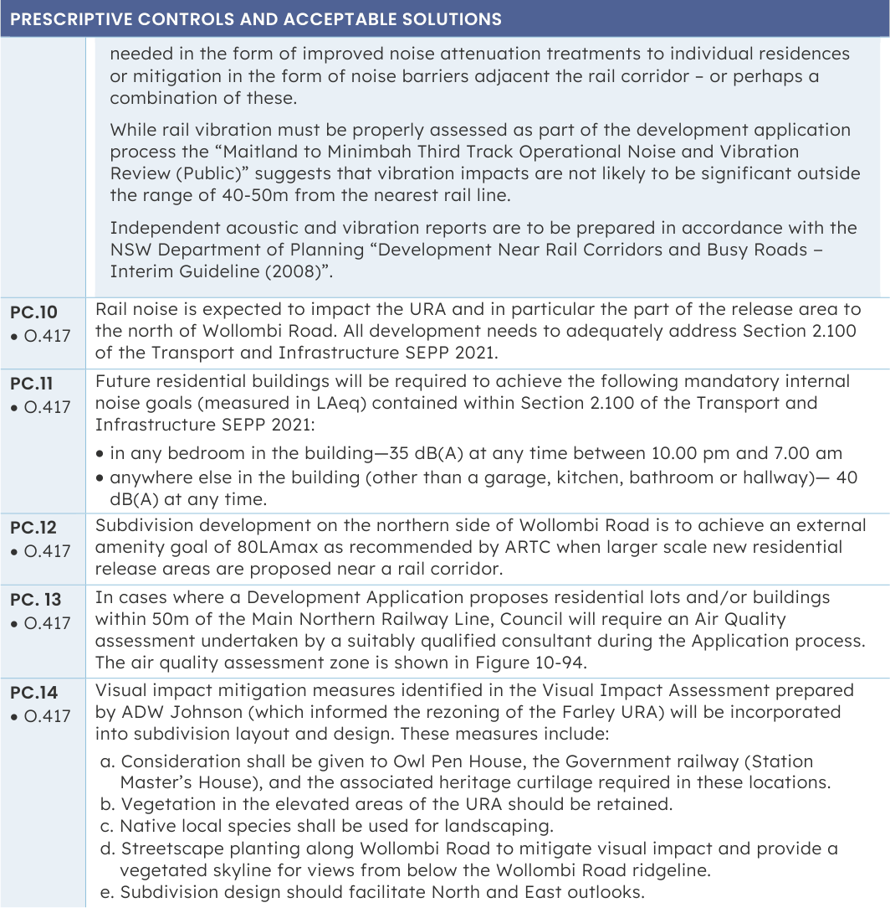
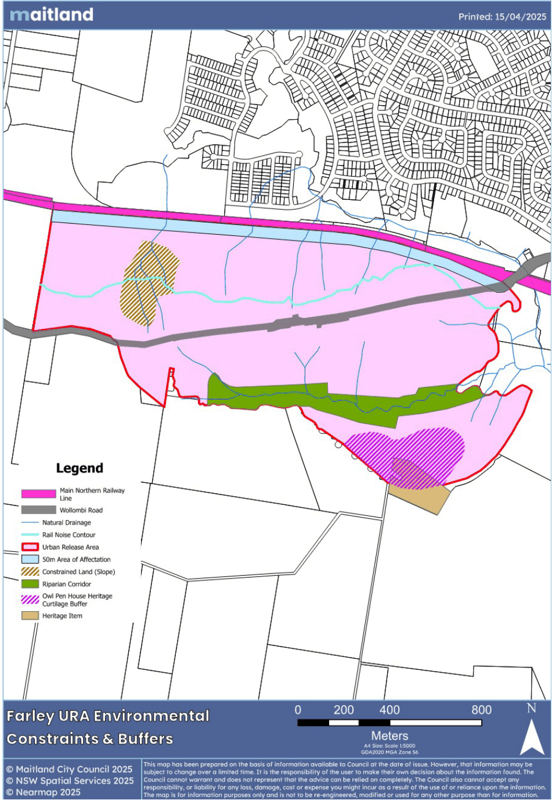

#### 10.4.8.4. Passive and Active Recreation Areas

#### Objectives

O.411 Neighbourhoods are conveniently located, open space areas that offer a range of recreational

opportunities for residents that are accessible within walking distance from each residence.

O.412 To provide a safe and appropriate level of pedestrian and cycleway access linking new development

with established urban areas, parks and public transport, including a mix of on-road and off-road cycle routes.

| PRESCRIPTIVE CONTROLS AND ACCEPTABLE SOLUTIONS |  |
|---|---|
| AS.1 • O.411 | Subdivision of land and the network of passive and active recreational areas should be consistent with that identified in Figure 10-88, and any such land or facilities within the relevant contributions plan. |
| PC.1 | Neighbourhoods must include conveniently located open space areas that offer a range of recreational opportunities for residents, accessible generally within 400m walking distance from each residence. |
| • O.411 |  |
| • O.412 |  |
| PC.2 • O.411 • O.412 | The amount of land to be provided for the neighbourhood sportsground is to be either: • 6ha to accommodate two playing fields with a monetary contribution for a third field at Council’s future Anambah Sportsground made under the Farley Contributions Plan 2015, or • 8ha to accommodate three fields. |

#### Objectives

O.413 To provide for an integrated and sustainable approach to the design and provision of open space

and urban water management.

O.414 To protect and enhance the water quality, water quantity and habitat value of downstream

waterways and environment.

O.415 To prevent erosion and run-off during site preparation, construction and the ongoing use of the land

to minimise cumulative impact on receiving waterways.

| PRESCRIPTIVE CONTROLS AND ACCEPTABLE SOLUTIONS |  |
|---|---|
| PC.1 | Development Applications will require evidence of satisfactory arrangements for essential services, including water and wastewater servicing. The release of allotments will be dependent on the satisfactory provision of reticulated water and wastewater services. |
| • O.413 |  |
| • O.414 |  |
| PC.2 • O.414 | Each Development Application is to include stormwater and water quality management controls, having particular regard to the proximity of the nearby regionally significant Wentworth Swamp to the South of the Farley URA. |
| AS.1 • O.414 | Where it can be demonstrated that only a minor upgrade is required to existing water and wastewater infrastructure in order to enable any proposed urban development within the Farley URA to be serviced, Council will require evidence of satisfactory arrangements from Hunter Water Corporation to support any Development Application for that land. In such circumstances, adherence to the Farley URA Staging Plan will be unnecessary. |
| PC.3 • O.413 • O.414 | Where any proposal is made to amend the proposed Farley URA Staging Plan for reasons relating to infrastructure upgrades that may increase capacities within each stage of the Farley URA, any such proposal would need to be informed by variations to the water and wastewater servicing strategies prepared by GCA Pty Ltd in May 2014, and shall be endorsed by Hunter Water Corporation. |
| PC.4 • O.414 • O.415 | Development Applications are to be supported by a stormwater study for the relevant land, which shall illustrate the connectivity to stormwater catchments within the wider Farley URA and locality. Stormwater detention areas are to be located in accordance with the stormwater study that supports each Development Application. |
| PC.5 | The stormwater and water quality management controls shall be consistent with the principles of Water Sensitive Urban Design (WSUD). |
| • O.413 |  |
| • O.414 |  |
| PC.6 | The number and location of WSUD elements should be determined by modelling to develop the WSUD strategy for the site and be integrated with the overall design. |
| • O.413 |  |
| • O.414 |  |
| AS.2 | Parking areas can be located adjacent or interspersed between WSUD elements where they are designed to prevent damage by vehicles. |
| • O.413 |  |
| PC.7 | Water quality and detention facilities are to be located to ensure the operational function of the facilities are not impacted by environmental constraints. |
| • O.414 |  |
| • O.415 |  |
| PC.8 • O.415 | Long-term maintenance costs are to be identified in the design of the WSUD elements and are to be submitted to Council for consideration prior to acceptance of the WSUD strategy. |
| PC.9 • O.414 • O.415 | Riparian corridors are to be maintained around identified watercourses, in accordance with Section 2.2.2 Riparian Land and Waterways of Chapter 2: Environmental Considerations, and relevant NSW Department of Water guidelines pertaining to minimum buffer widths. |

| PRESCRIPTIVE CONTROLS AND ACCEPTABLE SOLUTIONS |  |
|---|---|
| PC.10 | Stormwater design is to be considered in association with stormwater studies prepared for Development Applications. |
| • O.413 |  |
| • O.414 |  |
| • O.415 |  |
| AS.4 • O.415 | Swales may be acceptable on grades under 4% where it can be demonstrated that they will meet Council’s performance and maintenance objectives and facilitate safe and effective movement of pedestrians and vehicles. Flow control measures are to be used where grades in swales exceed 4%. |
| PC.11 | No change to the minimum width of roads on account of WSUD is supported. |
| • O.413 |  |
| • O.415 |  |
| AS.5 | Where practical, WSUD elements may be incorporated in a centre depressed median of dual carriage roads. |
| • O.415 |  |
| PC.12 • O.415 | Development Applications are to demonstrate that post-development stormwater flows do not exceed pre-development stormwater flows for events up to and including the 1 in 100- year flood. |
| AS.6 | Wetlands should be well-designed creating an attractive and safe amenity and be highly visible for both the adjoining residents and passers-by. |
| • O.414 |  |
| • O.415 |  |
| AS.7 | Walking paths should have frequent contact adjacent to the wetland edge. |
| • O.413 |  |
| AS.8 | Vegetation should be designed such that generous unobstructed views of the wetland is available. |
| • O.413 |  |
| • O.414 |  |
| AS.9 | Emergent macrophytes should be minimal and manageable. |
| • O.413 |  |
| • O.414 |  |
| AS.10 | Slopes surrounding wetlands should be gentle and offer convenient tractor-mowing access. |
| • O.413 |  |
| • O.415 |  |
| AS.11 | Flat grassed areas that potentially may be water-logged should be avoided. |
| • O.415 |  |
| AS.12 | Existing natural gullies should be retained where possible and if necessary enhanced to offset the need for maintenance. |
| • O.415 |  |
| PC.13 | In general, grassed areas must be kept to a minimum for maintenance purposes, and wetland and gullies should offer a sense of ownership to the public. |
| • O.413 |  |
| • O.415 |  |

#### Objectives

O.416 Amelioration of natural and environmental hazards, including bushfire, flooding and site

contamination and, in relation to natural hazards, the safe occupation of, and the evacuation from, any land so affected is achieved.

O.417 To ensure that future residential development is not adversely affected by any noise and vibration

from incompatible land uses, including road and rail corridors.

| PRESCRIPTIVE CONTROLS AND ACCEPTABLE SOLUTIONS |  |
|---|---|
| PC.1 • O.416 | Future subdivision design is to incorporate the existing areas of native vegetation into the character and design of the development and provide for links between areas of remnant vegetation creating improved habitat value and filter strips along watercourses. |
| PC.2 • O.416 | Future development and landscaping must recognise the cultural plantings located at Owl Pen House and where necessary, are to be designed to complement rather than compete with established features. |
| PC.3 • O.416 | Development Applications for Medium or Major Subdivision must include subdivision designs that consider the bushfire risk in the locality, in accordance with the NSW Rural Fire Service guidelines current at that time. Submission of a bushfire risk assessment will be a minimum requirement for any Development Application involving bushfire prone land within the Farley URA. |
| PC.4 • O.416 | Subdivision design must ensure that Asset Protection Zones (APZs) are contained wholly within the boundaries of residential allotments (and perimeter roads, where considered safe and practical to the satisfaction of Council), and do not extent into vegetated areas where clearing would be required. |
| PC.5 • O.416 | Development Applications for Medium or Major Subdivision will need to investigate soil salinity levels, soil structure/stability and Acid Sulfate Soils as part of geotechnical investigations associated with the site. |
| PC.6 • O.416 | Phase 1 site contamination studies are required for each Development Application for Medium or Major Subdivision, with Phase 2 site contamination studies required where deemed necessary through the Phase 1 process. Any Phase 1 or Phase 2 site contamination studies should have regard to the site contamination assessment completed by Douglas Partners Pty Ltd submitted with the rezoning proposal for the Farley URA. |
| PC.7 • O.416 | The Eastern boundary of the Farley URA generally reflects the extent of land inundated during the 1:100 Annual Recurrence Interval (ARI) flood event. Areas in the Eastern extent of the site that are inundated during the 1:100 ARI flood event are not to be further developed for residential purposes. Development within this locality must consider the potential flood hazard and flood behaviour adjoining this part of the Farley URA. |
| PC.8 • O.416 | Impacts from localised flooding are to be considered as part of Development Applications for Medium or Major Subdivision in the Farley URA, including any alternative access arrangements to lower lying areas of the Farley URA during times of storm events and localised flooding. |
| PC.9 • O.417 | Development applications within 50m of the rail corridor either north of Wollombi Road and/or north of the 60dB(A) indicative rail noise contour are to prepare an acoustic and vibration impact assessment. Note: The Farley URA Constraints and Buffers Map (Figure 10-94) shows the extent of the 60 dB(A) Leq 9hr (night-time 2022) noise contour as extracted from the Australian Rail and Track Corporation “Maitland to Minimbah Third Track Operational Noise and Vibration Review (Public)” dated June 2013. For land to the north of the 60dB(A) contour (closer to the rail corridor) specialised acoustic treatments are likely to be |

> [Picture on page 193: a picture, saved as a picture (images/ch-10-00-special-precincts-locality-plans-and-urban-release-page-193-1.gif, 150 dpi).]
> Words printed on the picture (title and legend, copied from the PDF):
> Interim Guideline (2008)”.
> • O.417
> • O.417
> Infrastructure SEPP 2021:
> • in any bedroom in the building—35 dB(A) at any time between 10.00 pm and 7.00 am
> • anywhere else in the building (other than a garage, kitchen, bathroom or hallway)— 40
> dB(A) at any time.
> • O.417
> • O.417
> • O.417

#### PRESCRIPTIVE CONTROLS AND ACCEPTABLE SOLUTIONS

needed in the form of improved noise attenuation treatments to individual residences or mitigation in the form of noise barriers adjacent the rail corridor – or perhaps a combination of these. While rail vibration must be properly assessed as part of the development application process the “Maitland to Minimbah Third Track Operational Noise and Vibration Review (Public)” suggests that vibration impacts are not likely to be significant outside the range of 40-50m from the nearest rail line. Independent acoustic and vibration reports are to be prepared in accordance with the NSW Department of Planning “Development Near Rail Corridors and Busy Roads −

#### PC.10

Rail noise is expected to impact the URA and in particular the part of the release area to the north of Wollombi Road. All development needs to adequately address Section 2.100 of the Transport and Infrastructure SEPP 2021.

#### PC.11

Future residential buildings will be required to achieve the following mandatory internal noise goals (measured in LAeq) contained within Section 2.100 of the Transport and

#### PC.12

Subdivision development on the northern side of Wollombi Road is to achieve an external amenity goal of 80LAmax as recommended by ARTC when larger scale new residential release areas are proposed near a rail corridor.

#### PC. 13

In cases where a Development Application proposes residential lots and/or buildings within 50m of the Main Northern Railway Line, Council will require an Air Quality assessment undertaken by a suitably qualified consultant during the Application process. The air quality assessment zone is shown in Figure 10-94.

#### PC.14

Visual impact mitigation measures identified in the Visual Impact Assessment prepared by ADW Johnson (which informed the rezoning of the Farley URA) will be incorporated into subdivision layout and design. These measures include:

a. Consideration shall be given to Owl Pen House, the Government railway (Station

Master’s House), and the associated heritage curtilage required in these locations.

b. Vegetation in the elevated areas of the URA should be retained.

c. Native local species shall be used for landscaping.

d. Streetscape planting along Wollombi Road to mitigate visual impact and provide a

vegetated skyline for views from below the Wollombi Road ridgeline.

e. Subdivision design should facilitate North and East outlooks.

> [Picture on page 194: a picture, saved as a picture (images/ch-10-00-special-precincts-locality-plans-and-urban-release-page-194-1.gif, 150 dpi).]

#### Figure 10-94: Farley URA Environmental Constraints and Buffers

#### Objectives

O.418 Heritage items, buildings with heritage significance and conservation areas are protected.

| PRESCRIPTIVE CONTROLS AND ACCEPTABLE SOLUTIONS |  |
|---|---|
| PC.1 • O.418 | Development Applications shall be supported by appropriate Aboriginal Heritage Impact Studies to determine the presence and locations of any Aboriginal artefacts or sites of significance, including methods for providing any necessary buffers within the site. Reference should also be made to the Indigenous Archaeological Due Diligence Assessment completed by McCardle Cultural Heritage Pty Ltd, which informed the rezoning of the Farley URA. |
| PC.2 • O.418 | Development Applications shall be referred to NSW Office of Environment and Heritage, Mindaribba LALC and Lower Hunter Wonnarua LALC for comment as part of the public and government agency exhibition process for assessing Development Applications. |
| PC.3 • O.418 | Development Applications will be prepared, having considered items identified in the European Heritage study prepared by Nexus Archaeology and Heritage for the rezoning of the Farley URA. Identified items include: • Owl Pen House, and • Government railway (Station Master’s House) |
| PC.4 • O.418 | A European Heritage Study will be required to incorporate an assessment of the appropriate heritage curtilage for Owl Pen House where the subdivision is within the preliminary Heritage Curtilage Buffer is proposed within Figure 10-94. The study must consider options for reducing the impact of the new development within and/or adjacent to the existing identified curtilage. Additionally, European Heritage studies are to also include further recommendations for the recognitions and protection of any other significant heritage items that may be exposed as a result of further investigation, planning on construction processes within the development area. |
