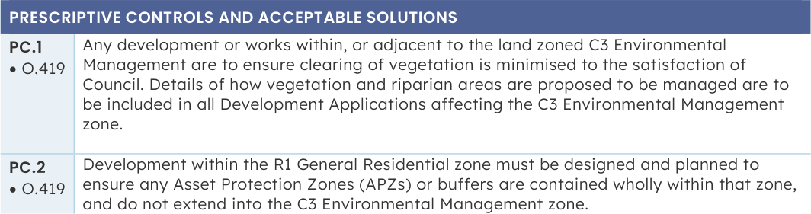
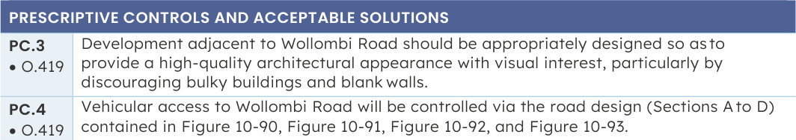

#### 10.4.8.8. Key Development Sites

#### Objectives

O.419 To ensure that detailed urban design controls are provided for significant development sites.

| PRESCRIPTIVE CONTROLS AND ACCEPTABLE SOLUTIONS |  |
|---|---|
| PC.1 • O.419 | Development Applications are to include detailed urban design controls such as, but not limited to, traffic management requirements and carparking design for the following Key Development Sites: • Owl Pen House • Government Railway (Station Master’s House) • Development adjoining the Main Northern Railway Line • Future neighbourhood centre |

#### Adjoining land zoned for environmental protection

> [Picture on page 196: a picture, saved as a picture (images/ch-10-00-special-precincts-locality-plans-and-urban-release-page-196-2.gif, 150 dpi).]
> Words printed on the picture (title and legend, copied from the PDF):
> • O.419
> zone.
> • O.419

#### PRESCRIPTIVE CONTROLS AND ACCEPTABLE SOLUTIONS PC.1

Any development or works within, or adjacent to the land zoned C3 Environmental Management are to ensure clearing of vegetation is minimised to the satisfaction of Council. Details of how vegetation and riparian areas are proposed to be managed are to be included in all Development Applications affecting the C3 Environmental Management

#### PC.2

Development within the R1 General Residential zone must be designed and planned to ensure any Asset Protection Zones (APZs) or buffers are contained wholly within that zone, and do not extend into the C3 Environmental Management zone.

> [Picture on page 196: a picture, saved as a picture (images/ch-10-00-special-precincts-locality-plans-and-urban-release-page-196-13.gif, 150 dpi).]
> Words printed on the picture (title and legend, copied from the PDF):
> • O.419
> • O.419

#### Land fronting Wollombi Road

#### PRESCRIPTIVE CONTROLS AND ACCEPTABLE SOLUTIONS PC.3

Development adjacent to Wollombi Road should be appropriately designed so as to provide a high-quality architectural appearance with visual interest, particularly by discouraging bulky buildings and blank walls. Vehicular access to Wollombi Road will be controlled via the road design (Sections A to D) contained in Figure 10-90, Figure 10-91, Figure 10-92, and Figure 10-93.

#### PC.4
