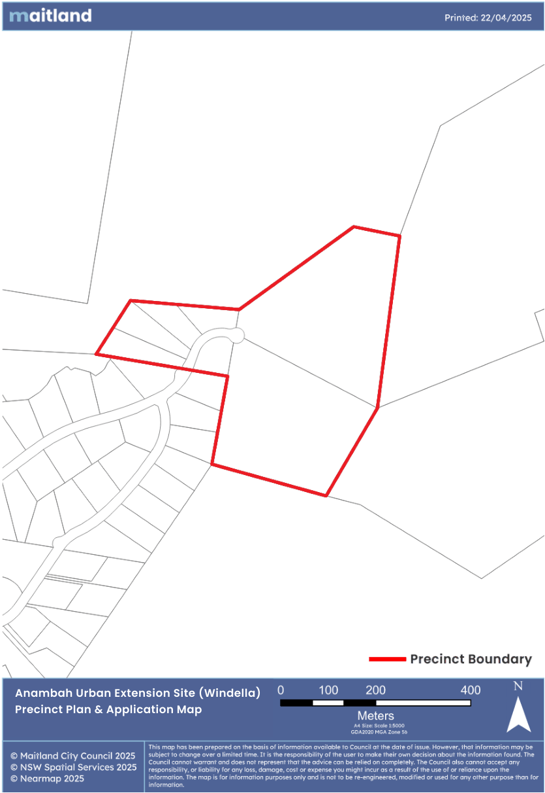
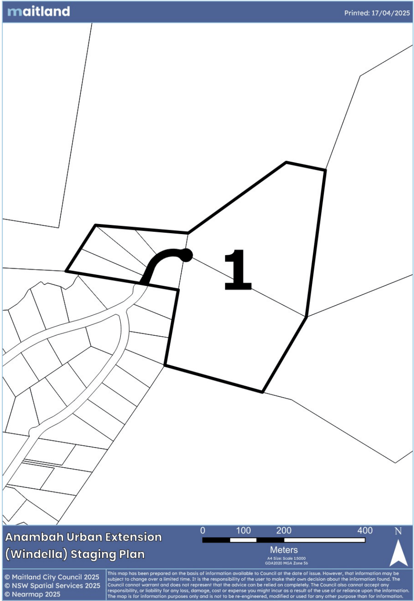

#### 10.4.9. Anambah Urban Extension Site (Windella)

The Anambah Urban Extension Site (Windella) is made up of one precinct, which utilises the general provisions of this section.

> [Picture on page 197: a picture, saved as a picture (images/ch-10-00-special-precincts-locality-plans-and-urban-release-page-197-4.gif, 150 dpi).]
> Words printed on the picture (title and legend, copied from the PDF):
> Anambah Urban Extension Site (Windella)
> Precinct Plan & Application Map

Figure 10-95: Anambah Urban Extension Site (Windella) Precinct Plan & Application

#### Map

> [Picture on page 198: a picture, saved as a picture (images/ch-10-00-special-precincts-locality-plans-and-urban-release-page-198-1.gif, 150 dpi).]

#### Figure 10-96: Anambah Urban Extension Site (Windella) Staging Plan

No specific requirements have been made for the following matters within the General Provisions for the Anambah Urban Extension Site (Windella) as they are already adequately addressed by other relevant provisions within the Maitland Local Environmental Plan 2011 and the Maitland Development Control Plan 2026:

• Transport Movement Hierarchy

• Overall Landscaping Strategy

• Passive and Active Recreation Areas

• Stormwater and Water Quality Management

• Key Development Sites

• Residential Densities

• Neighbourhood Commercial and Retail Uses

• Provision of Public Facilities and Services
