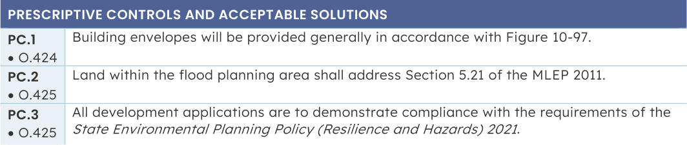
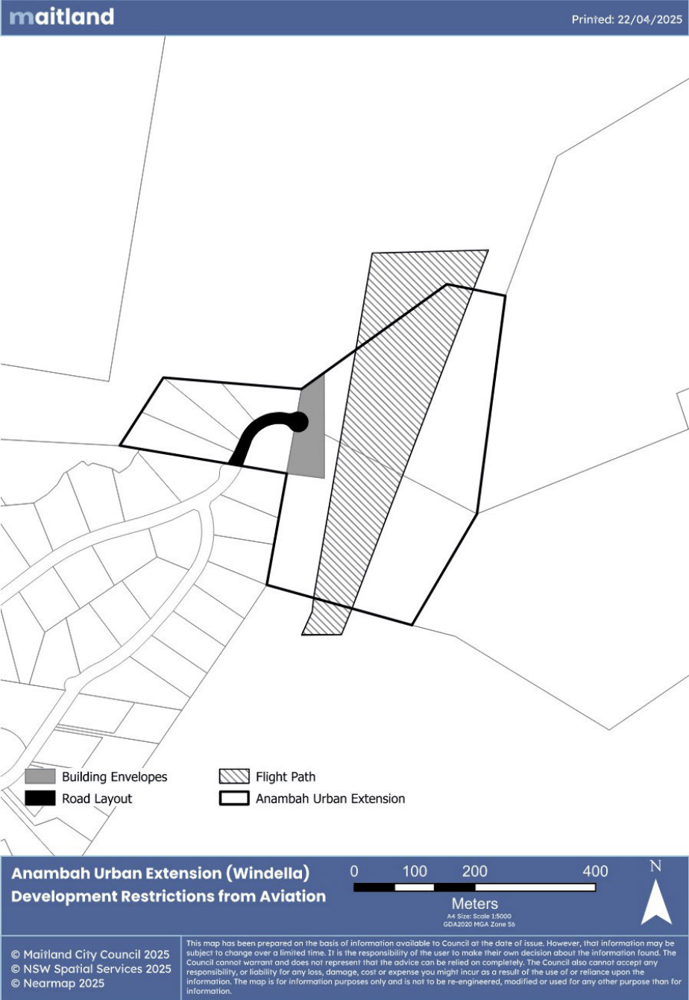

#### 10.4.9.2. Amelioration of Natural and Environmental Hazards

#### Objectives

O.424 To protect residential dwellings from aircraft noise associated with the Maitland Airport.

O.425 Amelioration of natural and environmental hazards, including bushfire, flooding and site

contamination and, in relation to natural hazards, the safe occupation of, and the evacuation from, any land so affected is achieved.

> [Picture on page 199: a picture, saved as a picture (images/ch-10-00-special-precincts-locality-plans-and-urban-release-page-199-27.gif, 150 dpi).]
> Words printed on the picture (title and legend, copied from the PDF):
> • O.424
> • O.425
> • O.425

#### PRESCRIPTIVE CONTROLS AND ACCEPTABLE SOLUTIONS

Building envelopes will be provided generally in accordance with Figure 10-97.

#### PC.1

Land within the flood planning area shall address Section 5.21 of the MLEP 2011.

#### PC.2

All development applications are to demonstrate compliance with the requirements of the State Environmental Planning Policy (Resilience and Hazards) 2021.

#### PC.3

> [Picture on page 200: a picture, saved as a picture (images/ch-10-00-special-precincts-locality-plans-and-urban-release-page-200-1.gif, 150 dpi).]

#### Figure 10-97: Building envelope restrictions for lots affected by aircraft noise

#### and flight paths
