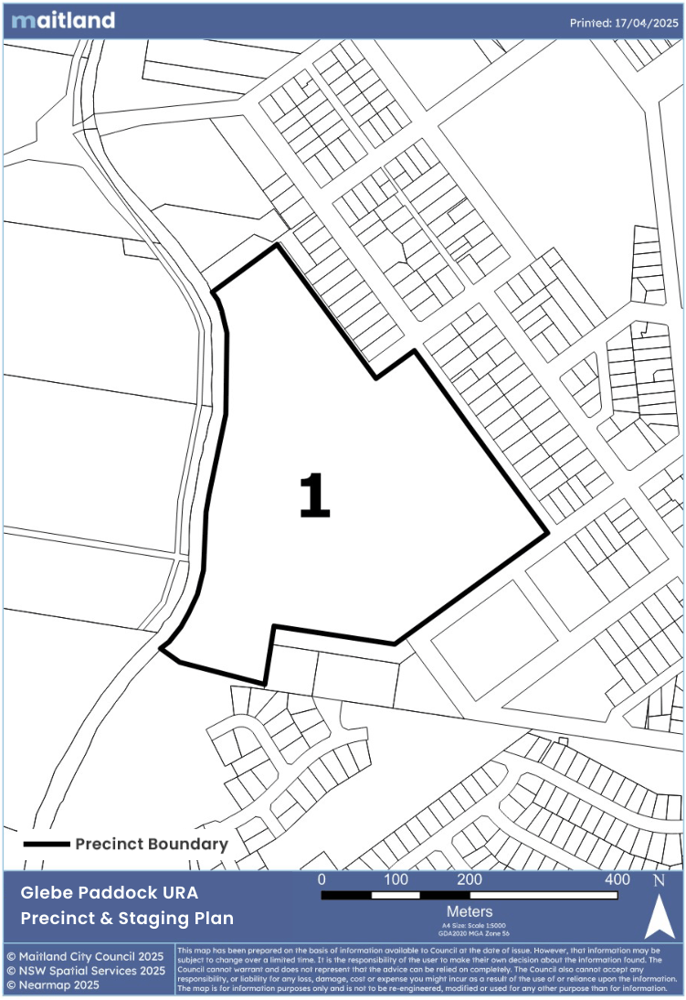

#### 10.4.10. Glebe Paddock Urban Release Area

The Glebe Paddock Urban Release Area is made up of one precinct, which utilises the general provisions of this section.

> [Picture on page 201: a picture, saved as a picture (images/ch-10-00-special-precincts-locality-plans-and-urban-release-page-201-4.gif, 150 dpi).]
> Words printed on the picture (title and legend, copied from the PDF):
> Glebe Paddock URA
> Precinct & Staging Plan

#### Figure 10-98: Glebe Paddock URA Precinct and Staging Plan

The Glebe Paddock refers to the land at Wallis Street, East Maitland. It is bounded by Wallis Street to the north-east, the unformed extension of George Street to the south-east and Wallis Creek to the west. The site is 16.76Ha in area. 4.35ha has been rezoned for general residential purposes. The residual area is zoned environmental conservation. It contains sites of Aboriginal cultural heritage, an endangered

ecological community and hollow-bearing trees. The proposed curtilage to the State listed Glebe Cemetery is mostly contained within the environmental land. The area is also partially affected by flooding. These following development controls were informed by several key investigations. These should be consulted when assessing a development application for the site.

a. “Glebe Gully Burial Ground, East Maitland” prepared by Richard Lamb and Associates dated

November 2012.

b. “Aboriginal Cultural Heritage Assessment” prepared by Archaeological Risk Assessment

Services dated December 2010.

c. “Flora, Fauna and Threatened Species Assessment” prepared by Ecological (undated).

### Development Controls – General Provisions

No specific requirements have been made for the following matters within the General Provisions for the Glebe Paddock Urban Release Area as they are already adequately addressed by other relevant provisions within the Maitland Local Environmental Plan 2011 and the Maitland Development Control Plan 2026:

• Transport Movement Hierarchy

• Passive and Active Recreation Areas

• Stormwater and Water Quality Management

• Key Development Sites

• Residential Densities

• Neighbourhood Commercial and Retail Uses

• Provision of Public Facilities and Services
