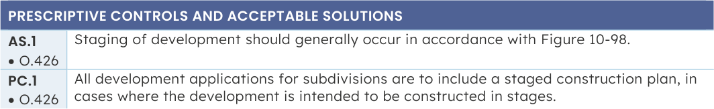

#### 10.4.10.1. Staging Plan

#### Objectives

O.426 To provide for the timely and efficient release of urban land making provision for necessary

infrastructure and sequencing.

> [Picture on page 202: a picture, saved as a picture (images/ch-10-00-special-precincts-locality-plans-and-urban-release-page-202-26.gif, 150 dpi).]
> Words printed on the picture (title and legend, copied from the PDF):
> • O.426
> • O.426

#### PRESCRIPTIVE CONTROLS AND ACCEPTABLE SOLUTIONS

Staging of development should generally occur in accordance with Figure 10-98.

#### AS.1

All development applications for subdivisions are to include a staged construction plan, in cases where the development is intended to be constructed in stages.

#### PC.1
