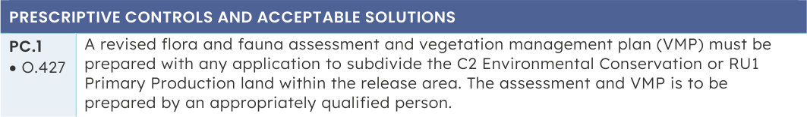
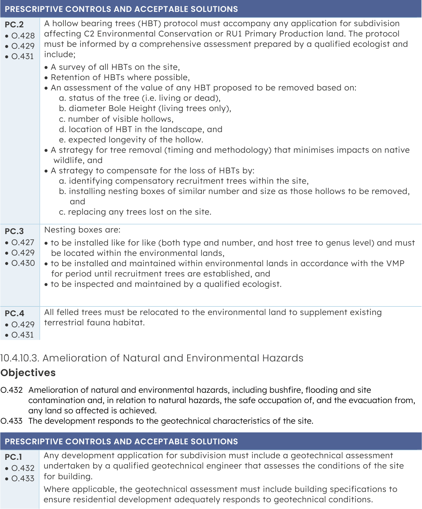

#### 10.4.10.2. Overall Landscaping Strategy

#### Objectives

O.427 Impacts of any action affecting threatened species, populations and ecologically endangered

communities (EEC) is properly assessed and compensated.

O.428 Any loss of endangered ecological community (EEC) must be offset in accordance with the Office of

Environment and Heritage EEC offset requirements and provided within the environmental land.

O.429 The habitat of those threatened species and populations that are dependent on hollow-bearing trees

for their lifecycle is protected.

O.430 To ensure that the VMP retains the area of prominent vegetation.

O.431 The risk to people and property from hollow-bearing trees is minimised.

> [Picture on page 202: a picture, saved as a picture (images/ch-10-00-special-precincts-locality-plans-and-urban-release-page-202-43.gif, 150 dpi).]
> Words printed on the picture (title and legend, copied from the PDF):
> • O.427

#### PRESCRIPTIVE CONTROLS AND ACCEPTABLE SOLUTIONS PC.1

A revised flora and fauna assessment and vegetation management plan (VMP) must be prepared with any application to subdivide the C2 Environmental Conservation or RU1 Primary Production land within the release area. The assessment and VMP is to be prepared by an appropriately qualified person.

> [Picture on page 203: a picture, saved as a picture (images/ch-10-00-special-precincts-locality-plans-and-urban-release-page-203-1.gif, 150 dpi).]
> Words printed on the picture (title and legend, copied from the PDF):
> • O.428
> • O.429
> • O.431
> wildlife, and
> and
> • O.427
> • O.429
> • O.430
> terrestrial fauna habitat.
> • O.429
> • O.431

#### PRESCRIPTIVE CONTROLS AND ACCEPTABLE SOLUTIONS

A hollow bearing trees (HBT) protocol must accompany any application for subdivision affecting C2 Environmental Conservation or RU1 Primary Production land. The protocol must be informed by a comprehensive assessment prepared by a qualified ecologist and include;

#### PC.2

• A survey of all HBTs on the site,

• Retention of HBTs where possible,

• An assessment of the value of any HBT proposed to be removed based on:

a. status of the tree (i.e. living or dead),

b. diameter Bole Height (living trees only),

c. number of visible hollows,

d. location of HBT in the landscape, and

e. expected longevity of the hollow.

• A strategy for tree removal (timing and methodology) that minimises impacts on native

• A strategy to compensate for the loss of HBTs by:

a. identifying compensatory recruitment trees within the site,

b. installing nesting boxes of similar number and size as those hollows to be removed,

c. replacing any trees lost on the site. Nesting boxes are:

#### PC.3

• to be installed like for like (both type and number, and host tree to genus level) and must

be located within the environmental lands,

• to be installed and maintained within environmental lands in accordance with the VMP

for period until recruitment trees are established, and

• to be inspected and maintained by a qualified ecologist.

All felled trees must be relocated to the environmental land to supplement existing

#### PC.4
