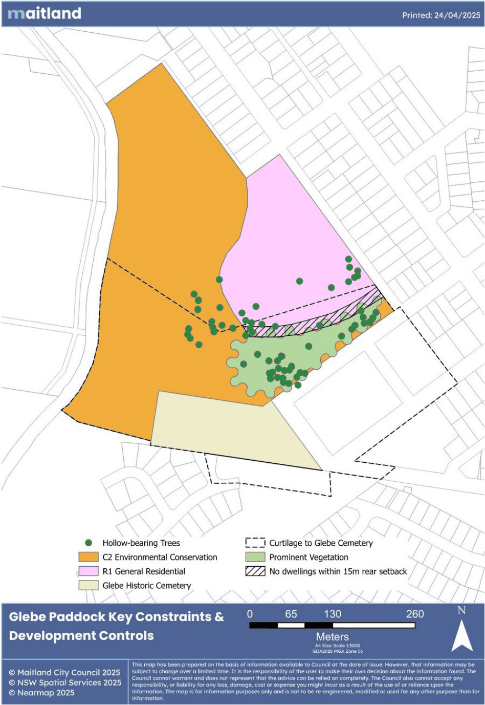

#### 10.4.10.3. Amelioration of Natural and Environmental Hazards

#### Objectives

O.432 Amelioration of natural and environmental hazards, including bushfire, flooding and site

contamination and, in relation to natural hazards, the safe occupation of, and the evacuation from, any land so affected is achieved.

O.433 The development responds to the geotechnical characteristics of the site.

#### PRESCRIPTIVE CONTROLS AND ACCEPTABLE SOLUTIONS

Any development application for subdivision must include a geotechnical assessment undertaken by a qualified geotechnical engineer that assesses the conditions of the site for building.

#### PC.1

Where applicable, the geotechnical assessment must include building specifications to ensure residential development adequately responds to geotechnical conditions.

#### Objectives

O.434 The interface between the residential area and the environmental area is sympathetic to the State

heritage item.

O.435 Fencing is low-impact, rural-type fencing.

O.436 Unauthorised access to the environmental area is discouraged.

O.437 The subdivision design maintains the open nature of the curtilage of the Glebe Cemetery.

O.438 The Aboriginal cultural heritage of the site is protected and maintained.

O.439 The Local Aboriginal Land Council is involved the future management of the Aboriginal cultural

heritage on the site.

| PRESCRIPTIVE CONTROLS AND ACCEPTABLE SOLUTIONS |  |
|---|---|
| PC.1 | Development must be in accordance with the Glebe Historic Cemetery Conservation Management Plan. |
| • O.434 |  |
| PC.2 | A ‘restriction as to user’ under Section 88B of the Conveyancing Act will be created over lots within the curtilage of the Glebe Cemetery requiring that no dwelling be constructed within 15m of the rear boundary. |
| • O.434 |  |
| • O.436 |  |
| • O.437 |  |
| PC.3 • O.435 | For properties immediately adjoining the environmental zoned area, rear fences and side fences up to the rear building line of the main dwelling are to be constructed of post and wire or post and rail, transparent, “rural type” fencing. |
| PC.4 | An updated Aboriginal cultural heritage impact assessment (ACHA) must be undertaken before consent is given to the subdivision. |
| • O.438 |  |
| PC.5 | Subdivision design must respond to the outcomes of an ACHA. |
| • O.438 |  |
| PC.6 | An Aboriginal cultural heritage management plan must be prepared for the environmental area. |
| • O.438 |  |
| PC.7 | The Aboriginal cultural heritage impact assessment must be undertaken in consultation with the Mindaribba Local Aboriginal Land Council and Traditional Owners. |
| • O.438 |  |
| • O.439 |  |

> [Picture on page 205: a picture, saved as a picture (images/ch-10-00-special-precincts-locality-plans-and-urban-release-page-205-1.gif, 150 dpi).]

#### Figure 10-99: Glebe Paddock key constraints and development controls
