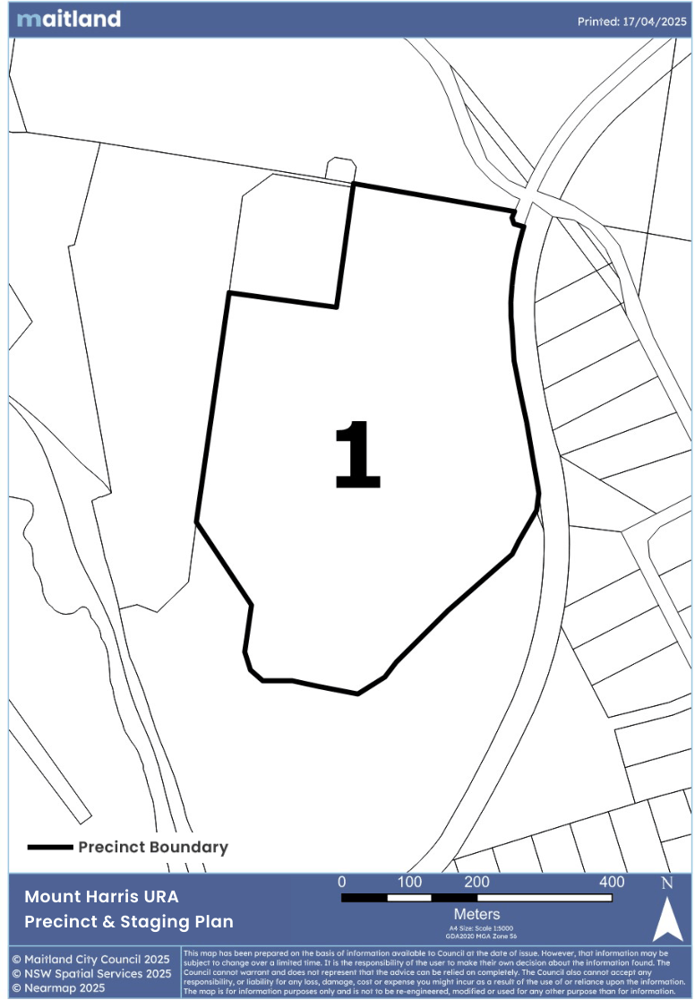

#### 10.4.11. Mount Harris Urban Release Area

The Mount Harris Urban Release Area is made up of one precinct, which utilises the general provisions

> [Picture on page 206: a picture, saved as a picture (images/ch-10-00-special-precincts-locality-plans-and-urban-release-page-206-3.gif, 150 dpi).]
> Words printed on the picture (title and legend, copied from the PDF):
> Mount Harris URA
> Precinct & Staging Plan

of this section.

#### Figure 10-100: Mount Harris URA Precinct and Staging Plan

The Mount Harris Urban Release Area (URA) is located along Maitland Vale Road, northwest of Bolwarra Heights. Encompassing approximately 23 hectares, it is bounded by the Hunter River to the west and the locally heritage-listed Main Northern Railway to the east. Rezoned to R5 Large Lot Residential in 2011 (minimum lot size 2,000 m²), significant subdivision has taken place within the URA.

The area is rural residential in character, featuring single- and two-storey dwellings on large lots, generous setbacks, and open-style front fencing. Any future subdivision or new dwellings must address noise impacts from the railway, as well as flooding and bushfire risk.

### Development Controls – General Provisions

No specific requirements have been made for the following matters within the General Provisions for the Mount Harris Urban Release Area as they are already adequately addressed by other relevant provisions within the Maitland Local Environmental Plan 2011 and the Maitland Development Control Plan 2026:

• Staging Plan

• Transport Movement Hierarchy

• Overall Landscaping Strategy

• Passive and Active Recreation Areas

• Stormwater and Water Quality Management

• Residential Densities

• Neighbourhood Commercial and Retail Uses

• Provision of Public Facilities and Services
