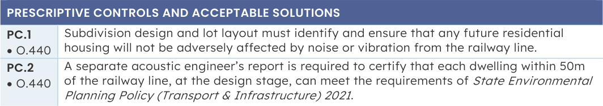

#### 10.4.11.1. Amelioration of Natural and Environmental Hazards

#### Objectives

O.440 To ensure subdivision and dwelling design near the railway corridor mitigate noise and vibration

impacts.

> [Picture on page 207: a picture, saved as a picture (images/ch-10-00-special-precincts-locality-plans-and-urban-release-page-207-21.gif, 150 dpi).]
> Words printed on the picture (title and legend, copied from the PDF):
> • O.440
> • O.440

#### PRESCRIPTIVE CONTROLS AND ACCEPTABLE SOLUTIONS

Subdivision design and lot layout must identify and ensure that any future residential housing will not be adversely affected by noise or vibration from the railway line.

#### PC.1 PC.2

A separate acoustic engineer’s report is required to certify that each dwelling within 50m of the railway line, at the design stage, can meet the requirements of State Environmental Planning Policy (Transport & Infrastructure) 2021.
