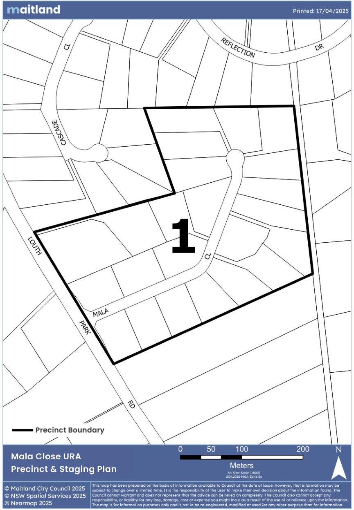

#### 10.4.12. Mala Close Urban Release Area

The Mala Close Urban Release Area is made up of one precinct, which utilises the general provisions of

> [Picture on page 208: a picture, saved as a picture (images/ch-10-00-special-precincts-locality-plans-and-urban-release-page-208-3.gif, 150 dpi).]

this section.

#### Mala Close URA

#### Precinct & Staging Plan

#### Figure 10-101: Mala Close URA Precinct and Staging Plan

No specific requirements have been made for the following matters within the General Provisions for the Mala Close Urban Release Area as they are already adequately addressed by other relevant provisions within the Maitland Local Environmental Plan 2011 and the Maitland Development Control Plan 2026:

• Transport Movement Hierarchy

• Overall Landscaping Strategy

• Passive and Active Recreation Areas

• Stormwater and Water Quality Management

• Key Development Sites

• Residential Densities

• Neighbourhood Commercial and Retail Uses

• Provision of Public Facilities and Services
