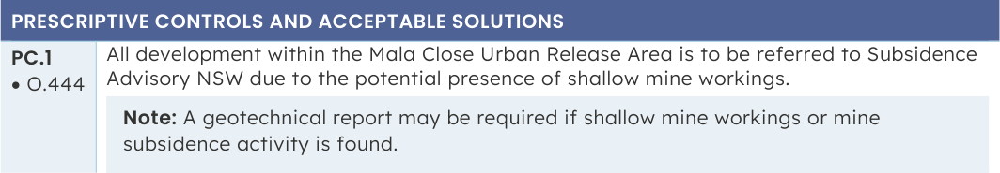

#### 10.4.12.1. Amelioration of Natural and Environmental Hazards

#### Objectives

O.444 To ensure mine subsidence matters are adequately addressed.

> [Picture on page 209: a picture, saved as a picture (images/ch-10-00-special-precincts-locality-plans-and-urban-release-page-209-16.gif, 150 dpi).]
> Words printed on the picture (title and legend, copied from the PDF):
> • O.444
> subsidence activity is found.

#### PRESCRIPTIVE CONTROLS AND ACCEPTABLE SOLUTIONS

All development within the Mala Close Urban Release Area is to be referred to Subsidence Advisory NSW due to the potential presence of shallow mine workings.

#### PC.1

Note: A geotechnical report may be required if shallow mine workings or mine
