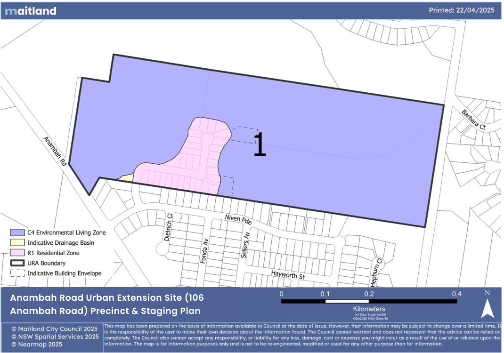

#### 10.4.13. Anambah Road Urban Extension Site (106 Anambah Road)

The Anambah Road Urban Extension Site (106 Anambah Road) Urban Release Area is made up of one precinct, which utilises the general provisions of this section.

> [Picture on page 210: a picture, saved as a picture (images/ch-10-00-special-precincts-locality-plans-and-urban-release-page-210-4.gif, 150 dpi).]
> Words printed on the picture (title and legend, copied from the PDF):
> Anambah Road Urban Extension Site (106
> Anambah Road) Precinct & Staging Plan

#### Figure 10-102: Anambah Road Urban Extension Site (106 Anambah Road) Precinct &

#### Staging Plan

The Urban Release Area known as Anambah Road Urban Extension Site is located at 106 Anambah Road, Anambah, adjoining to an existing urban residential area. The desired future character of this site is for low-density residential development which responds to the topography and environmental constraints of the site. This development makes efficient use of existing infrastructure and services to provide housing that accommodates future population growth.

### Development Controls – General Provisions

No specific requirements have been made for the following matters within the General Provisions for the Anambah Road Urban Extension Site (106 Anambah Road) as they are already adequately addressed by other relevant provisions within the Maitland Local Environmental Plan 2011 and the Maitland Development Control Plan 2026:

• Transport Movement Hierarchy

• Overall Landscaping Strategy

• Passive and Active Recreation Areas

• Stormwater and Water Quality Management

• Key Development Sites

• Residential Densities

• Neighbourhood Commercial and Retail Uses

• Provision of Public Facilities and Services
