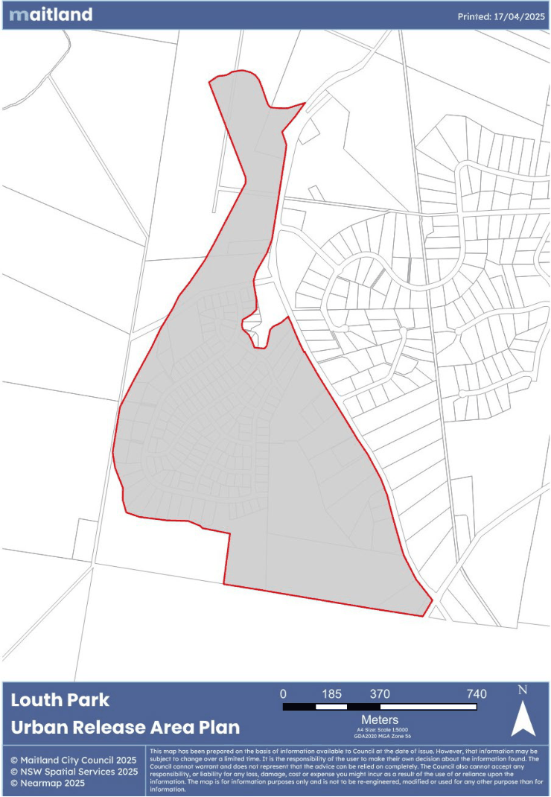
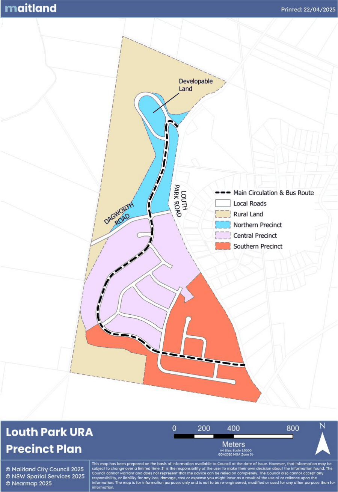
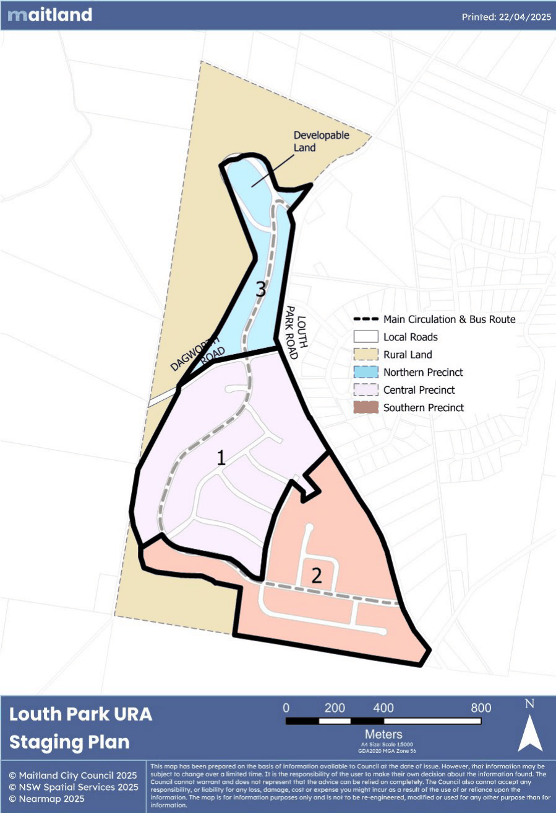

#### 10.4.14. Louth Park Urban Release Area

> [Picture on page 212: a picture, saved as a picture (images/ch-10-00-special-precincts-locality-plans-and-urban-release-page-212-2.gif, 150 dpi).]

#### Figure 10-103: Louth Park Urban Release Area Plan

The Louth Park Urban Release Area (URA) is located off Louth Park Road and Dagworth Road, adjoining the existing R5 Large Lot Residential subdivision known as Waterforde Estate and other rural allotments (Figure 10-103). The subject area is a natural extension to the adjacent large lot residential environment and is contained within the same visual catchment with a surrounding rural character. The URA has traditionally been used for grazing and is within the visual catchment of the Waterforde Estate, and is also visible from the north, south and west. The area has several important characteristics and constraints that must be considered with any new development, including visual amenity, mines subsidence, road infrastructure standards, flooding, water quality, established vegetation, ecology and bushfire.

> [Picture on page 213: a picture, saved as a picture (images/ch-10-00-special-precincts-locality-plans-and-urban-release-page-213-1.gif, 150 dpi).]

#### Figure 10-104: Louth Park Precincts and Road Hierarchy

> [Picture on page 214: a picture, saved as a picture (images/ch-10-00-special-precincts-locality-plans-and-urban-release-page-214-1.gif, 150 dpi).]

#### Figure 10-105: Louth Park Staging Plan

No specific requirements have been made for the following matters within the General Provisions for the Louth Park Urban Release Area as they are already adequately addressed by other relevant provisions within the Maitland Local Environmental Plan 2011 and the Maitland Development Control Plan 2026:

• Passive and Active Recreation Areas

• Residential Densities

• Neighbourhood Commercial and Retail Uses

• Provision of Public Facilities and Services
