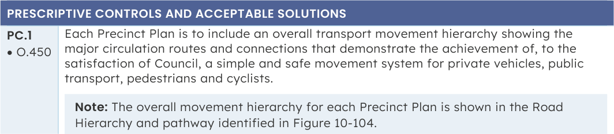
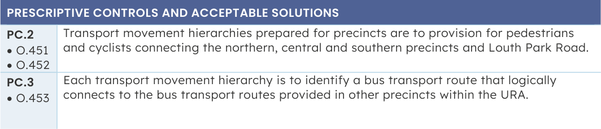

#### 10.4.14.3. Transport Movement Hierarchy

#### Objectives

O.450 To achieve a simple and safe movement system for private vehicles, public transport, pedestrians

and cyclists.

O.451 To provide walkable neighbourhoods with convenient access to neighbourhood shops, community

facilities and other services, with less dependence on cars for travel

O.452 To provide for access generally by way of an interconnected network of streets and paths which

facilitate safe, efficient and pleasant walking, cycling and driving.

O.453 To facilitate new development which supports the efficiency of public transport systems, and

provides safe, direct access to the system for residents.

> [Picture on page 215: a picture, saved as a picture (images/ch-10-00-special-precincts-locality-plans-and-urban-release-page-215-36.gif, 150 dpi).]
> Words printed on the picture (title and legend, copied from the PDF):
> • O.450
> transport, pedestrians and cyclists.

#### PRESCRIPTIVE CONTROLS AND ACCEPTABLE SOLUTIONS PC.1

Each Precinct Plan is to include an overall transport movement hierarchy showing the major circulation routes and connections that demonstrate the achievement of, to the satisfaction of Council, a simple and safe movement system for private vehicles, public

Note: The overall movement hierarchy for each Precinct Plan is shown in the Road

Hierarchy and pathway identified in Figure 10-104.

> [Picture on page 216: a picture, saved as a picture (images/ch-10-00-special-precincts-locality-plans-and-urban-release-page-216-1.gif, 150 dpi).]
> Words printed on the picture (title and legend, copied from the PDF):
> • O.451
> • O.452
> • O.453

#### PRESCRIPTIVE CONTROLS AND ACCEPTABLE SOLUTIONS

Transport movement hierarchies prepared for precincts are to provision for pedestrians and cyclists connecting the northern, central and southern precincts and Louth Park Road.

#### PC.2

Each transport movement hierarchy is to identify a bus transport route that logically connects to the bus transport routes provided in other precincts within the URA.

#### PC.3
