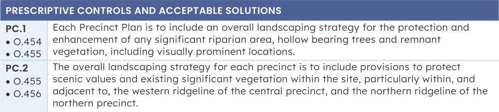

#### 10.4.14.4. Overall Landscaping Strategy

#### Objectives

O.454 To soften the visual impact of all built elements, creating attractive and consistent streetscapes

when viewed by passing traffic and pedestrians.

O.455 To ensure key environmental areas such as waterways, vegetation, land resources, and areas of

cultural significance and scenic value are protected.

O.456 To provide landscaping appropriate to the nature and scale of development that enhances the local

character and streetscape, supports retention and regeneration of ecological corridors and provides visual interest and a suitable backdrop to the built form.

> [Picture on page 216: a picture, saved as a picture (images/ch-10-00-special-precincts-locality-plans-and-urban-release-page-216-18.gif, 150 dpi).]
> Words printed on the picture (title and legend, copied from the PDF):
> • O.454
> • O.455
> • O.455
> • O.456
> northern precinct.

#### PRESCRIPTIVE CONTROLS AND ACCEPTABLE SOLUTIONS

Each Precinct Plan is to include an overall landscaping strategy for the protection and enhancement of any significant riparian area, hollow bearing trees and remnant vegetation, including visually prominent locations.

#### PC.1

#### PC.2

The overall landscaping strategy for each precinct is to include provisions to protect scenic values and existing significant vegetation within the site, particularly within, and adjacent to, the western ridgeline of the central precinct, and the northern ridgeline of the
