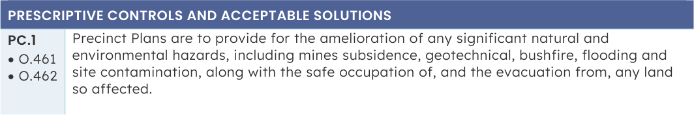

#### 10.4.14.5. Stormwater and Water Quality

#### Objectives

O.457 To provide for an integrated and sustainable approach to the design and provision of open space

and urban water management.

O.458 To protect and enhance the water quality, water quantity and habitat value of downstream

waterways and environment.

O.459 To prevent erosion and run-off during site preparation, construction and the ongoing use of the land

to minimise cumulative impact on receiving waterways.

O.460 To protect and enhance the water quality, water quantity and habitat value of downstream

waterways and environment, including Wallis Creek and the Hunter River.

| PRESCRIPTIVE CONTROLS AND ACCEPTABLE SOLUTIONS |  |
|---|---|
| PC.1 | Each Precinct Plan is to include stormwater and water quality management controls. |
| • O.457 |  |
| • O.458 |  |
| PC.2 • O.458 • O.459 • O.460 | Stormwater and water quality management controls are to include the general location of any trunk drainage, including any potential stormwater and water quality and quantity management controls and devices. |

#### Objectives

O.461 Amelioration of natural and environmental hazards, including bushfire, flooding and site

contamination and, in relation to natural hazards, the safe occupation of, and the evacuation from, any land so affected is achieved.

O.462 To ensure that future residential development is not adversely affected by any noise and vibration

from incompatible land uses.

> [Picture on page 217: a picture, saved as a picture (images/ch-10-00-special-precincts-locality-plans-and-urban-release-page-217-7.gif, 150 dpi).]
> Words printed on the picture (title and legend, copied from the PDF):
> • O.461
> • O.462
> so affected.

#### PRESCRIPTIVE CONTROLS AND ACCEPTABLE SOLUTIONS PC.1

Precinct Plans are to provide for the amelioration of any significant natural and environmental hazards, including mines subsidence, geotechnical, bushfire, flooding and site contamination, along with the safe occupation of, and the evacuation from, any land
