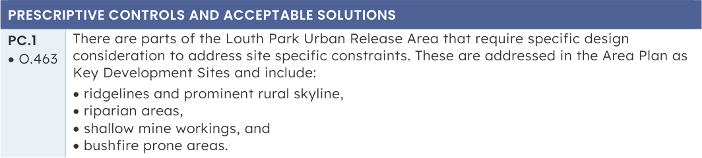
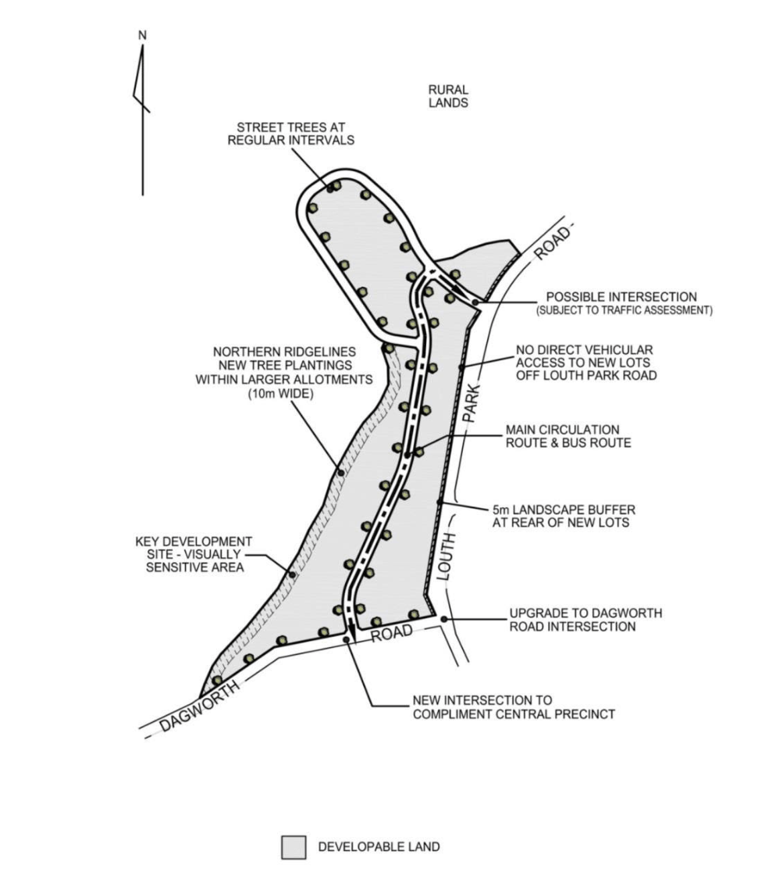

#### 10.4.14.7. Key Development Sites

#### Objectives

O.463 To ensure detailed urban design controls are provided for significant development sites.

> [Picture on page 217: a picture, saved as a picture (images/ch-10-00-special-precincts-locality-plans-and-urban-release-page-217-16.gif, 150 dpi).]
> Words printed on the picture (title and legend, copied from the PDF):
> • O.463
> • riparian areas,
> • bushfire prone areas.

#### PRESCRIPTIVE CONTROLS AND ACCEPTABLE SOLUTIONS PC.1

There are parts of the Louth Park Urban Release Area that require specific design consideration to address site specific constraints. These are addressed in the Area Plan as Key Development Sites and include:

• ridgelines and prominent rural skyline,

• shallow mine workings, and

### Development Requirements – Northern Precinct

No specific requirements have been made for the following matters within the Northern Precinct of the Louth Park Urban Release Area as they are already adequately addressed by other relevant provisions within the Maitland Local Environmental Plan 2011 and the Maitland Development Control Plan 2026:

• Passive and Active Recreation Areas

• Residential Densities

• Neighbourhood Commercial and Retail Uses

• Provision of Public Facilities and Services

> [Picture on page 218: a picture, saved as a picture (images/ch-10-00-special-precincts-locality-plans-and-urban-release-page-218-9.gif, 150 dpi).]

#### Figure 10-106: Louth Park Northern Precinct and Road Hierarchy

#### Objectives

O.464 To provide for the timely and efficient release of urban land making provision for necessary

infrastructure and sequencing.

#### PRESCRIPTIVE CONTROLS AND ACCEPTABLE SOLUTIONS

Where development is for the purpose of subdivision that is intended to be constructed in stages, a staging plan for construction is to be provided.

#### PC.1

• O.464
