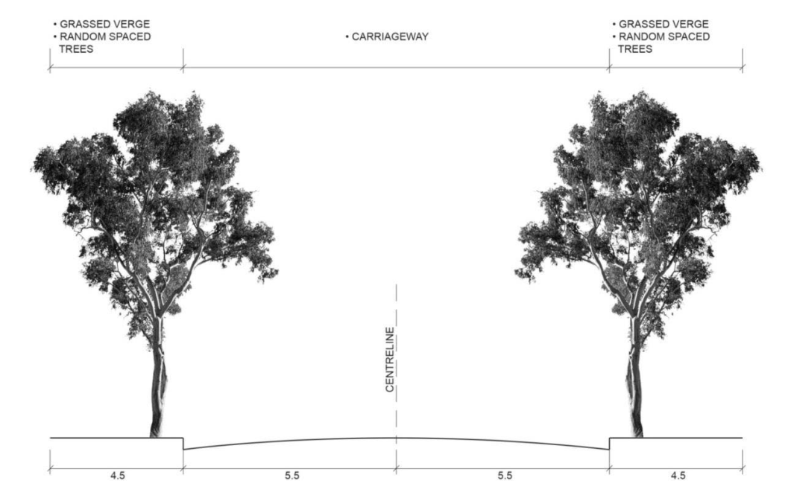

#### 10.4.14.9. Transport Movement Hierarchy

#### Objectives

O.465 To achieve a simple and safe movement system for private vehicles, public transport, pedestrians

and cyclists.

O.466 To provide walkable neighbourhoods with convenient access to neighbourhood shops, community

facilities and other services, with less dependence on cars for travel

O.467 To provide for access generally by way of an interconnected network of streets and paths which

facilitate safe, efficient and pleasant walking, cycling and driving.

O.468 To facilitate new development which supports the efficiency of public transport systems, and

provides safe, direct access to the system for residents.

| PRESCRIPTIVE CONTROLS AND ACCEPTABLE SOLUTIONS |  |
|---|---|
| PC.1 • O.465 | The principal access to the North Precinct will be via a controlled intersection on Dagworth Road to coincide with or complement the access to the Central Precinct. This main circulation route may be permitted to connect with Louth Park Road in the northern extent of the precinct, dependent upon detailed traffic assessment reports, particularly safety at any new intersection. |
| AS.1 | The main circulation route should accommodate a bus route. |
| • O.466 |  |
| • O.468 |  |
| PC.2 • O.467 | The main circulation route is to include a landscaped entry and planted median adjacent to the Dagworth Road intersection and provide street tree plantings at regular intervals along its full length, in accordance with Figure 10-107. |
| PC.3 • O.466 • O.467 | Road layout and street design will be consistent with the adopted Northern Precinct and Road Hierarchy Plan as shown on Figure 10-106, and take into consideration detailed survey and subdivision planning. Road design and widths in this precinct are to satisfy the aims and objectives of Council’s MoES, while also creating attractive streetscapes through landscaping and street furniture. |
| PC.4 | No new lot is to have direct vehicular access to Louth Park Road, except where existing dwelling houses are to be redeveloped in a coordinated and orderly manner. |
| • O.465 |  |
| • O.467 |  |

> [Picture on page 220: a picture, saved as a picture (images/ch-10-00-special-precincts-locality-plans-and-urban-release-page-220-1.gif, 150 dpi).]

#### Figure 10-107: Road Section for Main Circulation Route
