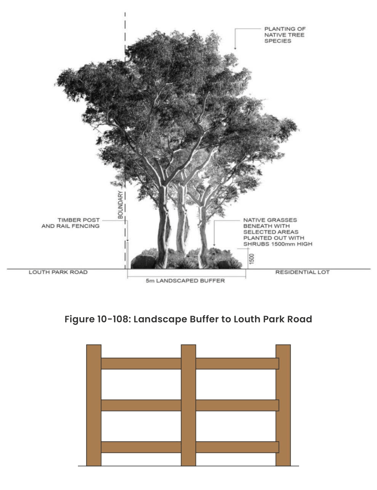

#### 10.4.14.10. Overall Landscaping Strategy

#### Objectives

O.469 To soften the visual impact of all built elements, creating attractive and consistent streetscapes

when viewed by passing traffic and pedestrians.

O.470 To ensure key environmental areas such as waterways, vegetation, land resources, and areas of

cultural significance and scenic value are protected.

O.471 To provide landscaping appropriate to the nature and scale of development that enhances the local

character and streetscape, supports retention and regeneration of ecological corridors and provides visual interest and a suitable backdrop to the built form.

O.472 To enhance the natural landscape character of the area.

O.473 To ensure the landscaping and visual qualities of the area are maintained.

| PRESCRIPTIVE CONTROLS AND ACCEPTABLE SOLUTIONS Detailed landscaping plans are to be submitted with all development applications for subdivision. landscaping will be required on residential allotments immediately adjacent to Louth forming a 5m wide landscape buffer. buffer is to be provided within allotments and maintained in perpetuity protective restriction as to user on title or covenant. is to include native ground covers and shrubs to a maximum height of hide the development but improve visual amenity. Figure 10-108 shows a the buffer. |
|---|
| PC.1 |
| • O.469 |
| PC.2 New • O.470 Park Road, • O.471 This landscaping by way of a The landscaping 1.5m so as to not typical cross section of |

| PRESCRIPTIVE CONTROLS AND ACCEPTABLE SOLUTIONS |  |
|---|---|
| PC.3 | Existing trees that are not affected by proposed new roads, infrastructure or buildings should be retained unless dead or dying within riparian corridors, flood liable lands, road reserves and open space. |
| • O.470 |  |
| • O.471 |  |
| AS.1 | Existing mature trees within and adjacent to the Louth Park and Dagworth Road reserves should be retained. |
| • O.470 |  |
| • O.471 |  |
| • O.472 |  |
| AS.2 | Any re-vegetation proposals should be integrated with landscape plans and include, where possible, those areas supporting Endangered Ecological Communities (EEC). |
| • O.470 |  |
| • O.471 |  |
| PC.4 | Landscaping plans for subdivision are to include appropriate street tree plantings at regular intervals within the precinct, particularly along the main circulation road. |
| • O.471 |  |
| PC.5 • O.471 | The precinct is to have consistent post and rail timber fencing treatments to Louth Park Road and Dagworth Road frontages where fencing is needed for safety, security or visual enhancement. |
| PC.6 | Suitable landscaping is to be provided at key intersections on Louth Park Road and Dagworth Road and provide attractive entrance statements. |
| • O.471 |  |
| PC.7 • O.471 | Any individual allotment boundary fencing within the precinct is to be of timber post and rail style, or similar open style rural fencing. Such requirements are to be reinforced and protected through mechanisms such as restrictions to user on titles and covenants. Refer to Figure 10-109 of typical fencing detail. If necessary for pets, safety or security, fencing may be modified to include the installation of wire or galvanized mesh. |
| PC.8 | A Visual and Scenic Impact Assessment is to accompany Development Applications for subdivision development within the precinct and must include proposed ameliorative measures such as new tree plantings and retention of existing mature trees within and adjacent to ridgeline areas and mid slopes to provide a vegetated skyline. |
| • O.471 |  |
| • O.472 |  |
| • O.473 |  |
| PC.9 • O.471 | No new dwellings, garages or outbuildings are to be located within 15m of Louth Park Road. A 5m landscape buffer is to be provided along the boundary between the property and Louth Park Rd. |
| PC.10 | Where practical, building envelopes are to be positioned to retain existing vegetation and hollow bearing trees. |
| • O.472 |  |
| • O.473 |  |
| PC.11 | Where impacts are proposed on areas of biodiversity value, demonstration on how the proposal will meet the “improve or maintain” threshold will be required with the development application. |
| • O.470 |  |
| • O.472 |  |
| • O.473 |  |

> [Picture on page 222: a picture, saved as a picture (images/ch-10-00-special-precincts-locality-plans-and-urban-release-page-222-1.gif, 150 dpi).]

#### Figure 10-108: Landscape Buffer to Louth Park Road

#### Figure 10-109: Typical Timber Boundary Fencing or Similar

#### Objectives

O.474 To provide for an integrated and sustainable approach to the design and provision of open space

and urban water management.

O.475 To protect and enhance the water quality, water quantity and habitat value of downstream

waterways and environment.

O.476 To prevent erosion and run-off during site preparation, construction and the ongoing use of the land

to minimise cumulative impact on receiving waterways.

| PRESCRIPTIVE CONTROLS AND ACCEPTABLE SOLUTIONS |  |
|---|---|
| PC.1 | Applications for subdivision are to include a Stormwater Management Plan (SWMP) for the precinct consistent with the principles for Water Sensitive Urban Design (WSUD). |
| • O.474 |  |
| • O.475 |  |
| PC.2 | The number and location of WSUD elements are to be determined by modelling, which is to assist in developing the SWMP for the site and be integrated with the overall design. |
| • O.474 |  |
| • O.475 |  |
| PC.3 | Long term maintenance costs are to be identified in the design of the WSUD elements and are to be submitted to Council for consideration prior to acceptance of the SWMP. |
| • O.474 |  |
| AS.1 • O.474 • O.475 • O.476 | Swales may be acceptable where it can be demonstrated that they will meet Council’s performance and maintenance objectives and facilitate safe and effective movement of pedestrians and vehicles. Flow control measures are to be used where grades in swales exceed 4%. |
| AS.2 | Wherever possible, existing natural drainage gullies should form part of a stormwater and runoff drainage system incorporating detention basins and/ or wetlands to alleviate stormwater peak and retain pollutants. |
| • O.474 |  |
| • O.475 |  |
| • O.476 |  |
| PC.4 | Wetlands should be well designed, creating an attractive and safe amenity. |
| • O.474 |  |
| • O.475 |  |
| AS.3 | Slopes surrounding wetlands should be gentle and offer convenient tractor-mowing access. |
| • O.474 |  |
| AS.4 | Gullies intended to be left in their natural state should, if necessary, be enhanced through landscaping (including riparian vegetation) and riprap/rock armour to offset the need for maintenance. |
| • O.474 |  |
| • O.475 |  |
| • O.476 |  |
